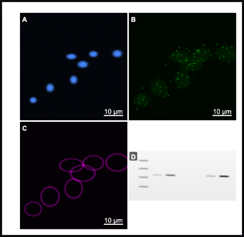

# FigureLab user guides

Task-by-task walkthroughs for the figures scientists make most often. Open `figure_lab.html` in Chrome or Firefox and follow along; every step uses the buttons and menus you see on screen.

Every guide was followed step by step on this build by a script in [`verify/`](verify/README.md) (in the FigureLab repository, beside these guides), on generated images and data whose true values are known (tilts, band amounts, calibrations, plaque counts, means and SDs). Where a result is quoted, it was measured on those test inputs. Problems found while checking are listed in [`verify/ISSUES.md`](verify/ISSUES.md).

## Which guide?

| Guide | For you if you are making… |
|---|---|
| [Western blot](western-blot.md) | Stacked blots with a loading control or total-protein stain, a +/− lane table, MW markers, densitometry charted beside the blot, and the uncropped originals (S1). |
| [Fluorescence](fluorescence.md) | Multichannel microscopy from 16-bit files: channel colours and names, display ranges matched in camera counts, merges and splits, scale bars, linked zoom insets, a channel key. |
| [Phage and microbiology](phage-and-microbiology.md) | TEM with a burned-in scale bar, head and tail measurements, plaque plates and counts, spot assays with a dilution row, growth or lysis curves from a CSV, and a gene map from GenBank, all in one grid. |
| [Charts](charts.md) | Bar, line, box, beeswarm and other charts from CSV files: data layouts, error bars, log axes, axis limits, significance brackets, sample colours shared across the paper, source data. |
| [Journal submission](journal-submission.md) | Any figure on its way to a journal: presets, the compliance check and its fix buttons, the legend key, caption, Methods and alt text, image-reuse checks, the submission package, revisions, saving and reopening. |
| [Freeform and graphical abstracts](freeform.md) | Layouts that are not a grid: panels of different shapes placed by numbers with exact gaps, clips, arrows and text boxes, layer order, and a graphical abstract. |

Also: [Tips and tricks](tips-and-tricks.md) (shortcuts, ⌘K phrases, common pitfalls) and [Troubleshooting](troubleshooting.md) (symptom → cause → fix, including habits from older versions that are no longer needed).

## Quick start: a journal-ready figure in about two minutes

This is the shortest path from images to a file you can submit. Each step links to the guide that covers it in depth. (Checked by [`verify/quickstart.verify.js`](verify/quickstart.verify.js) on three 16-bit fluorescence channels and a western blot.)

1. **Add images.** In **Images**, click **Drop or click to add images** (or drag files onto the window) and pick your files. Each becomes a lettered panel. A Fiji/ImageJ TIFF carries its calibration, and its panel gets a scale bar at once; a file without calibration gets none. To give a micrograph without calibration a bar, right-click it › **📏 Scale bar / calibrate…** (or select it and ⌘K `add scale bar`): its ⚙ opens at **Objective**, **🔬 Calibrate from image** and **🔍 Auto-detect scale bar**. If the picture already has a bar burned in, **🔍 Auto-detect scale bar** reads it and asks whether to also draw FigureLab's bar in a corner clear of it, or keep the burned-in bar as the scale bar ([Phage and microbiology](phage-and-microbiology.md)). Photos, blots and charts need no bar.
2. **Colour the channels.** If your files are channels named like `C1-…_DAPI.tif`, click **🎨 Auto-channels** in **Images**. → [Fluorescence](fluorescence.md)
3. **Check the grid.** Four pictures dropped on an empty figure arrive as 2 × 2 (**Arrange** reads **Columns** 2, **Rows** 2), so there is nothing to type here. For another layout, type **Columns** and **Rows** in **Arrange**.
4. **Letters.** Panels are lettered A, B, C… in order. To change the style, use **Look › Panel Labels (A, B, C…) › Label format** (for example `a b c`).
5. **Name the figure, then choose the journal.** Open **Export** and type the figure's name in **File name** (`Fig1`): the Save dialog uses it, and PLOS takes the figure number from it. Then press <kbd>⌘K</kbd> (<kbd>Ctrl+K</kbd> on Windows/Linux), type the journal's name or abbreviation (`nature`, `plos`, `elife`, `mbio`, `jbc`…) and press <kbd>Enter</kbd> on **Journal: …**. This sets the printed width, font, type sizes in points and DPI, and the toast lists what it changed. The width is the widest the journal allows that keeps the figure within its height limit: for this 2 × 2 figure the toast reads "Nature preset applied — printed width 89 mm — the widest that keeps it within 170 mm tall, Arial — letters 7 pt …", and **Export › Printed width** reads 89 mm. A journal FigureLab has no preset for (`nat comms`, `scientific reports`) says so and changes nothing. → [Journal submission](journal-submission.md)
6. **Check.** Open **Check** and click **✓ Check journal compliance**. Read the ✗ and ⚠ rows; most have a fix button. Two you are likely to meet:
   - **Text contrast** warns or fails on light panels: click the row's **Auto contrast** button. The chips behind the letters darken and every letter reads against its panel; **Background** stays ticked. The row then passes (the toast starts "Auto contrast on").
   - **Printed height** fails only if you widen the figure after the preset: the row's button (**Set 89 mm** here) narrows it again. Fewer rows also work.
7. **Export.** Click the format the journal wants in the toolbar (**↓ PDF lossless**, **↓ TIFF**…), check the name (`Fig1`, from step 5) and the resolution in the dialog, and click **Save**. The file carries the printed size: in the test, Fig1.pdf was 89.0 × 86.4 mm and Fig1.tiff 1051 px wide at 300 dpi.
8. **Check again.** Run the compliance check once more. The **Export format** row counts every format you saved since the figure last changed, so a PDF then a TIFF passes under Nature ("exported as PDF (lossless), TIFF since the figure last changed ✓"). An export made before a later change does not count: after any change the row reads ℹ "not checked — the figure changed after it was last exported (as TIFF), so that file shows an earlier version", and its **Save as PDF (lossless)** button opens the Save dialog again.

Then save your work with <kbd>Ctrl</kbd>/<kbd>⌘</kbd>+<kbd>S</kbd>: you get a session file with the images inside. Reopen it with **📂 Load a session** on the welcome card.

When you are ready to submit, **Export › 📦 Export submission package (ZIP)** writes the figure in every format with the legend key, caption, Methods, alt text, source data and S1 originals: see [Journal submission](journal-submission.md).
