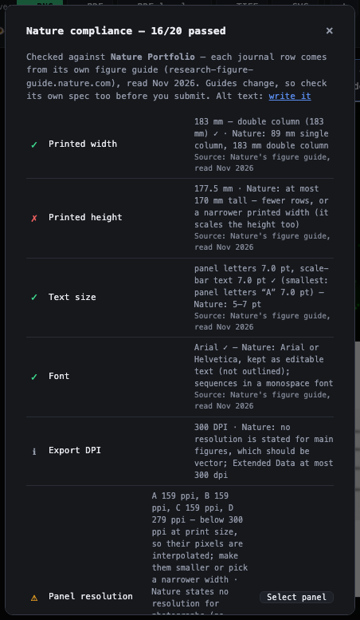

# FigureLab user guides

Task-by-task walkthroughs for the figures scientists make most often. Open `figure_lab.html` in Chrome or Firefox and follow along; every step uses the buttons and menus you see on screen.

Every guide was followed step by step on this build by a script in [`verify/`](verify/README.md), on generated images and data whose true values are known (tilts, band amounts, calibrations, plaque counts, means and SDs). Where a result is quoted, it was measured on those test inputs. Problems found while checking are listed in [`verify/ISSUES.md`](verify/ISSUES.md).

## Which guide?

| Guide | For you if you are making… |
|---|---|
| [Western blot](western-blot.md) | Stacked blots with a loading control or total-protein stain, a +/− lane table, MW markers, densitometry charted beside the blot, and the uncropped originals (S1). |
| [Fluorescence](fluorescence.md) | Multichannel microscopy from 16-bit files: channel colours and names, display ranges matched in camera counts, merges and splits, scale bars, linked zoom insets, a channel key. |
| [Phage and microbiology](phage-and-microbiology.md) | TEM with a burned-in scale bar, head and tail measurements, plaque plates and counts, spot assays with a dilution row, growth or lysis curves from a CSV, and a gene map from GenBank, all in one grid. |
| [Charts](charts.md) | Bar, line, box, beeswarm and other charts from CSV files: data layouts, error bars, log axes, axis limits, significance brackets, sample colours shared across the paper, source data. |
| [Journal submission](journal-submission.md) | Any figure on its way to a journal: presets, the compliance check and its fix buttons, the legend key, caption, Methods and alt text, image-reuse checks, the submission package, revisions, saving and reopening. |
| [Freeform and graphical abstracts](freeform.md) | Layouts that are not a grid: panels of different shapes placed by numbers with exact gaps, clips, arrows and text boxes, layer order, and a graphical abstract. |

Also: [Tips and tricks](tips-and-tricks.md) (shortcuts, ⌘K phrases, common pitfalls) and [Troubleshooting](troubleshooting.md) (symptom → cause → fix, including habits from older versions that are no longer needed).

## Quick start: a journal-ready figure in about two minutes

This is the shortest path from images to a file you can submit. Each step links to the guide that covers it in depth. (Checked by [`verify/quickstart.verify.js`](verify/quickstart.verify.js) on three 16-bit fluorescence channels and a western blot.)

1. **Add images.** In **Images**, click **Drop or click to add images** (or drag files onto the window) and pick your files. Each becomes a lettered panel. A Fiji/ImageJ TIFF carries its calibration, and its panel gets a scale bar at once; a file without calibration gets none.
2. **Colour the channels.** If your files are channels named like `C1-…_DAPI.tif`, click **🎨 Auto-channels** in **Images**. → [Fluorescence](fluorescence.md)
3. **Set the grid.** Open **Arrange** and type **Columns** and **Rows** (here 2 and 2).
4. **Letters.** Panels are lettered A, B, C… in order. To change the style, use **Look › Panel Labels (A, B, C…) › Label format** (for example `a b c`).
5. **Journal preset.** Press <kbd>⌘K</kbd> (<kbd>Ctrl+K</kbd> on Windows/Linux), type the journal's name (`nature`, `plos`, `elife`, `asm`…) and press <kbd>Enter</kbd> on **Journal: …**. This sets the printed width, font, type sizes in points and DPI. → [Journal submission](journal-submission.md)
6. **Check.** Open **Check** and click **✓ Check journal compliance**. Read the ✗ and ⚠ rows; most have a fix button. Two you are likely to meet:
   - **Text contrast** fails on light panels: untick **Look › Panel Labels (A, B, C…) › Background**. Auto contrast switches on and each letter turns black or white to suit its panel.
   - **Printed height** fails: the figure is taller than the journal allows at that width. Choose a narrower **Export › Printed width** (for a 2 × 2 figure, **89 mm — single column (Nature)**), or use fewer rows.
7. **Export.** Click the format the journal wants in the toolbar (**↓ PDF lossless**, **↓ TIFF**…), check the name and resolution in the dialog, and click **Save**. The file carries the printed size: in the test, Fig1.pdf was 89.0 × 86.4 mm and Fig1.tiff 1051 px wide at 300 dpi.
8. **Check again.** Run the compliance check once more. The **Export format** row checks the format you saved last, so export in the journal's format before this final check.

Then save your work with <kbd>Ctrl</kbd>/<kbd>⌘</kbd>+<kbd>S</kbd>: you get a session file with the images inside. Reopen it with **📂 Load a session** on the welcome card.

When you are ready to submit, **Export › 📦 Export submission package (ZIP)** writes the figure in every format with the legend key, caption, Methods, alt text, source data and S1 originals: see [Journal submission](journal-submission.md).
