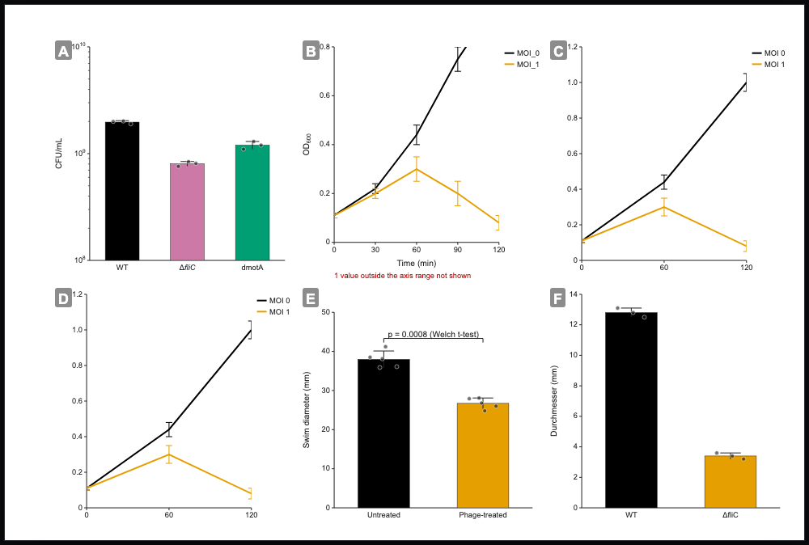
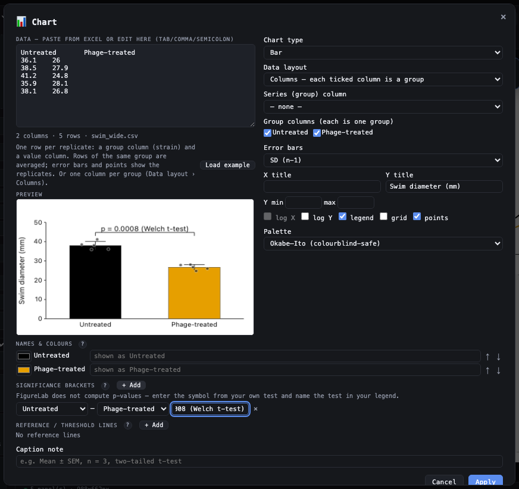

# Charts from your data

**What you'll make:** a figure of chart panels drawn from your own CSV files (bar charts with replicate points and SD, growth curves with error bars, a log-scale CFU panel and a significance bracket), lettered with the rest of your figure and exported with the plotted means, SDs and n as source data.

**You need:**
- One CSV (or TSV, or cells copied from Excel) per chart. Any of the layouts in Task 1 works.
- Optional: a `paper_style.json` from CFU Plot Studio or another FigureLab figure, to share sample colours across the paper.

Every step below was followed through the app's own buttons by [`verify/charts.verify.js`](verify/charts.verify.js), on six generated CSVs whose true means and SDs are known. The plotted values in the source data matched them.

---

## Task 1: Add a chart from a CSV

1. In **Images**, click **Drop or click to add images** and pick your CSV (or drag it onto the figure).
2. The **📊 Chart** dialog opens with a guess at the mapping and a **Preview**. The line under the data box says what was read, for example `3 columns · 9 rows · cfu_24h.csv`.
3. Check the four mapping fields on the right: **Chart type**, **Data layout**, **X / category column** and **Y columns** (and **Series (group) column** for tidy data; see Task 2).
4. Click **Apply**. The chart becomes the next lettered panel of the grid (the toast says, for example, "chart panel A in the grid"). The figure stays a grid: lane tables, headings and automatic letters keep working.

### Which layout is your file?

| Your table | What to set | Checked on |
|---|---|---|
| **Tidy, one value column**: `strain, replicate, cfu_per_ml`, one row per replicate | Chart type **Bar**, X / category column `strain`, Y columns only `cfu_per_ml`. Rows of the same group are averaged. | guessed this way on import |
| **Tidy with a series column**: `time_min, MOI, replicate, OD600` | Chart type **Line**, X `time_min`, **Series (group) column** `MOI`, Y `OD600`. One averaged line per MOI. | guessed this way on import |
| **Replicate columns**: `time_min, MOI_0_r1, MOI_0_r2, MOI_0_r3, MOI_1_r1…` | Chart type **Line**, tick **Average replicate columns into one series each**. It shows what it grouped: `(MOI_0: 3, MOI_1: 3)`. | guessed and ticked on import |
| **Mean and SD columns**: `time_min, MOI 0 mean, MOI 0 SD, MOI 1 mean, MOI 1 SD` | **Error bars** › **from a column**. One picker per series appears, already paired by name (MOI 0 mean → MOI 0 SD). Leave the SD columns unticked under Y columns. | guessed and paired on import |
| **Wide, one column per group** (Prism column table): `Untreated, Phage-treated` | Chart type **Bar**, **Data layout** › **Columns — each ticked column is a group**, then tick every group under **Group columns (each is one group)**. | must be set by hand: the import guesses Scatter |
| **European CSV**: `;` separators, decimal commas, a second header row of units | Nothing. `12,5` is read as 12.5, and the units row goes into the axis title (`Durchmesser (mm)`). The status line says `units row: Durchmesser mm`. | read this way on import |

**Wide tables are guessed wrongly.** A table whose columns are all numbers (one column per group) opens as **Scatter** with the first group as X. Set **Chart type** › **Bar** and **Data layout** › **Columns — each ticked column is a group**; then tick the first group again, because it was the X column and stays unticked.

### Other ways to add a chart

- **⌘K** (Ctrl+K), type `add bar chart`, press **Enter**. A chart panel is added and the dialog opens on it: paste your own cells into the data box. **Cancel** on a chart you just added this way removes the panel again.
- Cells copied from Excel can be pasted straight into the data box. The column lists, X and the status line update as you type, before you press Apply.

---

## Task 2: Error bars, points and averages

1. Open the chart (see Task 4) and set **Error bars**: **SD (n−1)**, **SEM (SD/√n)**, **from a column**, or **none**.
2. SD and SEM are computed from the rows (or replicate columns) that share a group, or an x on a line chart.
3. Tick **points** to draw every replicate over the bar.
4. Tick or untick **legend** and **grid** as you need. If you place the figure's legend key (see [journal-submission.md](journal-submission.md)), untick each chart's **legend** so the colours are explained once.

On the test data the plotted values in the source data equal the true values: WT 1.9733 × 10⁹ ± 6.429 × 10⁷ CFU/mL (SD, n = 3), Untreated 37.96 ± 2.151 mm (n = 5), and 12.8 mm from the decimal-comma file.

---

## Task 3: Log axes and axis limits

1. **Log axis.** Tick **log Y** (or **log X** on line and scatter charts). Bars start at the axis floor, and the axis snaps to whole decades labelled 10ⁿ (10⁸, 10⁹, 10¹⁰ on the CFU test).
   - **Stacked bar** greys out **log Y** and says why: "Stacked bars cannot be read on a log axis (the segments would not add up) — use Grouped bar".
2. **Axis limits.** Type **Y min** and **max** (and **X min** / **max** on line and scatter charts). Leave them empty to fit the data.
3. Values outside the limits are not drawn, and the chart says how many in red under the plot, for example "1 value outside the axis range not shown". This note is part of the figure; widen the limits if you do not want it there.

---

## Task 4: Edit a chart already in the figure

Any of these opens the same **📊 Chart** dialog on that panel:

- double-click the chart panel on the canvas;
- right-click it › **📊 Edit chart…**;
- its **⚙** in the image list › **📊 Edit chart data and style…**.

The preview follows every change. **Apply** keeps the changes; **Cancel** (or Esc) leaves the chart exactly as it was.

---

## Task 5: A significance bracket

1. In the dialog, under **Significance brackets**, click **+ Add**.
2. Pick the two groups in the two menus (for example **Untreated** – **Phage-treated**).
3. Type the label from your own test, up to 40 characters: `*`, `n.s.`, or `p = 0.0008 (Welch t-test)`. FigureLab does not compute p-values; name the test in your legend.
4. **Apply.** The bracket sits above the highest point, whisker or bar of the two groups. Bar, box, violin and beeswarm charts draw brackets.

Order your groups (Task 6) before you add brackets: a bracket remembers the two positions, so moving a group afterwards changes which pair it joins.

---

## Task 6: Names, order and colours

### In one chart: Names & colours

The **Names & colours** list in the dialog has one row per group or series.

1. **Swatch:** sets that sample's colour in every chart of the figure and in the legend key.
2. **shown as:** renames it on the chart, its legend and the key only, for example `Δ*fliC*` for `dfliC` (`*…*` is italic). The data keep their name, so the colour, the lab style and the source data still match it.
3. **↑ ↓:** move a group left or right.

### Across the figure: Look › Sample colours

1. Open **Look** › **Sample colours**. Each sample name used by a chart has a swatch.
2. Change a swatch to recolour that name in every chart and in the key.
3. Click **×** beside a name to put it back on the chart palette.
4. **⬇ Save as paper_style.json** saves the colours you have set (only those: `{"sample_palette": {"WT": "#0072b2"}}`), for the next figure.
5. **📄 Load lab style (paper_style.json)…** (at the end of Look) applies a lab style file: its font and its sample colours. A summary says what was applied. Loading replaces the whole colour list, including colours you picked by hand.

A colour is matched by the exact name. Name a sample the same way in every CSV (`MOI_0` and `MOI 0` are two samples to FigureLab).

---

## Task 7: Make chart text match the rest of the figure

1. Open **Look** › **Typography**.
2. Set **Font family** (for example **Arial**) and **Text size** in pt (default 8).
3. Chart text uses that font and size at the printed size (Text size also covers gene maps, scale-bar text and the legend key). On the test export, Text size 7 pt gave tick labels of 7.00 pt in Arial; axis titles are drawn slightly larger.
4. A journal preset (Look › **Target journal**) sets these for you; see [journal-submission.md](journal-submission.md).

---

## Task 8: Source data

1. Open **Export** and click **📦 Export submission package (ZIP)**.
2. The ZIP holds `source-data/A.csv`, `B.csv`… one per chart panel. Each file has your data as imported, then a **Plotted values** table: series, category or x, **n**, **mean**, **error** and the error type (`SD (n-1)`, `from a column`).
3. A bracket's label is written at the top of its file, marked as supplied by you and not computed by FigureLab.

---

## Tips

- Densitometry from a blot can become a chart panel in one click: **⫼ Analyse lanes & bands** › **📊 Chart these values**. See [western-blot.md](western-blot.md).
- Growth or lysis curves with a GenBank map and micrographs in one grid: see [phage-and-microbiology.md](phage-and-microbiology.md).
- Paste a European CSV as it is. Semicolons, decimal commas and a units row are read correctly.
- Labels take format marks: `OD_{600}` (subscript), `10^{8}` (superscript), `*fliC*` (italic).
- For a log CFU panel, a **Bar** chart with **log Y**, **SD (n−1)** and **points** shows the mean, the whisker and every replicate.
- More shortcuts: [tips-and-tricks.md](tips-and-tricks.md).

## If something looks wrong

- **A wide table plots as a scatter of one group against another.** Set **Chart type** › **Bar** and **Data layout** › **Columns — each ticked column is a group**, then tick every group (Task 1).
- **One sample has two colours, or appears twice in the key.** It has two names in your files (`MOI_0` in one, `MOI 0` in another), or one chart shows `dfliC` as `ΔfliC` while another file already says `ΔfliC`. Use one spelling everywhere, or use **shown as** so every chart shows the same name.
- **Look › Sample colours lists `cfu_per_ml` instead of your strains.** A single-colour bar chart is registered by its value column until one of its groups gets its own colour. Set a group's swatch in the chart's **Names & colours**, and its groups appear in the list.
- **A red "… outside the axis range not shown" note under a chart.** Your **Y min** / **max** cut off data. Widen or clear them.
- **log Y is greyed out.** The chart is a **Stacked bar**; use **Grouped bar**.
- **The panel letter covers the top tick label.** Move the letter: drag it on the canvas, or change **Look** › **Panel labels** › **Position**.
- **Not available yet:** an "n =" label drawn on the chart (n is in the source data, so say it in the legend), and a broken axis with a zero.
- Something else: [troubleshooting.md](troubleshooting.md).
