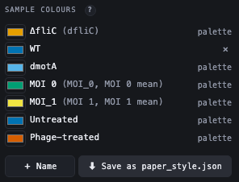

# Charts from your data

**What you'll make:** a figure of chart panels drawn from your own CSV files (bar charts with replicate points and SD, growth curves with error bars, a log-scale CFU panel and a significance bracket), lettered with the rest of your figure and exported with the plotted means, SDs and n as source data.

**You need:**
- One CSV (or TSV, or cells copied from Excel) per chart. Any of the layouts in Task 1 works.
- Optional: a `paper_style.json` from CFU Plot Studio or another FigureLab figure, to share sample colours across the paper.

Every step below was followed through the app's own buttons by [`verify/charts.verify.js`](verify/charts.verify.js), on fourteen generated CSVs whose true means and SDs are known. The plotted values in the source data matched them, and so did a source-data file dropped back in.

---

## Task 1: Add a chart from a CSV

1. In **Images**, click **Drop or click to add images** and pick your CSV (or drag it onto the figure). The drop zone reads "CSV/TSV → chart".
2. The chart is already the next lettered panel of the grid: the toast says, for example, "Imported 9 rows from cfu_24h.csv — chart panel A in the grid". The **📊 Chart** dialog opens on it with a guess at the mapping and a **Preview**. The line under the data box says what was read, for example `3 columns · 9 rows · cfu_24h.csv`.
3. Check the mapping fields on the right: **Chart type**, **X / category column**, **Y columns**, and **Series (group) column** for tidy data (see the table below). Bar, box, violin and beeswarm charts also have **Data layout**; line and scatter charts do not. If the mapping leaves out a text column whose values differ within a group, the line under the data box names it, for example "⚠ strain not used: 3 strain values (PA14, dlasR, dmexB) averaged together per group — pick strain as Series to show them apart".
4. The **Y title** starts as the value column's name (`cfu_per_ml`); type your own (`CFU/mL`).
5. Click **Apply** to keep your settings (the toast says "Chart updated"). The figure stays a grid: lane tables, headings and automatic letters keep working.

**Cancel** on a chart you have just dropped takes it away again ("Cancelled — the chart was not added"), and the grid keeps its size.

**Several files at once.** Pick or drop several CSVs together and each becomes a chart panel with its guessed settings; the dialog opens on the last one (in the test, `growth_A.csv` and `growth_B.csv` became panels I and J, with the dialog on `growth_B.csv`). Double-click each of the others to check its guess. Pick images and CSVs together and the toast says what each chart was guessed as; if a guess averaged a text column together, the toast says "Check this chart: L — medium not used (2 values averaged together)" and the dialog opens on that chart.

### Which layout is your file?

| Your table | What to set | Checked on |
|---|---|---|
| **Tidy, one value column**: `strain, replicate, cfu_per_ml`, one row per replicate | Chart type **Bar**, X / category column `strain`, Y columns only `cfu_per_ml`. Rows of the same group are averaged. | guessed this way on import |
| **Tidy with a series column**: `time_min, MOI, replicate, OD600` | Chart type **Line**, X `time_min`, **Series (group) column** `MOI`, Y `OD600`. One averaged line per MOI. | guessed this way on import, with two MOIs and with three (0, 1, 10) |
| **Tidy with two text columns**: `antibiotic, strain, replicate, MIC_ug_per_ml` | Chart type **Grouped bar**, X `antibiotic`, **Series (group) column** `strain`: one bar per strain within each antibiotic. With Series **— none —** the strains would be averaged together, and the line under the data box says so. | guessed this way on import |
| **Replicate columns**: `time_min, MOI_0_r1, MOI_0_r2, MOI_0_r3, MOI_1_r1…` | Chart type **Line**, tick **Average replicate columns into one series each**. It shows what it grouped: `(MOI_0: 3, MOI_1: 3)`. | guessed and ticked on import |
| **Replicate columns, one row per condition** (Prism or Excel): `condition, Rep1, Rep2, Rep3` | Chart type **Bar**, X `condition`, **Average replicate columns into one series each** ticked (it reads `(Mean: 3)`), **SD (n−1)** and **points**: one bar per condition with its mean, SD and replicate dots. | guessed and ticked on import |
| **Mean and SD columns**: `time_min, MOI 0 mean, MOI 0 SD, MOI 1 mean, MOI 1 SD` | **Error bars** › **from a column**. One picker per series appears, already paired by name (MOI 0 mean → MOI 0 SD). Leave the SD columns unticked under Y columns. | guessed and paired on import |
| **Wide, one column per group** (Prism column table): `Untreated, Phage-treated` | Chart type **Bar**, **Data layout** › **Columns — each ticked column is a group**, every group ticked under **Group columns (each is one group)**. | guessed this way on import |
| **European CSV**: `;` separators, decimal commas, a second header row of units | Nothing. `12,5` is read as 12.5, and the units row goes into the axis title (`Durchmesser (mm)`). The status line says `units row: Durchmesser mm`. A tidy file with German headers (`Stamm;Replikat;Biofilm`) gives a bar per strain: `Replikat` is read as the replicate number. | read this way on import |
| **A source-data file FigureLab wrote** (Task 8) | Nothing: the `#` lines and the Plotted values block are skipped. | read back on import |
| **A plate reader's export**: `Time` (h:mm:ss, h:mm, minutes or hours), a temperature column, `A1`, `A2` … one column per well | A **Line** chart of every well against time, with a **Plate wells** row that groups wells by plate row or column and subtracts a blank. See [A plate reader's export](phage-and-microbiology.md#a-plate-readers-export) in the phage guide. | read this way on import, from 11 to 49 time points, with and without a blank row |

### Other ways to add a chart

- **⌘K** (Ctrl+K), type `add bar chart`, press **Enter**. A chart panel is added and the dialog opens on it: paste your own cells into the data box. **Cancel** on a chart you just added this way removes the panel again, and the grid keeps its size.
- Cells copied from Excel can be pasted straight into the data box. The column lists, X and the status line update as you type, before you press Apply.

---

## Task 2: Error bars, points and averages

1. Open the chart (see Task 4) and set **Error bars**: **SD (n−1)**, **SEM (SD/√n)**, **from a column**, or **none**.
2. SD and SEM are computed from the rows (or replicate columns) that share a group, or an x on a line chart.
3. Tick **points** to draw every replicate over the bar.
4. **Box & whisker**, **Violin** and **Beeswarm (dots)** with a **Series (group) column** draw each series side by side within its category, in the series' colour. A beeswarm draws the mean as a short horizontal line and its whisker follows **Error bars** (SD, SEM or none); the caption says so ("Each dot is one value; the line marks the mean, whiskers ± SD (n−1)").
5. Tick or untick **legend** and **grid** as you need. If you place the figure's legend key (see [journal-submission.md](journal-submission.md)), untick each chart's **legend** so the colours are explained once.

A bar chart with one value column colours each bar by its group, so every strain keeps its own colour (see Task 6).

On the test data the plotted values in the source data equal the true values: WT 1.9733 × 10⁹ ± 6.429 × 10⁷ CFU/mL (SD, n = 3), Untreated 37.96 ± 2.151 mm (n = 5), and 12.8 mm from the decimal-comma file.

---

## Task 3: Log axes and axis limits

1. **Log axis.** Tick **log Y** (or **log X** on line and scatter charts). Bars start at the axis floor, and the axis snaps to whole decades. Decades between 0.001 and 10 000 are written as plain numbers (0.01, 0.1, 1, 10 on the MIC test); wider ranges are labelled 10ⁿ (10⁸, 10⁹, 10¹⁰ on the CFU test).
   - **Stacked bar** greys out **log Y** and says why: "Stacked bars cannot be read on a log axis (the segments would not add up) — use Grouped bar".
2. **Axis limits.** Type **Y min** and **max** (and **X min** / **max** on line and scatter charts). Leave them empty to fit the data.
3. Values outside the limits are not drawn, and the chart says how many in red under the plot, for example "1 value outside the axis range not shown". This note is part of the figure; widen the limits if you do not want it there.

---

## Task 4: Edit a chart already in the figure

Any of these opens the same **📊 Chart** dialog on that panel:

- double-click the chart panel on the canvas;
- right-click it › **📊 Edit chart…**;
- its **⚙** in the image list › **📊 Edit chart data and style…**.

The preview follows every change. **Apply** keeps the changes; **Cancel** (or Esc) leaves the chart exactly as it was.

---

## Task 5: A significance bracket

1. In the dialog, under **Significance brackets**, click **+ Add**.
2. Pick the two groups in the two menus (for example **Untreated** – **Phage-treated**).
3. Type the label from your own test, up to 40 characters (a counter beside the box shows how many, e.g. `25/40`): `*`, `n.s.`, or `p = 0.0008 (Welch t-test)`. FigureLab does not compute p-values; name the test in your legend. On a small two-group chart a long label can run wider than the plot; there, write `p = 0.0008` and name the test in the legend.
4. **Apply.** The bracket sits above the highest point, whisker or bar of the two groups. Bar, box, violin and beeswarm charts draw brackets.
5. Two brackets that share a group or overlap are stacked, one above the other, so their labels stay apart (in the test, `p = 0.011` and `p = 0.022` on three strains). The caption lists them: "Brackets: p = 0.011 (ΔfliC vs WT); p = 0.022 (WT vs dmotA), from the author’s own statistical test."

Order your groups (Task 6) before you add brackets: a bracket remembers the two positions, so moving a group afterwards changes which pair it joins.

---

## Task 6: Names, order and colours

### In one chart: Names & colours

The **Names & colours** list in the dialog has one row per group or series.

1. **Swatch:** sets that sample's colour in every chart of the figure and in the legend key.
2. **shown as:** the name every chart of the figure shows for that sample, in their legends and in the key, for example `Δ*fliC*` for `dfliC` (`*…*` is italic). The toast names the other panels that changed: "Chart updated — the new name also shows in panel F". The data keep their name, so the colour and the lab style still match it; the source data give both names (Task 8).
3. **↑ ↓:** move a group left or right. Its colour stays: a sample's colour is fixed by its name the first time it is drawn, so reordering groups or adding chart panels does not recolour anything.

### Across the figure: Look › Sample colours

1. Open **Look** › **Sample colours**. Every sample in your charts has a row: the name the charts show, the data names behind it in brackets (`ΔfliC (dfliC)`), a swatch, and "palette" or **×**. The list follows your charts as you edit them.
2. Change a swatch to recolour that sample in every chart and in the key.
3. Click **×** beside a name to put it back on the chart palette.
4. **⬇ Save as paper_style.json** saves every sample's colour, the palette ones too, and the **shown as** names, for the next figure. The toast counts them: "paper_style.json saved with 7 sample colours (1 set by hand, 6 from the palette; under 11 data names, so each name a sample is written as gets its colour; sample_palette and 2 shown-as names (sample_names))".
5. **📄 Load lab style (paper_style.json)…** (at the end of Look) applies a lab style file: its font, its sample colours and its shown-as names. A summary says what was applied. Loading replaces the whole colour list, including colours you picked by hand. In the test, a new figure with the same CFU file, given the saved file, drew `dfliC` as Δ*fliC* again, in its saved colour.

FigureLab reads `MOI_0`, `MOI 0` and `MOI 0 mean` as one sample: one row in Sample colours, one colour and one row in the key, even before you name it. **shown as** sets the name that row shows (here `MOI 0` in the replicate-column chart). A chart drawn from `… mean` columns has its own **shown as** box, filled in with the name without ` mean` (`MOI 0`).

One shown name is one sample: a colour follows the name a sample is shown as. In the test, `dfliC` shown as `Δ*fliC*` in one chart and a file whose data say `ΔfliC` in another were drawn in one colour and listed once in the key.

---

## Task 7: Make chart text match the rest of the figure

1. Open **Look** › **Typography**.
2. Set **Font family** (for example **Arial**) and **Text size** in pt (default 8).
3. Chart text uses that font and size at the printed size (Text size also covers gene maps, scale-bar text and the legend key). On the test export, Text size 7 pt gave tick labels of 7.00 pt in Arial; axis titles are drawn slightly larger.
4. Superscripts and subscripts (the 10ⁿ of a log axis, mL⁻¹, OD₆₀₀) print at 70 % of the text size. The compliance check's **Text size** row measures chart text and names the smallest superscript: at 7 pt the `10⁸` on the CFU axis was 4.9 pt, "below 5 pt". The row's **Text to 7.5 pt** button sets the text size that brings them to 5 pt.
5. A journal preset (Look › **Target journal**) sets these for you; see [journal-submission.md](journal-submission.md). Under a journal with a larger minimum the button may not be offered: under PLOS ONE (8–12 pt) the `10⁸` printed 5.6 pt, and the row says "no text size clears both" (raising them to 8 pt would print the chart titles above 12 pt). It warns and does not fail; there is no plain-number option for a 10ⁿ axis, so keep them and say so to the journal, or write the values out in the data.

---

## Task 8: Source data

1. Open **Export** and click **📦 Export submission package (ZIP)**.
2. The ZIP holds `source-data/A.csv`, `B.csv`… one per chart panel. Each file has your data as read (decimal commas written as points), then a **Plotted values** table: series, category or x, **n**, **mean**, **error** and the error type (`SD (n-1)`, `from a column`). Series and categories carry the data's name (`dfliC`); `series_shown_as` and `category_shown_as` give the name the chart shows, without format marks (`ΔfliC`). A point whose replicates are identical has error `0` with its type, not a blank (in the test, dlasR at 0.5, 0.5, 0.5 µg/mL).
3. A bracket's label is written at the top of its file, marked as supplied by you and not computed by FigureLab.
4. A source-data file reads back in: drop it on the figure and it charts the same values. The toast says "2 comment lines (#) over the table skipped; the “Plotted values” block below it left out".

**The caption.** **Export › ✦ Generate Caption** describes each chart as it is drawn: "(A) Bar chart of CFU/mL for ΔfliC, WT and dmotA, on a log scale. Bars show the mean ± SD (n−1); dots, individual replicates; n = 3 per bar." A line chart from replicate columns names its averaged series ("series: MOI 0 and MOI_1"), a grouped bar its series ("bars: PA14, dlasR and dmexB"), and brackets are listed with their groups.

---

## Tips

- Densitometry from a blot can become a chart panel in one click: **⫼ Analyse lanes & bands** › **📊 Chart these values**. See [western-blot.md](western-blot.md).
- Growth or lysis curves with a GenBank map and micrographs in one grid: see [phage-and-microbiology.md](phage-and-microbiology.md).
- Paste a European CSV as it is. Semicolons, decimal commas and a units row are read correctly.
- Labels take format marks: `OD_{600}` (subscript), `10^{8}` (superscript), `*fliC*` (italic).
- For a log CFU panel, a **Bar** chart with **log Y**, **SD (n−1)** and **points** shows the mean, the whisker and every replicate.
- A table with two text columns (antibiotic × strain) is a **Grouped bar** with the second column as **Series**.
- Added several CSVs at once? Double-click each chart to check its guess; the dialog opened only on the last.
- After placing the figure's legend key, untick each chart's **legend** so the colours are explained once.
- A chart in one grid cell at journal type size can be squeezed: the compliance check's **Chart room** row warns when a plot is squeezed too small or a legend name is cut off. Give the chart a column span of 2, or untick its **legend** when the figure's key lists the same names.
- More shortcuts: [tips-and-tricks.md](tips-and-tricks.md).

## If something looks wrong

- **One sample appears twice in the key.** Two charts show it under two different names: give it one name with **shown as**, in each chart (a chart drawn from `… mean` columns has its own box). Once the shown names match, the charts share one colour and one key row.
- **The strains of an MIC table are averaged into one bar.** The line under the data box says "⚠ strain not used …": pick `strain` as **Series (group) column** (Chart type **Grouped bar**).
- **A red "… outside the axis range not shown" note under a chart.** Your **Y min** / **max** cut off data. Widen or clear them.
- **log Y is greyed out.** The chart is a **Stacked bar**; use **Grouped bar**.
- **Not available yet:** an "n =" label drawn on the chart (n is in the source data, so say it in the legend), and a broken axis with a zero.
- Something else: [troubleshooting.md](troubleshooting.md).
