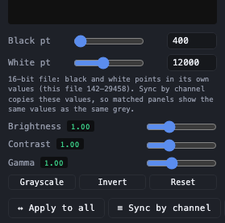
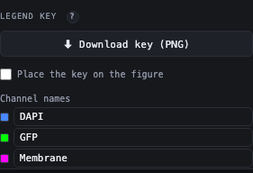

# Multichannel fluorescence figures

## What you'll make

A grid with one row per condition, each row reading DAPI | GFP | membrane | merge | zoom, with display ranges matched in camera counts, calibrated scale bars, linked insets and a channel key.

## You need

- One 16-bit TIFF per channel per field, as Fiji's *Image › Color › Split Channels* saves them: `C1-HeLa_DMSO_60x_DAPI.tif`, `C2-HeLa_DMSO_60x_GFP.tif`, `C3-HeLa_DMSO_60x_CellMask.tif`, and the same for each condition. FigureLab reads the channel from the last word of the file name.
- Files saved by Fiji or ImageJ (or OME-TIFFs) carry their pixel size, so you do not need to calibrate. Files without it need **🔬 Calibrate from image** (see [phage-and-microbiology.md](phage-and-microbiology.md)).

The steps below were followed on two conditions (DMSO, BafA1) of three channels each.

## 1. Import the channels

1. In **Images**, click **Drop or click to add images** and pick all six files.
2. Check each row in the image list. It shows the file name, a channel chip (**DAPI**, **GFP**, **CellMask**) and no orange **⚠ calibrate** badge. Each calibrated panel gets a 10 µm scale bar.
3. A toast says "16-bit scaled to 8-bit for display; native samples kept for measurement". The 16-bit numbers are kept: everything below is set in the file's own counts.

## 2. Colour the channels

1. Click **🎨 Auto-channels**. Each panel gets the look-up table its channel word names: DAPI blue, GFP green, CellMask magenta. The toast says "Assigned channels to 6 panels from filenames".
2. To change one panel's colour, open its **⚙** and click a button under **Fluorescence LUT** (**Off**, **Fire**, **GFP**, **Cyan**, **Mag**, **Red**, **Yel**, **Org**, **DAPI**, **Viridis**, **Magma**, **Inferno**, **Cividis**).

Use magenta, not red, as green's partner: magenta/green stays distinguishable for red–green colour-blind readers, and merged overlap shows as white.

## 3. Match display ranges in camera counts

Compare conditions only at the same display range. FigureLab shows the black and white points in the file's own values, so you type counts, not 0–255.

1. Open **⚙** on one GFP panel. Under **Adjustments**, type **Black pt** `400` (the camera offset) and **White pt** `12000`. Press Enter after each. The note under them gives this file's own range (for example "this file 142–29458").
2. Click **≡ Sync by channel**. Every other panel of that channel gets the same counts. The toast says "GFP 400–12000 from C → 1 panel (D)".
3. Repeat for the other channels (here DAPI 0–10000 and CellMask 0–20000).
4. To check, open **⚙** on the other GFP panel: its **Black pt** and **White pt** boxes read 400 and 12000.

A brighter condition now looks brighter. In the test figure BafA1 had 2.5× the GFP signal and its GFP panel is visibly brighter than DMSO's, as it should be.

## 4. Merge each condition, then split it into a row

1. Tick the three rows of one condition (the tick box at the left of each row).
2. Click **⊕ Merge channels**. The toast says which panel the merge became ("B, D, F merged into B"). The three source panels are hidden, not deleted.
3. Open the merge's **⚙** and click **⑃ Split channels into panels**. You get four panels: one per channel, named by channel, and the merge. They keep the 16-bit samples and the ranges you matched.
4. Untick, and repeat for the next condition.
5. In **Arrange**, set **Columns** to `4` and **Rows** to `2`. Splitting leaves the grid as it is ("so the grid was left as it is"), so some new panels sit outside the grid until you do this.
6. Click **🔤 Relabel A, B, C…**. The visible panels are lettered in order; each row now reads DAPI | GFP | CellMask | merge.

The merge's own **⚙** lists its channels under **Channels (screen blend)**, each with its own **B** and **W** boxes in counts; the GFP channel there reads 400–12000 too.

To remove the hidden source panels for good, use **🗑 Delete hidden panels…** in **Images**.

## 5. Scale bars

1. Open **⚙** on panel A. Under **Scale bar**, **µm / px** shows the value read from the file (0.10833).
2. Click **Auto**. It picks a round length about a fifth of the field: "Auto scale bar: 10 µm (field 55.5 × 55.5 µm)".
3. To use another length, type it in **Bar length** (for example `20`).
4. Click panel A **on the canvas** to select it, then go to **Look** and click **≡ Same bar on all calibrated**. The toast says "Scale bar 20 µm on 8 calibrated panels (from A)".

Select the panel on the canvas first. **≡ Same bar on all calibrated** copies the selected panel's length; with no panel selected it picks its own length for every panel, including the one you just typed.

## 6. Linked insets (zoom panels)

1. Click the merge panel on the canvas (D).
2. Go to **Check** and click **⧉ Add linked inset…**. The dialog title says "⧉ Inset of D"; check it names the panel you meant. Right-clicking the panel and choosing **⧉ Add linked inset…** opens the same dialog.
3. Drag a box on the picture, or type the region under **px**: **X** `300`, **Y** `80`, **W** `128`, **H** `128`.
4. Click **⧉ Add inset**. The inset is placed right after its parent, and an outline with the inset's letter appears on the parent.
5. Repeat for the other merge (H).
6. In **Arrange**, set **Columns** to `5`, then click **🔤 Relabel A, B, C…**. Each row now ends merge | zoom.
7. Open each inset's **⚙** and click **Auto** under **Scale bar**. The inset gets its own bar (2 µm here); the 20 µm bar it inherits is longer than its 13.9 µm field and is not drawn.

To move or resize an inset's region later: open the inset's **⚙**, click **⧉ Edit inset region…**, change the box or the **px** fields, and click **✓ Update inset**. The toast gives the new magnification.

An inset follows its parent's adjustments, so its display range stays the parent's.

## 7. Name the channels

The tags on the panels, the legend key and the legend text use one name per channel colour.

- **For every panel at once:** open **Export**. Under **Legend key › Channel names** there is one field per colour. Type `Membrane` in the magenta field and press Enter. Every magenta tag, the merges' tags and the key change.
- **For one panel:** click the channel chip in its row of the image list (or open **⚙** and use **Channel**). The cursor lands in that panel's **Channel** field. Naming one panel differently from the others shows both names in the key ("Membrane / CellMask").

## 8. Check colours for colour-blind readers

1. In the canvas toolbar, set **Colour-blind view** to **Deuteranopia (red-green)**. This changes the screen only, never an export. Set it back to **Normal vision** when done.
2. Go to **Check** and click **✓ Check journal compliance**. If a red look-up table sits beside a green one, the **Red/green** row warns and offers **Red → magenta**, which recolours the red tables magenta (pseudocoloured channels only, never an imported RGB picture).
3. The **Display ranges by channel** row reads "Same range per channel across panels ✓" once every channel is synced as in step 3. If it lists different ranges, sync that channel or say why in the legend.

## 9. Channel key and export

1. Give the key room: **Arrange › Margins**, set **Right** to `90`.
2. In **Export**, tick **Place the key on the figure**. The key goes in the emptiest corner; with the right margin it sits beside the top row.
3. Click **⬇ Download key** for the standalone key file. It is written in the format of your last export (the button shows which, e.g. "⬇ Download key (PNG)").
4. Under the caption helper, **Legend text starter** reads "DAPI (blue); GFP (green); Membrane (magenta)." Copy it into your legend.
5. Click **✎ Write Methods paragraph**. It states the display ranges in native values, e.g. "GFP 400–12000 (panels B, D, E, G, I and J)".
6. Export with **↓ PNG**, **↓ TIFF** or **↓ PDF lossless** in the toolbar and **Save** in the dialog.

For journal presets, compliance, captions and the submission package, see [journal-submission.md](journal-submission.md).

## Tips

- Set display ranges before you merge. The merge and the split panels take the ranges the channels had.
- Type exact values in the **Black pt** and **White pt** boxes instead of dragging the sliders.
- Use one acquisition setting for every condition you compare; matched display ranges cannot correct for different exposures.
- Help (**❔**) › Tutorials has a hands-on tutorial, *A multichannel fluorescence row*. It builds its own demo figure in place of yours; save first (Ctrl/⌘+S).
- More shortcuts in [tips-and-tricks.md](tips-and-tricks.md).

## If something looks wrong

- **A panel took the wrong colour.** Auto-channels reads the last word of the file name. Rename the file, or set the colour under **⚙ › Fluorescence LUT**.
- **≡ Sync by channel changed nothing on another panel.** That panel has a different channel name. Check the chips in the image list, or name both the same under **⚙ › Channel**.
- **≡ Same bar on all calibrated ignored the length you typed.** Click the panel on the canvas first, then press the button again.
- **An inset has no scale bar.** Its inherited bar is longer than its field. Open the inset's **⚙** and click **Auto**.
- **The placed key covers a panel or its letter.** Widen a margin (**Arrange › Margins**), then untick and tick **Place the key on the figure** again so it is placed afresh.
- **The Methods paragraph gives merged panels a second range "on the 0–255 display scale".** The native-value sentence before it is the one to keep; edit the merged-panel sentences out.

More in [troubleshooting.md](troubleshooting.md).
