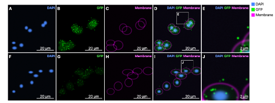

# Multichannel fluorescence figures

## What you'll make

A grid with one row per condition, each row reading DAPI | GFP | membrane | merge | zoom, with display ranges matched in camera counts, calibrated scale bars, linked insets and a channel key, set to a journal's width. At the end you swap one row for another field without redoing it.

## You need

- One 16-bit TIFF per channel per field, as Fiji's *Image › Color › Split Channels* saves them: `C1-HeLa_DMSO_60x_DAPI.tif`, `C2-HeLa_DMSO_60x_GFP.tif`, `C3-HeLa_DMSO_60x_CellMask.tif`, and the same for each condition. FigureLab reads the channel from the last word of the file name. Named fluorophores keep their own name: a file ending `_mScarlet.tif` gets the chip **mScarlet**.
- Files saved by Fiji or ImageJ (or OME-TIFFs) carry their pixel size, so you do not need to calibrate. Files without it need **🔬 Calibrate from image** (see [phage-and-microbiology.md](phage-and-microbiology.md)).

The steps below were followed on two conditions (DMSO, BafA1) of three channels each, and a second DMSO field for task 10.

## 1. Import the channels

1. In **Images**, click **Drop or click to add images** and pick all six files.
2. Check each row in the image list. It shows the file name, a channel chip (**DAPI**, **GFP**, **CellMask**) and no orange **⚠ calibrate** badge. Each calibrated panel gets a scale bar of a round length that fits its field (10 µm on the test's 55.5 µm field).
3. A toast says "16-bit scaled to 8-bit for display; native samples kept for measurement". The 16-bit numbers are kept: everything below is set in the file's own counts.
4. A file with a few pixels far above the rest opens with **White pt** set below them, so the cells are not left nearly black. Its **⚙** says so under **Adjustments**, for example "It opened with White at 2998: 21 pixels (the brightest 0.01 %) reach up to 62000, which would have left the rest nearly black — hot pixels or the brightest spots of real signal, which are saturated at this White; set White higher to show them unsaturated." Those pixels can be real signal (bright puncta), not only hot pixels: if you need them unsaturated, set **White pt** yourself as in task 3.

## 2. Colour the channels

1. Click **🎨 Auto-channels**. Each panel gets the look-up table its channel word names: DAPI blue, GFP green, CellMask magenta. The toast says "Assigned channels to 6 panels from filenames".
2. To change one panel's colour, open its **⚙** and click a button under **Fluorescence LUT** (**Off**, **Fire**, **GFP**, **Cyan**, **Mag**, **Red**, **Yel**, **Org**, **DAPI**, **Viridis**, **Magma**, **Inferno**, **Cividis**).

Use magenta, not red, as green's partner: magenta/green stays distinguishable for red–green colour-blind readers, and merged overlap shows as white.

## 3. Match display ranges in camera counts

Compare conditions only at the same display range. FigureLab shows the black and white points in the file's own values, so you type counts, not 0–255.

1. Open **⚙** on one GFP panel. Under **Adjustments**, type **Black pt** `400` (the camera offset) and **White pt** `12000`. Press Enter after each. The note under them gives this file's own range (for example "this file 142–29458").
2. Click **≡ Sync by channel**. Every other panel of that channel gets the same counts. The toast says "GFP 400–12000 from C → 1 panel (D)".
3. Repeat for the other channels (here DAPI 0–10000 and CellMask 0–20000).
4. To check, open **⚙** on the other GFP panel: its **Black pt** and **White pt** boxes read 400 and 12000.

A brighter condition now looks brighter. In the test figure BafA1 had 2.5× the GFP signal and its GFP panel is visibly brighter than DMSO's, as it should be.

## 4. Merge each condition, then split it into a row

1. Tick the three rows of one condition (the tick box at the left of each row).
2. Click **⊕ Merge channels**. The toast says which panel the merge became ("B, D, F merged into B"). The three source panels are hidden, not deleted.
3. Open the merge's **⚙** and click **⑃ Split channels into panels**. You get four panels: one per channel, named by channel, and the merge. They keep the 16-bit samples and the ranges you matched. If the new panels do not fit, the grid grows to hold them, and the toast says so: "… the grid grew to 3 × 3 rows so the new panels are drawn. Arrange › Columns 4 gives each split field its own row".
4. Untick, and repeat for the next condition.
5. In **Arrange**, set **Columns** to `4` and **Rows** to `2`, as the toast suggests.
6. Click **🔤 Relabel A, B, C…**. The visible panels are lettered in order; each row now reads DAPI | GFP | CellMask | merge.

The merge's own **⚙** lists its channels under **Channels (screen blend)**, each with its own **B** and **W** boxes in counts; the GFP channel there reads 400–12000 too. **≡ Sync by channel** in a merge's ⚙ copies all of its channels' ranges in one click: "DAPI 0–10000, GFP 400–12000, CellMask 0–20000 from D → …", listing the panels and merge channels it set.

To remove the hidden source panels for good, use **🗑 Delete hidden panels…** in **Images**.

## 5. Scale bars

1. Open **⚙** on panel A. Under **Scale bar**, **µm / px** shows the value read from the file (0.10833).
2. Click **Auto**. It picks a round length about a fifth of the field: "Auto scale bar: 10 µm (field 55.5 × 55.5 µm)".
3. To use another length, type it in **Bar length** (for example `20`).
4. Go to **Look** and click **≡ Same bar on all calibrated**. It copies the length you typed last (or that of the panel selected on the canvas): "Scale bar 20 µm on 8 calibrated panels (from A, the length typed last)".

## 6. Linked insets (zoom panels)

1. Click the merge panel on the canvas (D).
2. Open **Check** (it starts collapsed: click its heading) and click **⧉ Add linked inset…**. The dialog title says "⧉ Inset of D"; check it names the panel you meant. Right-clicking the panel and choosing **⧉ Add linked inset…** opens the same dialog.
3. Drag a box on the picture, or type the region under **px**: **X** `300`, **Y** `80`, **W** `128`, **H** `128`. The line under the picture says how the region will print. With no journal or printed width chosen yet, the test read "region 128×128 px, prints at about 41 ppi in a cell like its panel's — under 300: 300 ppi would need a region 938 px wide, more than the 512 px image — the cell prints too large for a zoom; choose a narrower printed width … or a journal's column". A zoom always enlarges its pixels; if your journal checks resolution, choose the journal (task 8) before you size the region.
4. Click **⧉ Add inset**. The inset is placed right after its parent, and an outline with the inset's letter appears on the parent.
5. Repeat for the other merge (H).
6. In **Arrange**, set **Columns** to `5` and **Rows** to `2`, then click **🔤 Relabel A, B, C…**. Each row now ends merge | zoom.

Each inset gets its own scale bar at a length that fits its field (2 µm for the 13.9 µm field here); the 20 µm of the other panels would not fit. To change it, use the inset's **⚙ › Scale bar**.

To move or resize an inset's region later: open the inset's **⚙**, click **⧉ Edit inset region…**, change the box or the **px** fields, and click **✓ Update inset**. The toast gives the new magnification. An inset whose bar was picked for it gets a new one for its new field: at **W** and **H** 256 the toast read "Inset E now magnifies 2.0×; its scale bar is 5 µm for the new field". A length you typed yourself is kept while it fits.

An inset follows its parent's adjustments, so its display range stays the parent's.

## 7. Name the channels

The tags on the panels, the legend key and the legend text use one name per channel colour.

- **For every panel at once:** open **Export**. Under **Legend key › Channel names** there is one field per colour. Type `Membrane` in the magenta field and press Enter. Every magenta tag, the merges' tags and the key change.
- **For one panel:** click the channel chip in its row of the image list (or open **⚙** and use **Channel**). The cursor lands in that panel's **Channel** field, and a name typed there renames that panel only. The key then shows both names ("DAPI (blue); GFP (green); Membrane / CellMask (magenta)."), and so does the **Channel names** field for that colour; typing one name there gives every panel of the colour that name. This holds after you named the colour under **Channel names** too, and the toast says so: "Panel C's channel is now CellMask — this panel only; the other magenta panels (…) keep Membrane. ≡ Sync by channel now treats it as its own channel. To rename every magenta panel, type the name under Export › Legend key › Channel names." To give that panel the others' name again, type it in the panel's own chip (`Membrane`): typing the name the colour already has under **Channel names** does not change it back (see [`verify/ISSUES.md`](verify/ISSUES.md)).
- **Long names on merge tags.** A merge's tag lists its channels beside the panel letter. When long names (`mScarlet-Parkin`, `mito-GFP (OMP25)`) do not fit, the tag wraps onto more lines, or reads "Merge" if even that does not fit; the key and the caption still name every channel. The compliance report's **Text over text** row lists what was fitted ("Tags fitted to clear their letters: D wrapped to more lines; E wrapped to more lines; … — type a tag in ⚙ › Tag for your own wording."). For your own short tag, type it in the merge's **⚙ › Tag (shown on the panel)**.

## 8. Check colours for colour-blind readers

1. In the canvas toolbar, set **Colour-blind view** to **Deuteranopia (red-green)**. This changes the screen only, never an export. Set it back to **Normal vision** when done.
2. Choose the journal now if you have not: **Look › Target journal** (here **eLife**). The toast reads "eLife preset applied — … letters 8 pt, headings 8 pt, text 7 pt (eLife states no type size)", and the figure is set to print 183 mm wide. Until a journal or **Export › Printed width** is chosen, the figure prints at its pixel size: an export then says so, for example "Saved Fig2_LC3_draft.png — it prints 423 mm wide, because no printed width or journal is chosen; journals print figures at most about 180 mm wide", with a **Choose the journal** button that takes you to **Target journal**.
3. Open **Check** and click **✓ Check journal compliance**. If a red look-up table sits beside a green one, the **Red/green** row warns and offers **Red → magenta**, which recolours the red tables magenta (pseudocoloured channels only, never an imported RGB picture). The row then reads "No red lookup table beside a green one ✓".
4. The **Display ranges by channel** row reads "Same range per channel across panels ✓" once every channel is synced as in task 3. If it lists different ranges, sync that channel or say why in the legend.
5. The **Text contrast** row measures the letters, channel tags and scale-bar text on the pixels under them. A coloured tag over a bright part of a picture can fail: in the test, the blue "DAPI" tag over a field shown at **White pt** 300 read 1.26:1. Click the row's **Auto contrast** button: the tag gets a dark backing chip and keeps its colour, and the toast ends "every text over a picture now reads at 4.5:1 or better". The row then passes.

## 9. Channel key and export

1. In **Export**, tick **Place the key on the figure**. The key goes into free space (a margin, an empty cell or a free corner), never over a panel, letter or heading. This figure has none, so the right margin grows to make room and a toast says so: "The legend key needed free space, so the right margin grew from 16 to 162 px — it sits there without covering anything." (at eLife's 183 mm).
2. To put it somewhere else, choose a place in the menu beside the switch (it has no label on screen; the toasts call it **Where**): **Free space**, **Top right**, **Top left**, **Bottom right**, **Bottom left**, **Right edge** or **Below**. You can also drag it. The compliance check's **Legend key on the figure** row says whether it covers anything.
3. Click **⬇ Download key** for the standalone key file. It is written in the format of your last export (the button shows which, e.g. "⬇ Download key (PNG)").
4. Under the caption helper, **Legend text starter** reads "DAPI (blue); GFP (green); Membrane (magenta)." Copy it into your legend. A channel shown in grey on its own panels and in colour in the merges is one entry: with both GFP panels set to **⚙ › Fluorescence LUT › Off**, it read "DAPI (blue); Membrane (magenta); GFP (greyscale; green in merges)."
5. Click **✎ Write Methods paragraph**. It states the display ranges in native values, e.g. "GFP 400–12000 (panels B, D, E, G, I and J)". **✦ Generate Caption** gives the same ranges, grouped by channel: "Display ranges in the files’ own 16-bit values: DAPI 0–10000 (panels A, D, E, F, I and J); GFP 400–12000 …", and names each merge by its channels: "(D) Merge of DAPI (blue), GFP (green) and Membrane (magenta)."
6. Export in a format your journal takes: eLife takes TIFF or JPEG, so click **↓ TIFF** in the toolbar and **Save TIFF** in the dialog. At eLife's width the test's TIFF was 2161 px wide at 300 dpi (183.0 mm). The dialog warns when the format does not suit the journal: **↓ PNG** under eLife reads "⚠ eLife accepts TIFF or JPEG, not PNG."

For journal presets, compliance, captions and the submission package, see [journal-submission.md](journal-submission.md).

## 10. Swap one field for another in a finished row

A reviewer asks for a more representative field. Swap the files and keep everything else: crops, letters, ranges, scale bars, the merge and its inset. Pick the new field's 16-bit TIFFs (here `C1-HeLa_DMSO_60x_f2_DAPI.tif` and its GFP and CellMask partners).

1. **The single-channel panels.** Right-click each one on the canvas › **⇄ Replace image…** and pick the new file of the same channel. The display range is kept in camera counts: "Panel G: C2-HeLa_DMSO_60x_GFP.tif → C2-HeLa_DMSO_60x_f2_GFP.tif — crop, label and settings kept; display range 400–12000 (native values) kept; caption note kept: “GFP” — edit it in ⚙ if it no longer fits".
2. **The merge.** Right-click it › **⇄ Replace image…** and pick the file of its first channel (the file named in its row in **Images**; DAPI here). This swaps that channel only, and the toast says so: "… display range 0–10000 (native values) kept; 2 channel overlays kept from the old field — if they belonged to it, use ⇄ beside each channel in ⚙ › Channels to swap them too (their ranges are kept)".
3. Open the merge's **⚙**. Under **Channels (screen blend)**, click **⇄** beside each channel and pick its new file: "Panel I, GFP: C2-HeLa_DMSO_60x_GFP.tif → C2-HeLa_DMSO_60x_f2_GFP.tif — colour and display range 400–12000 (native values) kept". A file of another size is refused, since channels of one field must match.
4. The inset follows its merge and shows the new field. The **Display ranges by channel** row still passes, and an untouched caption keeps the ranges.

Pick 16-bit files: an 8-bit file (a PNG, a JPEG) cannot hold a range in counts, and the toast says "crop and label kept, but display range 400–12000 (native values) cannot be kept: the new file has no 16-bit samples…". Press <kbd>Ctrl/⌘+Z</kbd> and pick the TIFF.

## Tips

- Set display ranges before you merge. The merge and the split panels take the ranges the channels had.
- Type exact values in the **Black pt** and **White pt** boxes instead of dragging the sliders.
- Use one acquisition setting for every condition you compare; matched display ranges cannot correct for different exposures.
- Help (**❔**) › Tutorials has a hands-on tutorial, *A multichannel fluorescence row*. It puts your figure aside while it runs, and when you end it, **Restore my figure** brings yours back with its 16-bit samples, so the levels still read in camera counts.
- **≡ Sync by channel** on a merge copies all of its channels' ranges at once.
- Choose the journal before you export or size insets: until then the figure prints at its pixel size (423 mm wide here).
- More shortcuts in [tips-and-tricks.md](tips-and-tricks.md).

## If something looks wrong

- **A panel took the wrong colour.** Auto-channels reads the last word of the file name. Rename the file, or set the colour under **⚙ › Fluorescence LUT**.
- **≡ Sync by channel changed nothing on another panel.** That panel has a different channel name. Check the chips in the image list, or name both the same under **⚙ › Channel**.
- **Some panels are outside the grid after a split.** Set **Arrange › Columns** to the number of panels in a row (4 here), as the split's toast says.
- **The key is not where you want it.** Pick a place in the menu beside **Export › Legend key › Place the key on the figure**, or drag it.
- **The key lists one colour as "Membrane / CellMask".** One panel's channel has another name. Type one new name in **Export › Legend key › Channel names**, or type the other panels' name in that panel's own chip: typing the name the colour already has under Channel names does not change that panel (see [`verify/ISSUES.md`](verify/ISSUES.md)).
- **A merge still shows the old field after ⇄ Replace image.** Replace swaps its first channel only; swap the others with **⇄** in its **⚙ › Channels**.
- **A replace toast says the display range "cannot be kept".** The new file is 8-bit. Undo and pick the 16-bit TIFF.
- **A channel tag fails Text contrast.** Click the row's **Auto contrast**: the tag gets a dark chip and keeps its colour.

More in [troubleshooting.md](troubleshooting.md).
