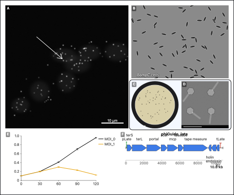
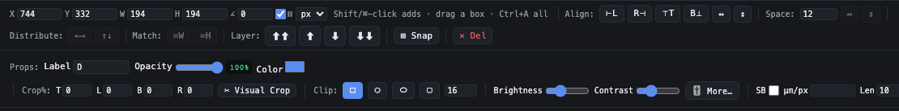
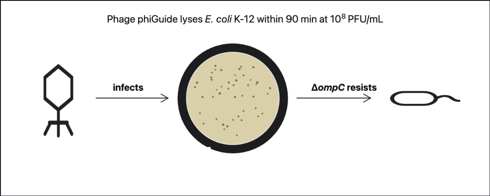

# Freeform figures and graphical abstracts

## What you'll make

A results figure that is not a regular grid (one big panel, a 4:3 photo and two small square panels, with a chart and a gene map underneath, all with exact 12 px gaps), and a 5:2 graphical abstract built from icons, a photo, arrows and a title. Both export with their text as editable text.

## You need

- Your pictures, of any shape (TIFF, PNG, JPEG, SVG).
- Optional: a CSV for a chart and a GenBank file for a gene map.
- The printed width your journal wants (for example 183 mm), so sizes in points come out right.

This guide was checked step by step by `verify/freeform.verify.js`, on a 16-bit fluorescence TIFF, a 4:3 photo, a plate photo, a TEM micrograph, a growth-curve CSV and a GenBank file.

**Grid or freeform?** If your panels fit rows and columns (even with a panel spanning two cells), stay in the grid: you keep the lane table, headings and automatic letters. Use freeform when panels of different shapes and sizes have to sit where you put them, or for a graphical abstract. A freeform figure gets a lettered caption, a submission package and its records as a grid does (§9).

## 1. Start a freeform figure

There are two ways in.

**From scratch**

1. Open **Arrange** and set **Canvas mode** to **✦ Freeform**.
2. Under **Canvas size (px)** type **W** and **H** (here 958 × 798). Set the shape before you place anything.
3. Open **Export** and choose the journal's **Printed width** (here **183 mm — double column (Nature; eLife preset)**) before you type any size in pt or mm. Until you do, **Look › Typography** says "no printed width chosen: 1 px prints at 1/96 in, so this figure prints 253 mm wide…", and 8 pt typed then is not 8 pt in the journal. Afterwards it reads "1 pt = 1.8 px here (183 mm printed width)".
4. Click **Drop or click to add images** and pick your pictures. They arrive in rows, each up to 300 px wide (here three on the first row and one under them), and each one appears in the **Elements** list under the canvas size. Where they land does not matter: §2 places them.
5. Click **⊡ Fit** to see the whole canvas.

**From a grid you already built**

1. In a grid figure, open **Arrange** and click **⇱ Pop out to free layout**.
2. If the figure has something freeform cannot draw (a flip, merged channels, an intensity bar, a spotlight, inset outlines, group brackets), a dialog names it first, for example "Freeform cannot draw the intensity bar on panel A". Click **Pop out**, or Cancel.
3. Every panel becomes an object at its grid size and place, with its crop, clip shape, letter, µm/px and scale bar. Lane tables and headings become text. The toast says what came across.
4. One <kbd>Ctrl/⌘+Z</kbd> brings the grid back exactly.

## 2. Place panels by numbers

The bar above the canvas holds the selection's **X**, **Y**, **W**, **H** and **∠** (angle), a **⛓** tick (keep the shape), and a **px / mm** menu. Type a value and press <kbd>Enter</kbd>.

1. Click an object on the canvas, or its name in the **Elements** list (useful when objects overlap). The fields always show the object you picked.
2. With **⛓** ticked, typing **W** sets **H** in proportion. A 4:3 photo given W 400 gets H 300; untick **⛓** to set both freely (charts and gene maps usually need this).
3. Give each picture its width and a rough place: type a rough **X** and **Y**, or drag it by its middle. Step 3 lines them up exactly.
4. Type the main panel's position exactly: here **X** 20, **Y** 20, **W** 506.
5. Choose **mm** in the units menu to type sizes at the printed size (the **Printed width** from §1 sets the scale). Here (958 px printed at 183 mm) A's **W** 506 reads 96.66 mm. Choose **px** again to go on typing in canvas px.

<kbd>⌘K</kbd> `position` jumps to the **X** field.

## 3. Line them up with exact gaps

Select two or more objects: **Shift-click** or **⌘/Ctrl-click** them, or drag a box starting on empty canvas (it selects every object it touches), or press <kbd>Ctrl/⌘+A</kbd>. With several selected, the bar shows the box around all of them, and typing **X** or **Y** moves them together.

1. Type the gap into **Space** (here 12).
2. Click **A**, Shift-click **B**, then **⊤T** (align top edges) and **⇿** (put exactly 12 px between them, left to right). B moves to X 538.
3. Click **B**, Shift-click **C**, then **⊢L** (align left edges) and **⇕** (12 px top to bottom). C moves to Y 332.
4. Click **C**, ⌘/Ctrl-click **D**, then **=W** (same width as the first one you selected), **⊤T** and **⇿**. D lands at X 744: its right edge meets B's (938) and, because A, C and D are square here, C's bottom meets A's (526).
5. **←→** and **↑↓** (Distribute) spread three or more objects evenly between the outer two, which stay where they are. Place the outer two first: if the middle one does not fit between them, the gaps come out negative (the toast says, for example, "3 items, -77.15 px apart").
6. **↔** and **↕** at the end of the Align buttons (tooltips "Centre horizontally" and "Centre vertically") centre one object on the canvas; with several selected they line up their centres with each other. (The **↕ MW ladder** button under Annotate & Draw is a different tool.)

Align uses the outermost edge of the selection (the topmost top for **⊤T**, the leftmost left for **⊢L**), whichever you clicked first. Move a newcomer roughly into place before aligning it, or it pulls the others to it.

Fine moves: arrow keys move the selection 1 px, <kbd>Shift</kbd>+arrow 10 px. <kbd>]</kbd> and <kbd>[</kbd> turn it by 1°, with <kbd>Shift</kbd> by 5°; the **∠** field shows the angle and takes a typed one.

To deselect, press <kbd>Esc</kbd> or click beside the canvas (a click on empty canvas starts a selection box instead).

On the test figure the exported PNG has 11.97 px (logical) between A and B and between C and D, for 12 typed.

## 4. Crop, clip and stack the pictures

The **Props** bar under the position bar shows the selected picture's settings.

1. **Clip**: **□** (none), **◯** circle, **⬭** ellipse, **▢** rounded rectangle (the number beside it is the corner radius). The toast says "Circle clip — it carries into every export". On a picture with a scale bar it adds "— its scale bar moved inside the clip": the bar and its label are drawn inside the circle. If the label is wider than the clip leaves room for, the bar is not drawn, the toast says so ("its scale bar is not drawn: its label “10 µm” is wider than the circle clip leaves room for at this text size …"), and the compliance check's **Scale bar drawn** row fails. Use a smaller text size, a larger picture, or no clip, as the toast says. A clip set in the grid survives **⇱ Pop out**.
2. **Crop%**: type **T**, **L**, **B**, **R** in percent. The box shrinks with the crop, keeps its **X** and **Y**, and the picture keeps its proportions (Crop% L 10 on a 194 px square gives 174.6 × 194, still at X 744, Y 332).
3. **Layer**: **⬆⬆** bring to front, **⬆** forward one step, **⬇** back one step, **⬇⬇** send to back.
4. **Label**: the panel letter of that object. **Arrange › 🔤 Relabel A, B, C…** letters everything in reading order, charts and gene maps included (here pictures A–D, chart E, gene map F). Inserted icons are left without a letter; type one in an icon's **Label** if it really is a panel, and Relabel then letters it with the rest. Set the letter size in **Look › Panel Labels (A, B, C…) › Size** in pt (8 pt at 183 mm is 14.77 px).
5. **Caption note**: what the caption says about this picture, after its letter (not drawn on the figure). See §9.

## 5. Add a chart and a gene map

1. **Chart**: click **Drop or click to add images** and pick a CSV. The **📊 Chart** dialog opens; check the columns and click **Apply** (see [charts.md](charts.md)). The chart lands in the middle of the canvas.
2. Select it (Elements list: its file name) and type its box: here **X** 20, **Y** 538, **W** 460, **H** 240. **⛓** is already unticked for charts and gene maps, so W and H are set separately.
3. **Gene map**: **Annotate & Draw › Gene maps & circuits › 🧬 Linear** (or **⭕ Plasmid**). In the dialog click **📄 GenBank / FASTA…** and pick the file; the line under the table says what was read ("10.8 kb · 12 features · 22.3 bp per pixel"). A record from NCBI lists most genes twice, as a gene and as its CDS; each is drawn once, and the toast says so ("10 genes listed twice (gene + CDS or RNA) drawn once each"). Click **Apply**; the dialog closes. **Cancel** on a map you have just added removes it again.
4. Select the gene map ("linear gene map" in the Elements list), type **W** 446 and **H** 160 and a rough **X**/**Y** below the pictures. Then click the chart, Shift-click the map, **⊤T** and **⇿**: the map sits 12 px right of the chart and ends at 938, flush with D.
5. Run **🔤 Relabel A, B, C…** again so the chart and map get the next letters.

## 6. Arrows, text and shapes

All of these are in **Annotate & Draw › Tool**. Set **Color**, **Width** and **Fnt** (font size, px) there before drawing; each mark keeps its own afterwards. Until you pick a **Color** yourself, a new mark takes dark (#111111) or white by what is under the point where you start it: dark on the white canvas or a light picture, white on a dark picture (the arrow and text on the fluorescence and phase panels here came out white). Once you have picked a Color, every new mark uses it.

1. **↗ Arrow**: drag from tail to head.
2. **T Text**: click where the text starts, type, press <kbd>Enter</kbd>. Format marks work: `Δ*ompC*` gives italic *ompC*, `H_{2}O` a subscript, `10^{8}` a superscript.
3. To edit text, choose **↖ Select** and double-click it; the editor opens on the text as typed, marks included. Its floating toolbar has **Color**, **W**, **Fnt**, **Halo**, the text field, **B** (bold for this text only; text starts bold) and **✕ Del**.
4. **⬜ TextBox**: drag a box. Select it and type into its toolbar's text field. A new TextBox is white text on a black box at 60 % opacity, whatever colour the other tools are set to: set **Fnt**, the text **Color**, and the box **Fill** colour and opacity there, or untick **Fill** for text with no box (then give the text a dark **Color** on a white canvas).
5. **□ Rect** and **○ Ellipse**: drag. Choosing a **Fill** colour ticks **Fill**. Rectangles have **Corner R** (radius in px).
6. Selected marks show in the position bar too: here the box behind C and D is **X** 530, **Y** 326, **W** 418, **H** 206.
7. **⬇ Behind** sends a mark behind every object ("The annotation is now behind every object — it is drawn there in the figure and every export"); **⬆ Front** brings it back. The tinted, rounded box behind C and D in the figure above is a Rect with a fill, Corner R 12, sent Behind.
8. **Connectors** (a line from one object to another, for a model or a workflow): select two objects (click one, Shift-click the other) and click **⇢** in the small toolbar that floats beside the selection (tooltip "Connect the two selected objects"), or press <kbd>⌘K</kbd> and pick **Connect two objects**. The toast says "Connected — the line follows both objects as they move": move either object and the line follows. It is listed as "↳ connector" in **Elements**, where its **×** deletes it.

Marks drawn over an object are pinned to it and move with it (Shift+→ on panel A moved its arrow 10 px).

## 7. A graphical abstract

1. Click **✕ New** › **Confirm**.
2. Press <kbd>⌘K</kbd>, type `graphical abstract`, and press <kbd>Enter</kbd> on **Canvas: graphical abstract (Elsevier)**. The canvas becomes 1328 × 531 px, exported at 300 DPI (112.4 mm wide), and a note gives Elsevier's rule and where it was read. Close it with <kbd>Esc</kbd>.
   - **Canvas: square graphical abstract (custom size — check your journal)** gives 1200 × 1200 px; it is not a checked specification. Switching an existing abstract to it keeps every object's place in px and names anything now past the edge, for example "Canvas 1200×1200: 1 object (Bacterium) reaches past the edge … — nothing was moved; drag them in or make the canvas larger".
3. **Annotate & Draw › Insert icon**: click an icon (here Bacteriophage and Bacterium; **Show all 210 icons** lists the rest). Icons arrive with no letter, and the **Elements** list names them ("Bacteriophage", "Bacterium").
4. Add a photo with **Drop or click to add images**, set its **W** (300) and **Clip ◯**, and type a rough **X** (500) so it sits between where the two icons will go. A new picture lands where the app finds a place, not where you need it (here X 430, Y 32, over the icons), so type its X: Distribute (step 6) keeps the leftmost and rightmost objects where they are and spaces the one in the middle.
5. Size and place the outer two first: phage **H** 220, **X** 80; bacterium **W** 220, **X** 1028.
6. Click beside the canvas, press <kbd>Ctrl/⌘+A</kbd>, then **↕** (centres in a line), **←→** (equal gaps; here "3 items, 247.85 px apart"), and type **Y** 156. With several selected, **Y** is the top of the box around them; that box is as tall as the tallest object (the 300 px plate), so Y 156 centres the row in the space under the 80 px title band (80 to 531). Y 116 would centre it on the whole canvas, high under the title.
7. Title: **⬜ TextBox**, drag a box, select it, then type **X** 80, **Y** 16, **W** 1168, **H** 64 and the text, for example `Phage phiGuide lyses *E. coli* K-12 within 90 min at 10^{8} PFU/mL`. Set **Fnt** 32 and a dark **Color**, and untick **Fill** so no box is drawn. The compliance check measures text boxes too, superscripts included (they print at 70 % of the text), so keep the title's Fnt large enough for its 10⁸.
8. Set **Fnt** 26 in Annotate & Draw, draw two **↗ Arrow**s between the objects and two **T Text** labels above them (dark, since they start on the white canvas). **Fnt** is in canvas px: on this 1328 px canvas printed 112.4 mm wide, 26 px prints at 6.2 pt; 18 px would print at 4.3 pt, which the check fails (under 5 pt).
9. **Check › ✓ Check journal compliance**: the **Text size** row reads "smallest text: annotation text “infects” 6.2 pt (3 text items measured: …) ✓": the title and the two labels.

## 8. Export and check

1. **↓ SVG** (layered by default): one layer per object, a layer "Annotations behind objects" under the panels, the clip as a clipPath, and every letter, label and text box as `<text>` with italic and superscript spans. Open it in Illustrator, Affinity or Inkscape to finish.
2. **Export › 📊 Export editable PowerPoint (.pptx)**: the slide is the figure's printed size (183 mm wide for the results figure, 112.4 mm for the abstract), so type sizes read in PowerPoint as they will print. It holds the pictures, plus editable text boxes for every letter, T Text and TextBox with their italic, subscript and superscript runs, and for the words of charts and gene maps (axis numbers, series names, gene names). The toast counts them, for example "PowerPoint exported — 6 pictures, 41 editable text boxes, and the legend key on slide 2" for the results figure.
3. **↓ PDF lossless**: the Save dialog says panel letters, labels, text annotations, text boxes and the words of charts and gene maps are written as real, selectable text in the PDF's standard fonts (Helvetica, Times or Courier; Greek letters and signs such as Δ, φ, −, ≥ in the standard Symbol font). The fonts are named, not embedded: every PDF reader supplies them, but a journal preflight that requires embedded fonts will flag them. Text with characters none of them has (✓, CJK, emoji) and text on a turned object stays in the picture. On the abstract, the title, "infects" and "Δ*ompC* resists" were all real text.
4. **↓ PNG** / **↓ TIFF**: the gaps you typed are the gaps in the file.

Before submitting, run the compliance check and add the legend key and caption: [journal-submission.md](journal-submission.md).

## 9. Caption, records and the submission package

These work on the results figure from §1–§6.

1. Select a picture and type its **Caption note** in the Props bar, for example `Phase contrast of strain MG1655` on B.
2. Open **Export** and click **✦ Generate Caption**. The caption is lettered by each object's **Label**: "(A) Panel A. Scale bar, 10 µm (0.108 µm per pixel). Field of view 55.5 × 55.5 µm. (B) Phase contrast of strain MG1655. (C) Panel C. (D) Panel D. (E) Line chart (series: MOI_0 and MOI_1). …". A picture without a note is "Panel C"; charts and gene maps are described from their data.
3. **📦 Export submission package (ZIP)** holds what a grid figure's package holds ([journal-submission.md](journal-submission.md)): the figure in each format, the key, caption, Methods, `-metadata.csv` (one row per object), `PANEL_HISTORY.txt` (each object's file and what was done to it) and `panels/` with one file per lettered object, named by its own letter (`panel_1_A.png` … `panel_6_F.png`). The test package held 27 files.

## 10. Replace a picture

1. Right-click the picture on the canvas › **⇄ Replace image…** (the menu has **⇄ Replace image…** and **✕ Delete object**) and pick the new file.
2. The picture keeps its place, width, crop, letter and caption note. A file of another shape keeps the width and takes the height its picture needs, and the toast says so. In the test, the 4:3 photo B replaced by a square one: "Picture B: phase_rods.png → phase_rods_rerun.png — place, crop, letter and settings kept; caption note kept: “Phase contrast of strain MG1655” — edit it in the Props bar › Caption note if it no longer fits; box height 300 → 400 px so the new picture keeps its shape — check what sits below it".
3. If the box grew, move what sits below it, and edit the **Caption note** if the new picture shows something else.
4. The caption, `metadata.csv` and `PANEL_HISTORY.txt` name the new file ("── B ── (source: phase_rods_rerun.png)" in the test package). One <kbd>Ctrl/⌘+Z</kbd> puts the old picture back.

## 11. Change the printed width later

Freeform sizes are in canvas px, but text in charts, gene maps, letters and scale-bar labels keeps its size in points. Narrow the printed width and that text grows against the pictures; marks typed in px (**Fnt**) shrink with them.

1. Change **Export › Printed width**. Narrowing it says by how much: "Printed width 183 → 89 mm: text keeps its point size, so it is 2.06× larger against the pictures now — check charts, gene maps and scale-bar labels for words that run together or past a panel’s edge".
2. Enlarge the chart and gene-map boxes (W and H) until their words fit again; there is no "scale everything". Make room first: raise **Arrange › Canvas size (px) › H** (here 798 → 980), then enlarge the boxes, or a taller box runs off the bottom of the canvas. A taller box does not separate x-axis numbers that run together: widen the chart, or give it a row of its own.
3. Run **Check › ✓ Check journal compliance** again. Its **Text size** row names text that is now too small: at 89 mm, the T Text label typed at Fnt 16 read "smallest text: annotation text “ΔompC cells” 4.2 pt". Raise its **Fnt**, or click the row's **Raise to 6 pt**, which raises every text under 6 pt in one undo step ("Text raised to 6 pt"; the label then read 6.0 pt). Text with a superscript or subscript is raised further, so that the small part prints at 5 pt: a label `10^{8} PFU/mL` went to 7.2 pt ("Text raised to 6 pt; “10⁸ PFU/mL” to 7.2 pt, so its superscripts and subscripts print at 5 pt or more"). Raised text grows to the right from where it starts; text that would then run past the canvas edge is moved back in, and the toast says by how much ("“10⁸ PFU/mL” moved 60 px left to stay inside the figure").
4. Text that already runs past the edge of the figure (a label typed near the right edge, say) would be cut in the export. The report gives it a ⚠ **Text past the edge** row ("text “10⁸ PFU/mL” runs 47 px past the figure’s right edge — the export cuts it there"), and its **Move inside** button moves it in.
5. If the legend key is on the figure (choose **Below** in the menu beside **Export › Place the key on the figure**; choosing a place ticks the box), it keeps out of the way of what you move or enlarge. In the test, the key placed Below grew the canvas from 798 to 819 px ("The legend key needed free space, so the canvas height grew from 798 to 819 px — it sits there without covering anything"); moving the gene map 100 px down into the key's place moved the key below the map, the canvas grew to 839 px, and the compliance report's **Legend key on the figure** row still read "The placed key sits in free space, inside the figure ✓". Re-run the check after each revision: that row says whether the key covers anything.

Best of all, choose the printed width before you lay out (§1.3).

## 12. Keep your figure: saving and versions

A freeform layout cannot be rebuilt from its exports, so keep the figure itself.

1. Press <kbd>Ctrl</kbd>/<kbd>⌘</kbd>+<kbd>S</kbd> (or **Export › Save / load your work › 💾 Save (bundled)**). You get `<name>-session.json` with the pictures inside, 16-bit samples included ("Session saved (images bundled, with 3 MB of native 16-bit samples so levels and measurements reopen in camera counts)"; 5.7 MB for the test figure).
2. To reopen it, click **📂 Load** under Save / load your work (or **📂 Load a session** on the welcome card) and pick the file. Every object comes back in place, with its letter, crop and caption note.
3. For versions of one figure, use **Export › Session library**: click **＋ Save current to library**, type a name (`Fig2 v1`), and click OK ("Saved "Fig2 v1" to your sessions"). Save again under another name after a change (`Fig2 v2`). The library lives in this browser only; the session file is what you keep or send.
4. **Open** beside a version replaces the figure on screen with it ("Opened "Fig2 v1""). One <kbd>Ctrl/⌘+Z</kbd> brings back the figure you had before you opened it.

## Tips

- Pick objects from the **Elements** list when they overlap; click them on the canvas for Shift/⌘-click selections.
- Press <kbd>Esc</kbd> or click beside the canvas before <kbd>Ctrl/⌘+A</kbd>: with the cursor still in a field, Ctrl/⌘+A selects that field's text, and <kbd>Ctrl/⌘+Z</kbd> undoes typing in it.
- Place the outermost objects first, then Distribute; set rough positions before Align.
- Inserted icons are not lettered by **🔤 Relabel**; give an icon a **Label** only if it is a panel.
- To join two objects with a line that follows them, select both and click **⇢** (or ⌘K `Connect two objects`).
- Type sizes in **mm** when the journal gives panel sizes in mm.
- Choose **Export › Printed width** before typing sizes in pt or mm, and keep annotation **Fnt** (px) large enough to print at 6 pt or more; the compliance check's **Text size** row tells you.
- Replace a picture in place (right-click › **⇄ Replace image…**) rather than deleting it and adding the new file: the letter, crop and caption note stay. The toast says to edit the note in the Props bar › **Caption note** if it no longer fits.
- Save versions with **Export › Session library › ＋ Save current to library**, and keep the <kbd>Ctrl/⌘+S</kbd> session file.
- A chart in freeform is drawn from its data with the same Chart dialog as in a grid ([charts.md](charts.md)). For a figure that mixes micrographs, charts and gene maps in rows, a grid is simpler ([phage-and-microbiology.md](phage-and-microbiology.md)).
- More shortcuts: [tips-and-tricks.md](tips-and-tricks.md).

## If something looks wrong

- **Text typed in pt prints at the wrong size.** No printed width was chosen: **Look › Typography** says "no printed width chosen". Choose **Export › Printed width**, then retype the sizes.
- **Align pulled everything to the wrong place.** Align uses the outermost edge of the selection. Undo, move the stray object roughly into place, and align again.
- **Distribute made the objects overlap.** The outer two stay put; move them apart first.
- **An object is cut off after a canvas change.** The toast names what reaches past the edge; drag it in or make the canvas larger.
- **A replaced picture overlaps what is below it.** A file of another shape takes the height it needs (the toast says by how much); move the objects below it, or crop the new picture.
- **Chart or gene-map words run together after a narrower printed width.** Their text keeps its point size; raise the canvas **H**, then enlarge the chart or map box (§11).
- **A label is cut off at the edge of the export.** The compliance report's **Text past the edge** row names it; click **Move inside** (§11).
- **A scale bar disappeared after a circle clip.** Its label did not fit inside the circle; the toast and the **Scale bar drawn** row say so. Use a smaller text size, a larger picture, or no clip (§4).
- **The PDF fails a journal's "all fonts embedded" check.** FigureLab's PDF names its standard fonts without embedding them; send the TIFF, or finish the text in the SVG.
- **The SVG's gaps read 11.5 px, not 12.** The layered SVG places each panel's picture up to 0.7 px off its box; the PNG, TIFF and PDF have the exact gap. **Export › SVG › Flat (one image)** writes the whole figure as one picture, drawn as the PNG is, with the text on top.
- More: [troubleshooting.md](troubleshooting.md).
