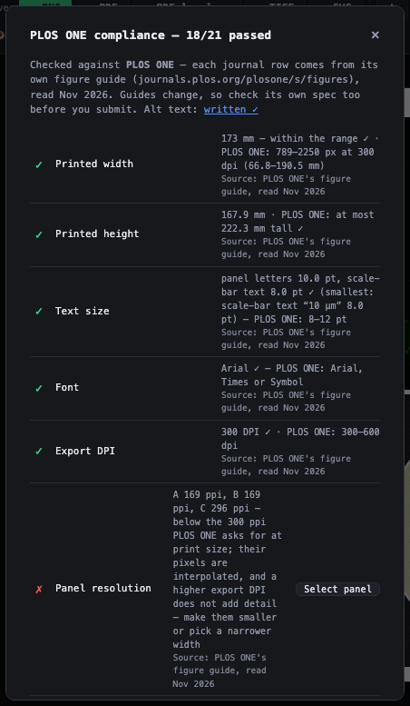
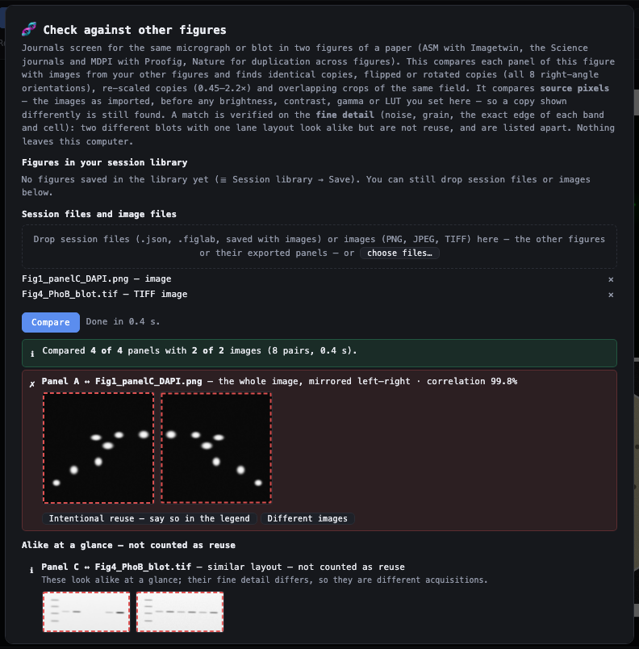

# Getting a figure through journal submission

## What you'll make

A figure set to one journal's rules, checked row by row against that journal's figure guide, with a legend key, a caption, a Methods paragraph and alt text, checked for reused images, and exported as one submission package you can rebuild after review.

## You need

- A figure that is already laid out. The figure-type guides get you there: [western blots](western-blot.md), [fluorescence](fluorescence.md), [phage and microbiology](phage-and-microbiology.md), [charts](charts.md).
- The images from your other figures of the paper, or their exported panels, if you want to check for reuse across figures.
- The journal's own figure guide open in another tab. FigureLab read each journal's page in November 2026; guides change.

Every step below was run on this build by `verify/journal-submission.verify.js`, on a four-panel figure (two calibrated 16-bit fluorescence channels, a western blot and a plate photo).

## 1. Choose the journal

Do this after the layout is settled (columns, rows, spans), and after you name the figure.

1. Open **Export** and type the figure's name in **File name**, with its number: `Figure 2`.
2. Open **Look** and choose your journal in **Target journal**. You can also press <kbd>Ctrl</kbd>/<kbd>⌘</kbd>+<kbd>K</kbd>, type the journal's name and pick **Journal: …**, or click one of the preset buttons under it (**Nature**, **PLOS**, **eLife**, **EMBO**, **ASM**, **JBC** …).
3. Read the toast. It lists what the preset changed, for example `PLOS ONE preset applied — Arial, LZW TIFF, named Fig2 — letters 10 pt, headings 9 pt, text 8 pt`.

What a preset sets, where the journal states it:

| | Nature | PLOS ONE | eLife |
|---|---|---|---|
| Printed width | 183 mm (or 89 mm) | 173 mm | 183 mm |
| Font | Arial | Arial | not changed |
| Letters / headings / text | 7 / 7 / 7 pt | 10 / 9 / 8 pt | 8 / 8 / 7 pt (eLife states no size) |
| TIFF | — | LZW, named `Fig2.tif` | — |

PLOS file names take the number from your File name: `Figure 2` becomes `Fig2`. If you rename the figure after choosing PLOS, the compliance report's **File name** row offers a **Name Fig3** button.

Science, Cell and PNAS are marked *unverified*: FigureLab could only read secondary sources for them, so their rows never fail.

## 2. Run the compliance check

1. Open **Check** and click **✓ Check journal compliance** (or ⌘K › **Check against …**, which reports without changing your journal).
2. Read the title: `PLOS ONE compliance — 18/21 passed`.
3. Read each row. Each journal row names its source.

What the icons mean:

- **✓** the figure meets the rule.
- **⚠** a warning: the figure may be fine, but check (for example panels below 300 ppi).
- **✗** the figure breaks the journal's rule.
- **ℹ** nothing was checked: the row says **Does not apply** (no insets, no pseudocoloured panels), **Not run** (the reuse check across figures) or **not checked** (no export yet). These rows are not counted in the passed total.

### The fix buttons

Each button is one undo step, and the report refreshes after it.

| Row | Button | What it does |
|---|---|---|
| Text size, journal states sizes | **Fit 8–12 pt** (the journal's range) | Brings the figure's text sizes into range. Verified: 3 pt text → 8 pt under PLOS. |
| Text size, journal states none (None, Science, Cell, PNAS) | **Raise to 5 pt** | Raises text under 5 pt, the smallest any journal FigureLab has read accepts. |
| Scale-bar calibration | **Calibrate…** / **No scale bar on these** | Calibrate a micrograph, or switch off a bar on a photo, blot or chart that has no scale. |
| Text contrast | **Auto contrast** | Letters pick black or white from the picture under them. See the note below. |
| Panel resolution | **Select panel** | Selects the first panel that prints below 300 ppi, so you can make it smaller. |
| Alt text | **Alt text** | Opens the ALT TEXT box under the caption. |
| File name (PLOS) | **Name Fig2** | Renames the export. |
| Export format (Nature) | **Save as PDF (lossless)** | Opens the Save dialog in a format the journal accepts. |

**Text contrast.** With **Look › Panel Labels (A, B, C…) › Background** ticked (the default), a white letter on its chip over a white panel measured 3.4:1, and the report's **Auto contrast** button does not change that. Untick **Background** instead: Auto contrast switches on with it and the row passed (17.5:1 in the test). If a letter sits on a mid-grey picture, check that row again; Auto contrast can still pick white there.

**Printed height.** Nature allows 170 mm. On a 2 × 2 figure of square panels, the Nature preset kept 183 mm and the figure printed 177.5 mm tall; the row failed and has no fix button. Choose **Export › Printed width › 89 mm — single column (Nature)**, or put the panels in fewer rows.

## 3. Add the legend key

The key lists every channel colour, chart series and gene-map feature once, with the exact colour, marker and line drawn in the figure.

1. Open **Export › Legend key**.
2. Rename a channel under **Channel names** if the file name gave the wrong one (`GFP` → `GFP-LC3`). The key, its text and the placed key follow. Clear a name to go back to the tag or file name.
3. Tick **Place the key on the figure**. It goes in the emptiest corner. If it covers a panel letter, widen **Arrange › Margins › Right** (110 px in the test), then untick and tick **Place the key on the figure** again: it moves into the margin.
4. Click **⬇ Download key**. It is written in the format of your last export, shown on the button: **⬇ Download key (PNG)** before any export, **⬇ Download key (TIFF)** after a TIFF.
5. Under **Figure caption helper**, the **Legend text starter** box holds the key as a sentence: `DAPI (blue); GFP-LC3 (green).` Click **Copy** and paste it into your figure legend.

The placed key shows the same names, swatches and font as the downloaded file.

## 4. Write the caption, Methods and alt text

1. In each panel's **⚙**, type a **Caption note (not rendered)**: what the panel shows, for example `PhoA western blot; WT and ΔphoA, ± IPTG`.
2. Open **Export** and click **✦ Generate Caption**. Panels are named by letter: `(C) PhoA western blot; …`. Scale bars, µm per pixel and field of view are written in for calibrated panels.
3. Click **✎ Write Methods paragraph**. It states the 16-bit display ranges in camera counts, the look-up tables, where each calibration came from, which panels print below 300 ppi, and any reuse you marked as intentional.
4. Under **Alt text**, click **✦ Draft from figure**. The draft says what is where, not what it shows; add your findings. It goes into the PNG, SVG and PDF and into the package.

An untouched caption follows the figure. Once you edit it, FigureLab keeps your words. If the figure changes afterwards (press **⟳ Render** after typing a caption note), the box shows `⚠ The figure has changed since this caption was generated. ✦ Regenerate (replaces your edits)`. **✦ Generate Caption** also replaces your edits, without asking, so copy them out first.

## 5. Check for reused images

Journals screen whole papers for the same micrograph or blot used twice (ASM with Imagetwin; the Science journals and MDPI with Proofig; Nature).

### Within the figure

1. Open **Check** and click **🧬 Duplication check**.
2. Read **Whole panels**, then **Regions**. A copied panel reads `B and E are 100.0% similar — the fine detail matches — confirm these are different acquisitions`.
3. Decide each finding: **Intentional reuse — say so in the legend**, **Different images**, or, for frames of one field, **Same field, different acquisitions**.

### Across the paper's figures

1. Click **🧬 Check against other figures…**.
2. Under **Session files and image files**, click **choose files…** and pick the other figures' session files or exported panels (PNG, JPEG, TIFF). Figures you saved with **＋ Save current to library** are listed already.
3. Click **Compare**.
4. Decide each ✗ finding. Marking **Intentional reuse — say so in the legend** writes a sentence into the caption and Methods: `The image in panel A is reused from “Fig1_panelC_DAPI.png”, mirrored left–right.`

**"Similar layout" is not reuse.** Two different blots with one lane layout, two plates in the same dish, or two fields behind the same letterbox look alike at a glance. The check compares the fine detail (noise, grain, band edges), and lists pairs that only share the composition under **Alike at a glance — not counted as reuse**, with nothing to decide and nothing written into the legend. In the test, a different blot with the same six lanes was listed there; the mirrored copy of panel A was found at 99.8 %.

The compliance report's **Image reuse across figures** row shows whether the check was run and whether every finding is decided. The package carries `IMAGE_REUSE_CHECK.txt`. The check compares only the images you give it; it does not search published papers and does not detect AI-generated images.

## 6. Export and build the submission package

1. Export the figure in the journal's format: the toolbar's **↓ TIFF** › **Save TIFF** under PLOS wrote `Fig2.tif`, LZW, 300 dpi, 173.0 mm wide. For Nature use **↓ PDF lossless**.
2. Re-run **✓ Check journal compliance**: the **Export format** row now checks what you saved.
3. Open **Export** and click **📦 Export submission package (ZIP)**.

What the package holds (25 files in the test):

- the figure as `.png`, `.tif`, `.pdf` (lossless) and `.svg` (layered);
- the key as `-key.png`, `-key.tif`, `-key.pdf`, `-key.svg` and `-key.txt` (the legend text starter);
- `-caption.txt`, `-methods.txt`, `-alt.txt`;
- `-session.json` (reopens the whole figure), `-metadata.csv`, `-repro-log.txt`, `_assemble.R`, `_assemble.py`;
- `PANEL_HISTORY.txt` and `.json` (every operation on every panel, including replaced images);
- `IMAGE_REUSE_CHECK.txt`;
- `panels/` (each panel on its own);
- `README.txt` (the list, and notes on the text files).

A figure with cropped blots also carries the uncropped originals (S1) and the densitometry CSVs; the [western blot guide](western-blot.md) covers them.

Caption and Methods in the package: an untouched box is regenerated for the figure as exported; your edited text is kept. If the figure changed after you edited, or the text came from a reopened session, the package keeps your text and adds `-caption-generated.txt` / `-methods-generated.txt` with FigureLab's version, and `README.txt` says so.

## 7. Save and reopen your work

1. Press <kbd>Ctrl</kbd>/<kbd>⌘</kbd>+<kbd>S</kbd>, or **Export › Save / load your work › 💾 Save (bundled)**. You get `<name>-session.json` with the images inside, including the 16-bit samples (the toast says how many MB).
2. To reopen: on a fresh page, click **📂 Load a session** on the welcome card, or **Export › 📂 Load**, and pick the file.

Verified: panels, letters, target journal, File name, channel names in the key and caption notes all came back. Autosave cannot hold large images; keep the session file.

## 8. Revise after review

1. **Replace an image.** Right-click the panel on the canvas › **⇄ Replace image…** (also in the panel's **⚙** and in ⌘K). Label, crop, caption note and settings are kept: `Panel C: PhoA_blot.tif → PhoA_blot_rerun.tif — crop, labels and settings kept`. Calibration comes from the new file, and is cleared with a message when the pixel size may differ.
2. **Swap two panels.** Drag one panel onto the other on the canvas. The toast says `Panels swapped`, and the letters follow position. After **⎘ Duplicate** or other reordering, **Arrange › 🔤 Relabel A, B, C…** letters them in order again.
3. **Change journal.** ⌘K › **Journal: eLife** (or Look › Target journal). Run the compliance check again.
4. **Re-export** the figure and the package. `PANEL_HISTORY.txt` records the replaced file.

## Tips

- Lay out the figure first, name it, then choose the journal. The preset sets sizes in points at the printed width, and PLOS takes the figure number from the name.
- ⌘K › **Check against …** reports against any journal without changing your target.
- Export the figure in the journal's format before the final check, so the **Export format** row has something to check.
- Write caption notes in each panel's ⚙ rather than editing the caption: they survive regeneration and travel with the panel when you swap or replace it.
- Save the session (⌘S) before a revision round, and keep the package's `-session.json`: it reopens the figure as submitted.
- More shortcuts: [tips and tricks](tips-and-tricks.md).

## If something looks wrong

| Symptom | Fix |
|---|---|
| **Text contrast** still fails after **Auto contrast** | Untick **Look › Panel Labels (A, B, C…) › Background**. |
| **Printed height** fails after a preset | Pick a narrower **Export › Printed width**, or fewer rows. |
| The placed key covers a letter | Widen **Arrange › Margins › Right**, then untick and tick **Place the key on the figure**. |
| The key lists only some panels | It keys colour: channels, chart series and gene-map features. A blot or an RGB photo has no key row. |
| The caption shows ⚠ out of date | Click **✦ Regenerate** (replaces your edits), or edit it by hand. |
| A caption note does not appear in the caption | Press **⟳ Render**. |
| A blot pair is listed as "similar layout" | Nothing to do: it is not counted as reuse. |
| The TIFF is named `Figure 2.tif` under PLOS | Click **Name Fig2** on the report's **File name** row, or choose PLOS after naming. |

More in [troubleshooting](troubleshooting.md). Back to the [guide index](README.md).
