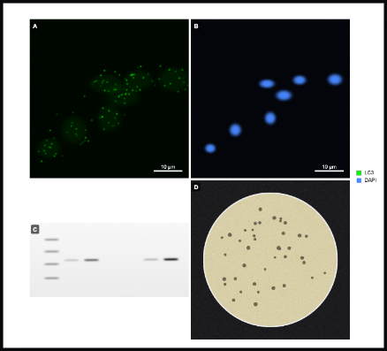

# Getting a figure through journal submission

## What you'll make

A figure set to one journal's rules, checked row by row against that journal's figure guide, with a legend key, a caption, a Methods paragraph and alt text, checked for reused images, and exported as one submission package you can rebuild after review.

## You need

- A figure that is already laid out. The figure-type guides get you there: [western blots](western-blot.md), [fluorescence](fluorescence.md), [phage and microbiology](phage-and-microbiology.md), [charts](charts.md).
- The images from your other figures of the paper, or their exported panels, if you want to check for reuse across figures.
- The journal's own figure guide open in another tab. FigureLab read each journal's page in November 2026; guides change.

Every step below was run on this build by `verify/journal-submission.verify.js`, on a four-panel figure (two calibrated 16-bit fluorescence channels, a western blot and a plate photo).

## 1. Choose the journal

Do this after the layout is settled (columns, rows, spans), and after you name the figure.

1. Open **Export** and type the figure's name in **File name**, with its number: `Figure 2`.
2. Open **Look** and choose your journal in **Target journal**. You can also press <kbd>Ctrl</kbd>/<kbd>⌘</kbd>+<kbd>K</kbd>, type the journal's name or abbreviation (`plos`, `mbio`, `j bacteriol`, `jbc`) and press <kbd>Enter</kbd> on **Journal: …**, or click one of the preset buttons under it (**Nature**, **PLOS**, **eLife**, **EMBO**, **ASM**, **JBC** …). A journal FigureLab has no preset for says so and changes nothing: `nat comms` finds "Journal: no preset for Nature Communications", and `scientific reports` finds "Journal: no preset for Scientific Reports".
3. Read the toast. It lists what the preset set, for example `PLOS ONE preset applied — printed width 173 mm (PLOS ONE allows up to 190.5 mm), Arial, LZW TIFF, files named Fig2 (your name “Figure 2” is kept for when you change journal) — letters 10 pt, headings 9 pt, text 8 pt`. It says "kept" only for a width you had set before choosing the journal.

What a preset sets, where the journal states it:

| | Nature | PLOS ONE | eLife |
|---|---|---|---|
| Printed width | 183 mm, or 89 mm when 183 mm would make the figure taller than 170 mm | 173 mm | 183 mm |
| Font | Arial | Arial | not changed |
| Letters / headings / text | 7 / 7 / 7 pt | 10 / 9 / 8 pt | 8 / 8 / 7 pt (eLife states no size) |
| TIFF | — | LZW, named `Fig2.tif` | — |

A preset picks the widest width the journal allows that keeps the figure within its height limit, and its toast says so: on a 2 × 2 figure of square panels, "… printed width 89 mm — the widest that keeps it within 170 mm tall".

PLOS file names take the number from your File name: `Figure 2` becomes `Fig2`, and the **File name** box reads `Fig2`. Your own name is kept: choose Nature afterwards and the box reads `Figure 2` again (the toast says "files named “Figure 2” again"). If you rename the figure after choosing PLOS, the compliance report's **File name** row offers a **Name Fig3** button.

Science, Cell and PNAS are marked *unverified*: FigureLab could only read secondary sources for them, so their rows never fail.

## 2. Run the compliance check

1. Open **Check** and click **✓ Check journal compliance**. To see how the figure fares under another journal, press ⌘K and type `check against` and its name (`check against nature`): the report's title ends "· report only", a line says "Report only — your target journal is still PLOS ONE, and nothing was changed", and a **Switch the target to Nature** link changes the target if you want it (one undo step).
2. Read the title: `PLOS ONE compliance — 18/21 passed · 1 to do: export as TIFF`. The "to do" names what is still to be done: here, an export in the journal's format (§6).
3. Read each row. Each journal row names its source.

What the icons mean:

- **✓** the figure meets the rule.
- **⚠** a warning: the figure may be fine, but check (for example panels below 300 ppi).
- **✗** the figure breaks the journal's rule.
- **ℹ** nothing was checked: the row says **Does not apply** (no insets, no pseudocoloured panels), **Not run** (the reuse check across figures) or **not checked** (no export yet). These rows are not counted in the passed total.

### The fix buttons

Each button is one undo step, and the report refreshes after it.

| Row | Button | What it does |
|---|---|---|
| Text size, journal states sizes | **Fit 8–12 pt** (the journal's range) | Brings the figure's text sizes into range. Verified: 3 pt text → 8 pt under PLOS. |
| Text size, journal states none (None, Science, Cell, PNAS) | **Raise to 6 pt** | Text under 5 pt (the smallest any journal FigureLab has read accepts) fails, and text under 6 pt warns; the button raises it to 6 pt. |
| Scale-bar calibration | **Calibrate…** / **No scale bar on these** | Calibrate a micrograph, or switch off a bar on a photo, blot or chart that has no scale. |
| Scale-bar calibration, a picture that looks like a micrograph with no calibration and no bar | **Calibrate…** / **No scale needed** | The row warns, for example "E (HeLa_DMSO_phase.tif) looks like a micrograph — its file name says “phase” — with no calibration and no scale bar". **No scale needed** marks a picture that truly has none (it is kept with the figure), and the row passes. |
| Text contrast | **Auto contrast** | Darkens the chips behind the letters and picks black or white text, so every letter reads against its panel. See the note below. |
| Printed height | **Set 89 mm** (the width that fits) | Narrows the figure until it fits the journal's height. |
| Legend key on the figure | **Move to free space** | Puts a key that covers a panel, letter or heading back into free space. |
| Blank margins (journal reports only) | **Balance margins** | The row appears when the blank strip on one side of the figure is wider than on the other (the default margins leave a wider strip on the left and top): ⚠ under a journal that asks for whitespace cropped (ASM), ℹ otherwise. The button trims the wider margins to match: "Margins balanced: left 60 → 16 px, top 40 → 7 px (Arrange › Margins) — a journal preset keeps them" in the [phage guide](phage-and-microbiology.md)'s test. |
| Panel resolution | **Select panel** | Selects the first panel that prints below 300 ppi, so you can make it smaller. |
| Alt text | **Alt text** | Opens the ALT TEXT box under the caption. |
| File name (PLOS) | **Name Fig2** | Renames the export. |
| Export format | **Save as …** in the journal's format (**Save as TIFF** under PLOS) | Opens the Save dialog again when nothing was exported since the figure last changed (see §6). |

Rows for charts, blots and measurements are described in those guides: **Text to N pt** when chart superscripts print below the journal's minimum, and **Chart room** when a chart's plot is squeezed or a legend name is cut off ([charts](charts.md)); **Lane tables to 7 pt** and **Widen A** for lane-table labels, and the **Charts from densitometry** row for a chart whose numbers were typed by hand ([western blot](western-blot.md)); **Measurements** when a count or ruler was made on a picture you have since replaced ([phage](phage-and-microbiology.md)); **Text over text** when a tag or heading sits on a panel letter, with the merge tags it fitted ([fluorescence](fluorescence.md)).

**Text contrast.** The row measures each letter against the picture under its strokes. In the test, letter C on its chip over the white blot read 3.55:1 (⚠). The row's **Auto contrast** button fixed it with **Look › Panel Labels (A, B, C…) › Background** still ticked: the toast reads "Auto contrast on — the chips behind the letters are darker and the letters white — every text over a picture now reads at 4.5:1 or better", and the row passed. Scale-bar text is inked from the pixels under it, with a backing chip where neither black nor white reads, so text over a mid-grey TEM passes too ([phage guide](phage-and-microbiology.md)).

**Printed height.** Nature allows 170 mm. The preset already picks a width that fits. If you choose a wider **Export › Printed width** afterwards (183 mm on a 2 × 2 figure of square panels), the row fails and its **Set 89 mm** button brings it back. Fewer rows also work.

## 3. Add the legend key

The key lists every channel colour, chart series and gene-map feature once, with the exact colour, marker and line drawn in the figure.

1. Open **Export › Legend key**.
2. Rename a channel under **Channel names** if the file name gave the wrong one (`GFP` → `GFP-LC3`). The key, its text and the placed key follow. Clear a name to go back to the tag or file name. Greyscale pictures (phase contrast, bright field) are listed there too, under the name their panels show: an uncalibrated `HeLa_DMSO_phase.tif` came in as **BF**, and typing `Phase contrast` in its field renamed every panel of that name ("Phase contrast (greyscale)" in the key text).
3. Tick **Place the key on the figure**, or press <kbd>⌘K</kbd>, type `legend key` and press <kbd>Enter</kbd> on **Legend key: place it on the figure**. It goes into free space (a margin, an empty cell or a free corner), never over a panel, letter or heading. When there is no room, a margin grows for it and the toast says so: "Legend key placed on the figure. The legend key needed free space, so the bottom margin grew from 16 to 53 px — it sits there without covering anything. Choose another place in Export › Legend key › Where, or drag it." The key moves itself when the layout, text size, printed width or journal changes, and when it moves, the margin grown for its old place is given back ("The key moved; the bottom margin back to 16 px").
4. To choose the place yourself, use the menu beside the switch (it has no label on screen; the toasts call it **Where**): **Free space**, **Top right**, **Top left**, **Bottom right**, **Bottom left**, **Right edge** or **Below**. Or drag the key with **Annotate & Draw › ↖ Select**: a key you moved stays where you put it. If it then covers something, the compliance report's **Legend key on the figure** row warns ("the key you moved covers panel letter A, 1 panel") and its **Move to free space** button puts it back.
5. Click **⬇ Download key**. It is written in the format of your last export, shown on the button: **⬇ Download key (PNG)** before any export, **⬇ Download key (TIFF)** after a TIFF.
6. Under **Figure caption helper**, the **Legend text starter** box holds the key as a sentence: `DAPI (blue); GFP-LC3 (green).` Click **Copy** and paste it into your figure legend.

The placed key shows the same names, swatches and font as the downloaded file.

## 4. Write the caption, Methods and alt text

1. In each panel's **⚙**, type a **Caption note (not rendered)**: what the panel shows, for example `PhoA western blot; WT and ΔphoA, ± IPTG`. Lab-book details (dates, conditions) go in the field under it, **Metadata note (records only, not the caption)**, which is kept in the package's metadata.csv and PANEL_HISTORY and never written into the caption or alt text.
2. Open **Export** and click **✦ Generate Caption**. Panels are named by letter: `(C) PhoA western blot; …`. Scale bars, µm per pixel and field of view are written in for calibrated panels; chart panels are described by what they draw ([charts](charts.md)).
3. Click **✎ Write Methods paragraph**. It states the 16-bit display ranges in camera counts, the look-up tables, where each calibration came from, which panels print below 300 ppi, and any reuse you marked as intentional.
4. Under **Alt text**, click **✦ Draft from figure**. The draft says what is where, not what it shows; add your findings. It goes into the PNG, SVG and PDF and into the package.

An untouched caption follows the figure by itself, also in a reopened session: in the test, swapping panels A and B after reopening rewrote the untouched caption to start with "(A) GFP-LC3". A new caption note reaches an untouched caption within a second (0.6 s in the test), without **⟳ Render**.

Once you edit one of them, FigureLab keeps your words. If the figure changes afterwards (a caption note, a swap, a renamed sample, a replaced picture), a line under the box says so within a second and offers both ways:

- caption: `⚠ The figure has changed since this caption was written. ✦ Regenerate (replaces your edits; a sentence in a panel's ⚙ › Caption note, or a chart's, is kept) · Keep mine`;
- Methods: `… since this paragraph was written. ✎ Rewrite (replaces your edits) · Keep mine`;
- alt text: `⚠ The figure or its caption has changed since this alt text was written — exports embed it as it is. ✦ Redraft (replaces your edits) · Keep mine`.

**Keep mine** keeps your text and hides the line until the figure changes again. Clicking **✦ Generate Caption** or **✎ Write Methods paragraph** on edited text asks first ("Replace your caption?"): **Replace** or **Keep mine**.

A sentence you want in every new caption (the assay, n, the statistical test) goes in a caption note, not at the end of the caption: a panel's **⚙ › Caption note (not rendered)**, or for a chart the **Caption note** field in its Chart dialog. Caption notes are written into the caption each time; text typed into the caption box itself is replaced by **✦ Regenerate**.

## 5. Check for reused images

Journals screen whole papers for the same micrograph or blot used twice (ASM with Imagetwin; the Science journals and MDPI with Proofig; Nature).

### Within the figure

1. Open **Check** and click **🧬 Duplication check**.
2. Read **Whole panels**, then **Regions**. A copied panel reads `B and E are 100.0% similar — the fine detail matches — confirm these are different acquisitions`.
3. Decide each finding: **Intentional reuse — say so in the legend**, **Different images**, or, for frames of one field, **Same field, different acquisitions**.

### Across the paper's figures

1. Click **🧬 Check against other figures…**.
2. Under **Session files and image files**, click **choose files…** and pick the other figures' session files or exported panels (PNG, JPEG, TIFF). Figures you saved with **＋ Save current to library** are listed already.
3. Click **Compare**.
4. Decide each ✗ finding. Marking **Intentional reuse — say so in the legend** writes a sentence into the caption and Methods: `The image in panel A is reused from “Fig1_panelC_DAPI.png”, mirrored left–right.`

**"Similar layout" is not reuse.** Two different blots with one lane layout, two plates in the same dish, or two fields behind the same letterbox look alike at a glance. The check compares the fine detail (noise, grain, band edges), and lists pairs that only share the composition under **Alike at a glance — not counted as reuse**, with nothing to decide and nothing written into the legend. In the test, a different blot with the same six lanes was listed there; the mirrored copy of panel A was found at 99.8 %.

The compliance report's **Image reuse across figures** row shows whether the check was run and whether every finding is decided. The package carries `IMAGE_REUSE_CHECK.txt`. The check compares only the images you give it; it does not search published papers and does not detect AI-generated images.

## 6. Export and build the submission package

1. Export the figure in the journal's format: the toolbar's **↓ TIFF** › **Save TIF** under PLOS wrote `Fig2.tif`, LZW, 300 dpi, 173.0 mm wide. For Nature use **↓ PDF lossless**.
2. Re-run **✓ Check journal compliance**: the **Export format** row counts every format you saved since the figure last changed, and passes if one of them is one the journal accepts ("exported as TIFF since the figure last changed ✓ (TIFF accepted)"). A file saved before the last change does not count: the row turns ℹ "not checked — the figure changed after it was last exported (as TIFF), so that file shows an earlier version; export it again in TIFF", and its **Save as TIFF** button opens the Save dialog.
3. Open **Export** and click **📦 Export submission package (ZIP)**.

What the package holds (25 files in the test):

- the figure as `.png`, `.tif`, `.pdf` (lossless) and `.svg` (layered) (TIFFs are `.tif` under PLOS, `.tiff` otherwise);
- the key as `-key.png`, `-key.tif`, `-key.pdf`, `-key.svg` and `-key.txt` (the legend text starter);
- `-caption.txt`, `-methods.txt`, `-alt.txt`;
- `-session.json` (reopens the whole figure), `-metadata.csv`, `-repro-log.txt`, `_assemble.R`, `_assemble.py`;
- `PANEL_HISTORY.txt` and `.json` (every operation on every panel: the file first imported, each replacement, and where each pixel size came from, e.g. "source=read from ImageJ metadata");
- `IMAGE_REUSE_CHECK.txt`;
- `panels/` (each panel on its own);
- `README.txt` (the list, and notes on the text files).

File names inside the ZIP use plain hyphens, never en or em dashes.

A figure with cropped blots also carries the uncropped originals (S1) and the densitometry CSVs; the [western blot guide](western-blot.md) covers them.

Caption and Methods in the package: an untouched box is regenerated for the figure as exported; your edited text is kept. If the figure changed after you edited it, the package keeps your text, adds `-caption-generated.txt`, `-methods-generated.txt` or `-alt-generated.txt` with FigureLab's version, and says so: a note "⚠ Check the …" opens when the package is written, and `README.txt` repeats it. In the test, Methods and alt text edited in a reopened session, then a panel swap, gave `Fig2-methods-generated.txt` and `Fig2-alt-generated.txt`.

## 7. Save and reopen your work

1. Press <kbd>Ctrl</kbd>/<kbd>⌘</kbd>+<kbd>S</kbd>, or **Export › Save / load your work › 💾 Save (bundled)**. You get `<name>-session.json` with the images inside, including the 16-bit samples: "Session saved (images bundled, with 2 MB of native 16-bit samples so levels and measurements reopen in camera counts)".
2. To reopen: on a fresh page, click **📂 Load a session** on the welcome card, or **Export › 📂 Load**, and pick the file. If the browser kept a copy, a bar at the bottom comes first: after a Save session it reads "↺ Your figure was last saved with Save session (downloaded as Fig2-session.json) at …, with no changes after — open that file (📂 Load session) to get it back with everything, 16-bit values included." Click **Dismiss** and load the file; **Restore the browser copy** brings back the autosaved copy, which does not keep 16-bit samples.

Verified: panels, letters, target journal, printed width (173 mm), File name, channel names in the key and caption notes all came back. Autosave cannot hold large images; keep the session file.

## 8. Revising after review

Reviewers ask for a panel swapped, a sample renamed, another journal or another width. Save the session first (<kbd>Ctrl</kbd>/<kbd>⌘</kbd>+<kbd>S</kbd>), make the changes, then re-check and re-export.

**Change the figure**

1. **Replace a picture.** Right-click the panel on the canvas › **⇄ Replace image…** (also in the panel's **⚙** and in ⌘K). Letter, crop, settings and caption note are kept, and the toast says so: `Panel C: PhoA_blot.tif → PhoA_blot_rerun.tif — crop, label and settings kept; display range 0–53369 (native values) kept; caption note kept: “PhoA western blot; WT and ΔphoA, ± IPTG” — edit it in ⚙ if it no longer fits`. If the new picture shows something else, edit that caption note. When something cannot be kept (a display range an 8-bit file cannot hold, a calibration that may not fit), the toast reads "crop and label kept, but" and names it. A new file that carries its own calibration (an ImageJ TIFF) brings it. A file without one keeps the panel's µm/px only if it has the same pixel size; otherwise the calibration is cleared and the toast says so ("calibration cleared: the new file is 400×400 px and the old one 512×512, so 0.1083 µm/px may be wrong — calibrate it again"). Freeform pictures are replaced the same way ([freeform](freeform.md)).
2. **Swap two panels.** Drag one panel onto the other on the canvas. The toast says `Panels swapped`, and the letters follow position.
3. **Remove a panel.** Right-click it › **✕ Remove panel**. When the letters then skip one, the toast says so and offers to reletter: "Panel A removed — Ctrl+Z brings it back. The letters now skip A" with a **🔤 Relabel A, B, C…** button.
4. **Rename a sample.** A channel: **Export › Legend key › Channel names** (in the test `GFP-LC3` → `LC3`; the key text and the untouched caption read "LC3 (green)" at once). A chart sample: its **shown as** box ([charts](charts.md)).
5. **Change the journal.** ⌘K › **Journal: eLife** (or Look › Target journal). The toast lists what the preset set.
6. **Change the printed width.** In **Export › Printed width**. A narrower width keeps text at its point size, so the toast warns that it grows against the pictures: "Printed width 183 → 89 mm: text keeps its point size, so it is 2.06× larger against the pictures now — check charts, gene maps and scale-bar labels for words that run together or past a panel’s edge". With the key on the figure, the same toast goes on to say how its margin changed ("The legend key needed free space, so the bottom margin grew from 53 to 72 px …").

**What FigureLab flags for you**

- An untouched caption, Methods or alt text follows the change; one you edited shows its "⚠ The figure has changed…" line with **Regenerate** / **Keep mine** (§4).
- The compliance report's **Export format** row turns ℹ "not checked — the figure changed after it was last exported" until you export again, with a **Save as …** button in the journal's format (§6).
- The package keeps your edited texts and adds `-caption-generated.txt`, `-methods-generated.txt` or `-alt-generated.txt` beside them, with a note "⚠ Check the …" (§6). In the test, after a replace and a swap, it held `Fig2-methods-generated.txt` and `Fig2-alt-generated.txt`.
- `PANEL_HISTORY.txt` records the file first imported and each replacement ("replaceImage: from=PhoA_blot.tif, to=PhoA_blot_rerun.tif").
- A densitometry chart whose numbers you typed is flagged when its blot changes ([western blot](western-blot.md)).

**Then**

1. Run **✓ Check journal compliance** again and work through the new ✗ and ⚠ rows.
2. Re-export the figure in the journal's format, and check that **Export format** passes.
3. Rebuild the package (**📦 Export submission package (ZIP)**) and read any "⚠ Check the …" note.

## Tips

- Lay out the figure first, name it, then choose the journal. The preset sets sizes in points at the printed width, and PLOS takes the figure number from the name.
- ⌘K › **Check against …** reports against any journal without changing your target.
- Export the figure in the journal's format before the final check, so the **Export format** row has something to check.
- Write caption notes in each panel's ⚙ (or a chart's Chart dialog) rather than editing the caption: they survive ✦ Regenerate and travel with the panel when you swap or replace it.
- Save the session (⌘S) before a revision round, and keep the package's `-session.json`: it reopens the figure as submitted.
- More shortcuts: [tips and tricks](tips-and-tricks.md).

## If something looks wrong

| Symptom | Fix |
|---|---|
| **Printed height** fails | You widened the figure after the preset: click **Set … mm** on the row, or use fewer rows. |
| **Legend key on the figure** warns | A key you dragged covers something: click **Move to free space**, or pick a place in the menu beside **Export › Legend key › Place the key on the figure**. |
| The key lists only some panels | It keys colour: channels, chart series and gene-map features. A blot or an RGB photo has no key row. |
| The caption shows ⚠ out of date | Click **✦ Regenerate** (replaces your edits) or **Keep mine**. |
| **Export format** reads ℹ "not checked — the figure changed after it was last exported" | The file you saved shows an earlier version. Click the row's **Save as …** button (or the toolbar's format) and save again. |
| ⌘K **Check against …** did not change the target journal | It reports only. Click **Switch the target to …** in the report to change it. |
| **Scale-bar calibration** warns that a picture "looks like a micrograph" | Calibrate it (**Calibrate…**), or click **No scale needed** for a picture that has no scale. |
| A blot pair is listed as "similar layout" | Nothing to do: it is not counted as reuse. |
| The TIFF is named `Figure 2.tif` under PLOS | Click **Name Fig2** on the report's **File name** row, or choose PLOS after naming. |

More in [troubleshooting](troubleshooting.md). Back to the [guide index](README.md).
