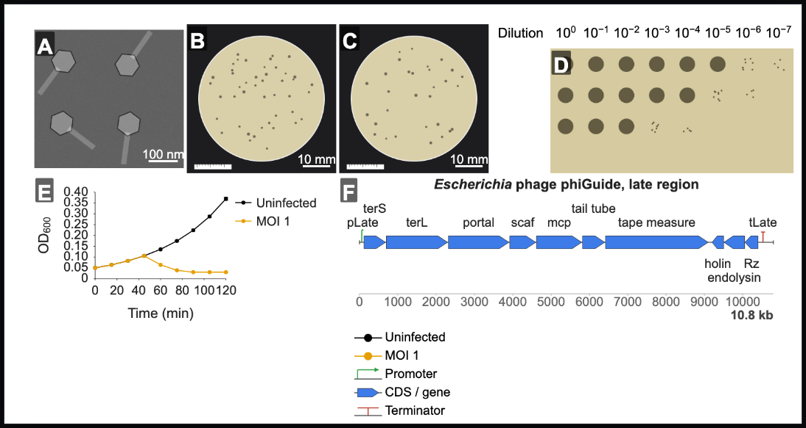
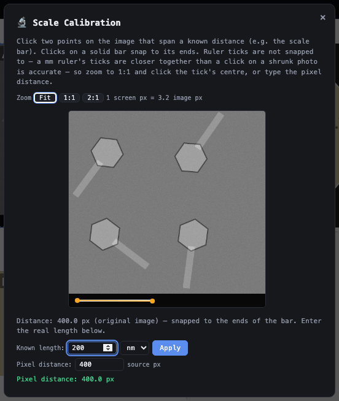

# Phage and microbiology figures

## What you'll make

A one-grid figure for an ASM journal: a calibrated TEM of the virion with head and tail measured, two plaque plates at the same magnification with their plaques counted, a spot assay with a dilution row over it, lysis curves from a replicate CSV, a gene map read from a GenBank file, and the legend key under them.

## You need

- A TEM micrograph with the microscope's info strip and scale bar burned in (TIFF, 8- or 16-bit).
- Plate photos with a ruler or a dish of known size in the frame (JPEG is fine).
- A spot-assay photo.
- Growth or lysis data as a CSV: a time column and one column per replicate (`MOI_0_rep1`, `MOI_0_rep2` …), or tidy rows.
- A GenBank (`.gb`) or FASTA file of the region you want to draw.

Everything here stays a grid panel: charts and gene maps get letters, spans, the legend key and undo like the pictures. You do not need freeform for this figure.

## 1. Add the pictures

1. Images › **Drop or click to add images** and pick the TEM, the plate photos and the spot assay. They fill the grid as A, B, C, D.
2. Panels with no calibration start with their scale bar off. You switch each one on by calibrating it (below).

## 2. Calibrate the TEM from its burned-in bar

1. Open panel A's ⚙ (in its row in the image list). Right-clicking the panel on the canvas › **📏 Scale bar / calibrate…**, or ⌘K `add scale bar`, leads to the same place.
2. Click **🔍 Auto-detect scale bar**. It finds the burned-in bar and opens a dialog with its length in pixels (400 px here); pick the length printed on it (**200 nm**). The toast reads *Scale set: 0.5 nm/px (400 px = 200 nm) · scale bar 100 nm*: the bar drawn on the panel is a round length that fits the field, and need not equal the burned-in one.
3. If it says *No scale bar found in the bottom third of the image*, click **🔬 Calibrate from image** instead.
4. In the Scale Calibration dialog, click near the left end of the bar, then near the right end. The clicks snap to the bar's real ends: the dialog reads *Distance: 400.0 px (original image) — snapped to the ends of the bar*.
5. Type the bar's length in **Known length** (200), set the unit to **nm**, and click **Apply**. The calibration is the same 0.5 nm/px, and a 100 nm bar is switched on.
6. To use another length, type it in ⚙ › Scale bar › **Bar length** and pick the unit beside it, or click **Auto**.

If you know the bar's length in pixels, type it in **Pixel distance** instead of clicking.

## 3. Crop off the info strip

1. In panel A's ⚙, under **Clip shape**, the four boxes **T**, **L**, **B**, **R** under **Crop % cut from each edge** are the percent cut from each side.
2. Type the strip's height as a percent of the image height in **B** (a 70-px strip on a 1024-px image: **7**), and press **R** (it redraws even with the cursor still in the box) or click **⟳ Render**.

The calibration and the bar stay: they are in source pixels, not in the crop.

## 4. Measure head and tail

1. Give the micrograph room so you can click precisely: ⚙ › **Panel span (grid mode)** › **Col span** 2, **Row span** 2. Another panel may drop out of the grid until you put the span back; that is expected.
2. Measure › **⊢ Ruler**. Drag across each capsid (flat side to flat side) and along each tail (from the capsid to the baseplate).
3. In the **Rulers** table under Measure, type a name in each row: `capsid`, `tail`. Below the table you get one line per name, for example *capsid · panel A: n = 3, 70.1 ± 0.4 nm (mean ± SD)*.
4. Click **⬇ Ruler lengths CSV**. It has one row per ruler with its name, length, the source-pixel ends and where the calibration came from.
5. To take the rulers off the figure: Annotate & Draw › **✕ Clear** › **Confirm** (this removes every annotation), or click × on single rows in the Annotations list. Set the span back to 1 × 1.

On the test micrograph (0.5 nm/px) three capsids read 70.1 ± 0.4 nm against a true 70 nm, and three tails 99.5 ± 0.6 nm against 99.3 nm. A ruler end is only as fine as one figure pixel, which is why you enlarge the panel first (the CSV states the source px per figure px).

## 5. Plaque plates at the same magnification

1. Plate B's ⚙ › **🔬 Calibrate from image**. Click the 0 and the 10 mm marks of the ruler in the photo (or type the distance in **Pixel distance**), type **10** in Known length, pick **mm**, **Apply**. A 10 mm bar is switched on. Clicks snap to a solid bar's ends but not to ruler ticks: click **1:1** above the picture to see one photo pixel per screen pixel, scroll to the ruler and click each tick's centre (**Fit** shows the whole photo again). In the test, clicks on the fitted photo gave 219.88 px for the true 220.
2. Tick the checkboxes of rows B and C (left of each row), then in B's ⚙ click **⇉ Same µm/px on ticked panels**. The toast reads *45.45 µm/px from B → C (10 mm bar)*. Use this only for photos taken with the same camera set-up.
3. Untick the rows.

## 6. Count plaques in the dish

1. Measure › **🔢 Count**.
2. Set the menu to **dark objects (plaques)** and tick **round (a dish)** (the box or its words).
3. Drag a box around the dish on the canvas, from one side of the rim to the other. The count is made inside the ellipse that box draws.
4. Read the result under the tools: *Objects detected*, the equivalent diameter (mean ± SD, in the panel's units) and the foreground area. Each counted object is marked on the panel so you can check it.
5. **⬇ Export Measurements CSV** saves the result: one row per count, with the objects counted (dark or bright), the region (ellipse or box), how many plaques the rim cut and left out, and the equivalent diameters (mean, SD, median, unit, and each object's). Click **🔢 Count** again to turn the tool off.

On test plates with 45 and 30 plaques, Count found 45 and 30 (equivalent diameter 861 ± 115 µm on plate B). It is a single intensity threshold: touching plaques count as one, so move **Threshold** and count again if the marks show merged plaques.

## 7. Spot assay with a dilution row

1. Crop the spot assay so the spot columns fill the panel evenly: panel D's ⚙ › **Clip shape** T, L, B, R (here 10, 5.6, 10, 5.6). The dilution labels are spaced evenly across the panel, so this is what puts each one over its column.
2. Click panel D on the canvas, press **⌘K** (Ctrl+K), type `lane table`, press **Enter**. The dialog title reads *Lane table — panel D*.
3. Set **Lanes** to the number of dilutions (8). Type the row name (`Dilution`) in the first box of the row.
4. Click the first cell and type the whole row separated by **commas**: `10^{0}, 10^{-1}, 10^{-2}, 10^{-3}, 10^{-4}, 10^{-5}, 10^{-6}, 10^{-7}`, then press **Enter**. It fills across. `^{…}` is a superscript.
5. Check the preview at the top of the dialog: each label should sit over its column. Close the dialog with ×.

Separate the cells with commas or tabs (cells copied from a spreadsheet work too). Spaces split a row only when every cell is a + or −.

## 8. Lysis or growth curves from a CSV

1. Images › **Drop or click to add images** and pick the CSV. The **📊 Chart** dialog opens and a chart panel is added to the grid (*Imported 9 rows from lysis_OD600.csv — chart panel E in the grid*).
2. With replicate columns (`MOI_0_rep1`, `MOI_0_rep2`, `MOI_0_rep3` …), check that **Average replicate columns into one series each** is ticked (it says how many it found per series) and that **Error bars** reads **SD (n−1)** or **SEM (SD/√n)**. A time column gives **Line** as the chart type.
3. Type **X title** (`Time (min)`) and **Y title** (`OD_{600}`; `_{…}` is a subscript). Tick **points**.
4. Under **Names & colours**, type a display name for each series in its *shown as* box (`Uninfected`, `MOI 1`). The data keep their column names; the chart, legend and key show yours.
5. Click **Apply**.

To edit the chart later: its ⚙ › **📊 Edit chart data and style…**. For everything else charts can do (tidy data, log axes, axis limits, brackets, sample colours), see [charts.md](charts.md).

## 9. Gene map from GenBank

1. Annotate & Draw › **🧬 Linear**. The **Gene map** dialog opens on a new gene map panel holding a sample construct; **Cancel** takes that panel away again.
2. Click **📄 GenBank / FASTA…** and pick your file. The feature table, length and title fill in; the line under the import button reads, for example, *10.8 kb · 12 features · 40.9 bp per pixel*. A gene listed twice, as a gene and its CDS (NCBI files do this), is drawn once, and the toast says so: *Loaded 12 features from phiGuide_late.gb (10.8 kb). 10 genes listed twice (gene + CDS or RNA) drawn once each*.
3. Edit **Title** if you like (`*Escherichia* phage phiGuide, late region`; `*…*` is italic) and click **Apply** (the dialog closes).
4. To change it later: its ⚙ › **🧬 Edit gene map…**.

The map shows only what the file declares (the LOCUS length and the FEATURES table); nothing is inferred.

## 10. One grid for pictures, chart and map

1. Give the wide panels more width, each in its ⚙ › **Panel span (grid mode)** › **Col span**: the spot assay 2 (at journal type size its eight dilution labels need two columns), the chart 2, the gene map 3.
2. Arrange › **⊞ Fit grid to panels**. It gives 5 × 2: the TEM, the plates and the spot assay in the top row, the chart and the map below.

## 11. Journal, check, export

1. **⌘K** › type `asm` › **Enter** on *Journal: ASM (mBio, J Bacteriol, J Virol…)*: 177.8 mm wide, Arial, type sizes in points. Lane tables, such as the dilution row, take the journal's type size too.
2. Put the key on the figure: Export › Legend key › **Where** › **Below**. With no key yet, choosing a place puts it there and ticks **Place the key on the figure**. This grid has no free space, so the bottom margin grows to hold the key and the toast says so (*The legend key needed free space, so the bottom margin grew from 16 to 199 px …*). **Free space**, the default when you tick the switch, would widen the right margin instead and shrink the panels of a wide figure; choose the place before you tick.
3. Check › **✓ Check journal compliance**. See [journal-submission.md](journal-submission.md) for what each row means. The test figure read 19/20, with **Text contrast** ⚠ for the white letters over the chart and the gene map (3.35:1) and the TEM's scale-bar text (4.06:1).
4. Click **Auto contrast** on the **Text contrast** row. Letters keep their chips, now darker, and turn white; the toast says what is still under 4.5:1. Here that was the TEM's scale-bar text: *scale-bar text “100 nm” (#111111) 4.3:1*. A mid-grey micrograph (TEM backgrounds often are) leaves bar text without a chip under 4.5:1 in black or in white.
5. Only if the row still names text on a micrograph: darken that panel's display slightly, with its ⚙ › **Black pt** (for the test TEM, 10000 in the file's own counts), and check again. The test figure then passed 20/20. Export › **✎ Write Methods paragraph** states the change (*display ranges in native values: 10000–62000 (panel A)*), along with where each calibration came from (*copied from panel B* for plate C).
6. Export › **File name**, then **↓ TIFF** › **Save TIFF** (ASM asks for TIFF). The test figure saved as 2100 × 1109 px at 300 dpi, 177.8 mm wide.
7. **↓ SVG** › **Save SVG** gives a layered file in which the chart, the gene map, the dilution row and the scale-bar labels are real text. **↓ PDF lossless** writes the same words as selectable text in the PDF's standard fonts (named, not embedded).
8. Export › Legend key › **⬇ Download key** saves the key on its own, in the format you exported last (the button reads **⬇ Download key (PDF)** after the PDF). The legend text starter under the caption helper reads *Uninfected (black, solid line with filled circles); MOI 1 (orange, …); Promoter (green, bent arrow); CDS / gene (blue, arrow); …*.

## Tips

- **⌘K** finds the measuring tools by plain words: `ruler`, `count`, `plaque`, `lane table`, `calibrate`.
- Calibrate before you measure: rulers and Count read the panel's µm/px when you draw them.
- Name rulers as you go; the per-name mean ± SD updates at once and goes into the CSV.
- Rulers drawn on a panel stay on what they measure when you change the panel's span.
- `^{…}` superscript, `_{…}` subscript and `*…*` italic work in chart titles, the lane table, gene-map titles and headings.
- A chart in a single grid cell at journal type size can run its tick labels together; give it a column span of 2. A lane table follows the journal's type size, so a long row (a dilution series) needs a panel wide enough for its labels.
- Save your work with **Ctrl+S** (a session file with the images inside). More in [tips-and-tricks.md](tips-and-tricks.md).

## If something looks wrong

- **No scale bar on a panel.** Panels without calibration start with the bar off. Calibrate them (step 2 or 5); for a chart or a gene map there is nothing to do.
- **Auto-detect says "No scale bar found".** Use 🔬 Calibrate from image; the clicks snap to the bar ends.
- **The dilution labels show as "…".** At journal type size they do not fit their columns. Give the spot assay a wider panel (⚙ › **Col span** 2) or shorter labels.
- **The TEM bar is too short or too long.** Type your own **Bar length** and unit in ⚙ › Scale bar, or click **Auto**.
- **Count merged two plaques or picked up the rim.** Move **Threshold** and drag again; draw the box just inside the rim.
- **Dilution labels are not over their spots.** Crop the panel so the spot columns fill it evenly (step 7.1) and check the preview in the lane table dialog.
- **The whole dilution row went into one cell.** Separate the cells with commas, not spaces.
- **The key went into the right margin and the panels shrank.** Choose **Where** › **Below**, then set **Arrange › Margins › Right** back to 16: a margin the key grew stays when the key moves.
- More in [troubleshooting.md](troubleshooting.md).

*Every step above was followed on this build by [verify/phage-and-microbiology.verify.js](verify/phage-and-microbiology.verify.js) on synthetic inputs (a 0.5 nm/px TEM with a 200 nm bar, plates with 45 and 30 plaques, a 4 × 8 spot assay, a triplicate lysis CSV, a 10.8 kb GenBank file listing each gene as gene + CDS).*
