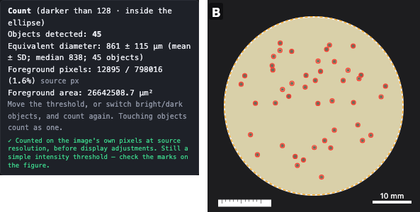

# Phage and microbiology figures

## What you'll make

A one-grid figure for an ASM journal: a calibrated TEM of the virion with head and tail measured, two plaque plates at the same magnification with their plaques counted, a spot assay with a dilution row over it, lysis curves from a replicate CSV, a gene map read from a GenBank file, and the legend key under them.

## You need

- A TEM micrograph with the microscope's info strip and scale bar burned in (TIFF, 8- or 16-bit).
- Plate photos with a ruler or a dish of known size in the frame (JPEG is fine).
- A spot-assay photo.
- Growth or lysis data as a CSV: a time column and one column per replicate (`MOI_0_rep1`, `MOI_0_rep2` …), tidy rows, or a plate reader's export as it comes (one column per well).
- A GenBank (`.gb`) or FASTA file of the region you want to draw.

Everything here stays a grid panel: charts and gene maps get letters, spans, the legend key and undo like the pictures. You do not need freeform for this figure.

## 1. Add the pictures

1. Images › **Drop or click to add images** and pick the TEM, the plate photos and the spot assay. They fill the grid as A, B, C, D.
2. Panels with no calibration start with their scale bar off. You switch each one on by calibrating it (below).

## 2. Calibrate the TEM from its burned-in bar

1. Open panel A's ⚙ (in its row in the image list). Right-clicking the panel on the canvas › **📏 Scale bar / calibrate…**, or ⌘K `add scale bar`, leads to the same place.
2. Click **🔍 Auto-detect scale bar**. It finds the burned-in bar and opens a dialog with its length in pixels (400 px here). Under the lengths, leave **Also draw FigureLab's bar — in a corner clear of this one, so the two do not overlap** chosen (this bar sits in the info strip that task 3 crops off), then pick the length printed on the bar (**200 nm**). The toast reads *Scale set: 0.5 nm/px (400 px = 200 nm) · FigureLab's 200 nm bar is drawn bottom right (⚙ › Scale bar › Corner moves it)*: FigureLab's bar takes the length you picked.
3. If it says *No scale bar found in the bottom third of the image*, click **🔬 Calibrate from image** instead.
4. In the Scale Calibration dialog, click near the left end of the bar, then near the right end. Clicks a little inside the ends snap to the bar's real ends, and the dialog says so: *Distance: 400.0 px (original image) — snapped to the ends of the bar (your clicks were 391.2 px apart; type that under Pixel distance to use them)*.
5. Type the bar's length in **Known length** (200), set the unit to **nm**, and click **Apply**. The calibration is the same 0.5 nm/px, and a 200 nm bar is switched on.
6. To use another length, type it in ⚙ › Scale bar › **Bar length** and pick the unit beside it, or click **Auto**.

If you know the bar's length in pixels, type it in **Pixel distance** instead of clicking.

**When the burned-in bar stays in the picture** (a light micrograph whose camera software drew a bar in a corner, and you do not crop it off), choose **Keep the bar in the image as the scale bar — calibrate only, draw no second bar** in the Auto-detect dialog before you pick the length. The panel is calibrated and FigureLab draws no bar of its own, so the figure does not show two bars. On a test phase-contrast photo with a 200 px bar the toast read *Scale set: 50 nm/px (200 px = 10 µm) · the 10 µm bar in the image is the scale bar — FigureLab draws none (⚙ › Scale bar › Enable adds one, clear of it)*, and the caption said *Scale bar (in the image), 10 µm (0.05 µm per pixel).*

## 3. Crop off the info strip

1. In panel A's ⚙, under **Clip shape**, the four boxes **T**, **L**, **B**, **R** under **Crop % cut from each edge** are the percent cut from each side.
2. Type the strip's height as a percent of the image height in **B** (a 70-px strip on a 1024-px image: **7**), and press **R** (it redraws even with the cursor still in the box) or click **⟳ Render**.

The calibration and the bar stay: they are in source pixels, not in the crop.

## 4. Measure head and tail

1. Give the micrograph room so you can click precisely: ⚙ › **Panel span (grid mode)** › **Col span** 2, **Row span** 2. Another panel may drop out of the grid until you put the span back; that is expected.
2. Measure › **⊢ Ruler**. Drag across each capsid (flat side to flat side) and along each tail (from the capsid to the baseplate).
3. In the **Rulers** table under Measure, type a name in each row: `capsid`, `tail`. Below the table you get one line per name, for example *capsid · panel A: n = 3, 70.1 ± 0.4 nm (mean ± SD)*.
4. Click **⬇ Ruler lengths CSV**. It has one row per ruler with its name, length, the source-pixel ends and where the calibration came from.
5. To take the rulers off the figure: Annotate & Draw › **✕ Clear** › **Confirm** (this removes every annotation), or click × on single rows in the Annotations list. Set the span back to 1 × 1.

On the test micrograph (0.5 nm/px) three capsids read 70.1 ± 0.4 nm against a true 70 nm, and three tails 99.5 ± 0.6 nm against 99.3 nm. A ruler end is only as fine as one figure pixel, which is why you enlarge the panel first (the CSV states the source px per figure px).

## 5. Plaque plates at the same magnification

1. Plate B's ⚙ › **🔬 Calibrate from image**. Click two labelled marks of the ruler in the photo, here 0 and 10 mm (or type the distance in **Pixel distance**), type the distance between them in Known length (**10**; for the 0 and 2 cm marks of a ruler in cm, 20), pick **mm**, **Apply**. The toast reads *Scale set: 45.45 µm/px (220.0 px = 10 mm) · scale bar 10 mm*. The bar switched on is a round length about a fifth of the field (10 mm on these 55 mm wide photos), not necessarily the distance you typed; if it sits on the ruler sticker, ⚙ › Scale bar › **Corner** moves it. Clicks snap to a solid bar's ends but not to ruler ticks: click **1:1** above the picture to see one photo pixel per screen pixel, scroll to the ruler and click each tick's centre (**Fit** shows the whole photo again). In the test, clicks on the fitted photo gave 219.88 px for the true 220.
2. Tick the checkboxes of rows B and C (left of each row), then in B's ⚙ click **⇉ Same µm/px on ticked panels**. The toast reads *45.45 µm/px from B → C (10 mm bar)*. Use this only for photos taken with the same camera set-up.
3. Untick the rows.

## 6. Count plaques in the dish

1. Measure › **🔢 Count**.
2. Set the menu to **dark objects (plaques)** and tick **round (a dish)** (the box or its words).
3. Drag a box around the dish on the canvas, from one side of the rim to the other. The count is made inside the ellipse that box draws.
4. Read the result under the tools: *Objects detected* (here *Objects detected: 45*), the equivalent diameter (mean ± SD, in the panel's units) and the foreground area. Plaques cut by the ellipse are not in that number; when there are some, the line adds how many, as *(+N cut by the ellipse's edge — the rim — not counted)*. The dark dish wall along the ellipse's edge is not counted as plaques: when the ellipse runs along it, the line says *(the dish wall along the ellipse's edge is left out)*. Each counted object is marked on the panel so you can check it.
5. **⬇ Export Measurements CSV** saves the result: one row per count, with the objects counted (dark or bright), the region (ellipse or box), how many plaques the rim cut (**Cut by the rim (not counted)**), **Dish wall (left out)**, the equivalent diameters (mean, SD, median, unit, and each object's) and the **Source file** the count was made on. Click **🔢 Count** again to turn the tool off.
6. The count goes into the caption by itself (*45 objects counted inside the dish; equivalent diameter 861 ± 115 µm (mean ± SD).* for plate B), and **✎ Write Methods paragraph** says how it was made (*Objects in panel B were counted in FigureLab by an intensity threshold … inside an ellipse drawn around the dish, objects cut by its edge being left out …*).

On test plates with 45 and 30 plaques, Count found 45 and 30 (equivalent diameter 861 ± 115 µm on plate B). It is a single intensity threshold: touching plaques count as one, so move **Threshold** and count again if the marks show merged plaques.

**After ⇄ Replace image on a counted plate**, the old count belongs to the old photo. FigureLab marks it out of date: the replace toast says so (*Panel C: IMG_4415_BW25113.jpg → IMG_4431_BW25113_repeat.jpg — crop and label kept, but Count 2 (30 objects) was made on the old picture — marked out of date and left out of the Measurements CSV, the caption and Methods; count again…*), Measure lists it as *Count 2 · 30 objects · ⚠ out of date: made on IMG_4415_BW25113.jpg*, and the compliance report's **Measurements** row warns (*Count 2 (30 objects) on panel C was made on IMG_4415_BW25113.jpg, since replaced by IMG_4431_BW25113_repeat.jpg — left out of the CSV; measure again or remove it (× in Measure)*). Count the new photo (steps 1–3 again); the new count goes into the CSV with the new **Source file**, and the old one is left out. In the test, the new plate (38 plaques) counted 36.

## 7. Spot assay with a dilution row

1. Crop the spot assay so the spot columns fill the panel evenly: panel D's ⚙ › **Clip shape** T, L, B, R (here 10, 5.6, 10, 5.6). The dilution labels are spaced evenly across the panel, so this is what puts each one over its column. Keep from half a column spacing left of the first spot column to half a spacing right of the last, and the same for the rows; each box is that cut as a percent of the photo. On the test photo (1400 × 800 px) the eight columns are 156 px apart, the first at x = 156 and the last at 1244: keep 78–1322 px, so **L** = **R** = 78 / 1400 = 5.6 %. The four rows are 160 px apart from y = 160: **T** = **B** = 80 / 800 = 10 %. Your photo's numbers will differ.
2. Click panel D on the canvas, press **⌘K** (Ctrl+K), type `lane table`, press **Enter**. The command works on the panel you clicked last. The dialog title reads *Lane table — panel D*.
3. Set **Lanes** to the number of dilutions (8). Click the row's name box (the first box of the row) and type `Dilution`.
4. Click the first cell and type the whole row separated by **commas**: `10^{0}, 10^{-1}, 10^{-2}, 10^{-3}, 10^{-4}, 10^{-5}, 10^{-6}, 10^{-7}`, then press **Enter**. It fills across, and the toast says *Filled 8 cells of the row from lane 1*. `^{…}` is a superscript.
5. Check the preview at the top of the dialog: each label should sit over its column. Close the dialog with ×.

Separate the cells with commas or tabs (cells copied from a spreadsheet work too); the dialog's own hint says so. Spaces split a row only when every cell is a + or −.

## 8. Lysis or growth curves from a CSV

1. Images › **Drop or click to add images** and pick the CSV. The **📊 Chart** dialog opens and a chart panel is added to the grid (*Imported 9 rows from lysis_OD600.csv — chart panel E in the grid*). A plate reader's export works too: see [below](#a-plate-readers-export).
2. With replicate columns (`MOI_0_rep1`, `MOI_0_rep2`, `MOI_0_rep3` …), check that **Average replicate columns into one series each** is ticked (it says how many it found per series) and that **Error bars** reads **SD (n−1)** or **SEM (SD/√n)**. A time column gives **Line** as the chart type.
3. Type **X title** (`Time (min)`) and **Y title** (`OD_{600}`; `_{…}` is a subscript). Tick **points**.
4. Under **Names & colours**, type a display name for each series in its *shown as* box (`Uninfected`, `MOI 1`). The data keep their column names; the chart, legend and key show yours.
5. Click **Apply**.

To edit the chart later: its ⚙ › **📊 Edit chart data and style…**. For everything else charts can do (tidy data, log axes, axis limits, brackets, sample colours), see [charts.md](charts.md).

### A plate reader's export

This is instead of the replicate CSV above (use one or the other for the figure's chart). Add the export as the reader wrote it: a time column, a temperature column, one column per well (`A1`, `A2` …). You do not need to convert the time, subtract the blank or rename columns first.

The time can be written any of these ways:

| Time column | Read as | X title |
|---|---|---|
| h:mm:ss (`0:15:00`, `1:30:00`), any header | time, in minutes for a run under 3 hours and in hours for 3 hours or longer; the line under the data box says which (*Time read as h:mm:ss time, in minutes*) | *Time (min)* or *Time (h)* |
| h:mm (`1:30`) under a header that says time (`Time`) | the same (*Time read as h:mm time, in hours*) | *Time (min)* or *Time (h)* |
| plain numbers, minutes or decimal hours (`Time (min)`: 0, 10, 20 …; `Time (h)`: 0, 0.25, 0.5 …) | numbers, as they are | the column's name |

1. Images › **Drop or click to add images** and pick the export. The **📊 Chart** dialog opens on a **Line** chart of every well against the time column. The line under the data box says what it did, for example *Time read as h:mm:ss time, in minutes · T° 600 (temperature) not plotted — tick it under Y columns to plot it*.
2. A **Plate wells** row appears, naming the wells it found (*Plate wells (12: A1–D3)*). Set **replicates** to **by plate row (A, B, C…)** (or **by plate column (1, 2, 3…)** if your replicates run down a column).
3. If one row holds medium only, set **blank** to it, here **subtract Row A**. The mean of the blank wells at each time point is taken away from every other well, and each row's wells become one series: their mean, with **SD (n−1)** error bars. With no blank row, leave **blank** at **none**.
4. Under **Names & colours**, type a name for each row in its *shown as* box (`Row B` → `BW25113`, `Row C` → `BW25113 + Kz7` …), type the **Y title**, and click **Apply**. The order does not matter.

On a test export with three cultures in triplicate (rows B–D), a blank row A and 11 time points, every plotted point equalled the mean of its three wells minus the mean of A1–A3, with n = 3, and the caption said *blank-subtracted: the mean of A1, A2, A3 at each time point*. An 8-hour run read every 10 minutes (49 rows, wells A1–E3, row A blank) opened the same way, in hours (*Time (h)*, *Plate wells (15: A1–E3)*), and all 196 points matched. h:mm times, minutes, decimal hours and an export with no blank row (*Plate wells (9: B1–D3)*) each opened with the Plate wells row.

A chart that cannot draw anything says why under the data box. A line chart against a column of words, for example, reads *⚠ nothing drawn: the x column “timepoint” holds no numbers (“day one”) — a line needs a numeric x; pick another X column, or a bar chart*.

## 9. Gene map from GenBank

1. Annotate & Draw › **🧬 Linear**. The **Gene map** dialog opens on a new gene map panel holding a sample construct; **Cancel** takes that panel away again.
2. Click **📄 GenBank / FASTA…** and pick your file. The feature table, length and title fill in; the line under the import button reads, for example, *10.8 kb · 12 features · 40.9 bp per pixel*. A gene listed twice, as a gene and its CDS (NCBI files do this), is drawn once, and the toast says so: *Loaded 12 features from phiGuide_late.gb (10.8 kb). 10 genes listed twice (gene + CDS or RNA) drawn once each*.
   - **ruler** (ticked) draws a ruler under the map. A map of 10 kb or more is ruled in kb, with only as many ticks as fit (0, 1 … 10 kb, then 10.8 kb at the end, here).
   - **Unit** reads **bp (DNA)**. For a protein's domain map, choose **aa (protein)**.
3. Edit **Title** if you like (`*Escherichia* phage phiGuide, late region`; `*…*` is italic) and click **Apply** (the dialog closes).
4. To change it later: its ⚙ › **🧬 Edit gene map…**.

The map shows only what the file declares (the LOCUS length and the FEATURES table); nothing is inferred.

## 10. One grid for pictures, chart and map

1. Give the wide panels more width, each in its ⚙ › **Panel span (grid mode)** › **Col span**: the spot assay 2 (at journal type size its eight dilution labels need two columns), the chart 2, the gene map 3.
2. Arrange › **⊞ Fit grid to panels**. It gives 5 × 2 (the toast reads *5 × 2 for 6 panels*): the TEM, the plates and the spot assay in the top row, the chart and the map below.

## 11. Journal, check, export

1. **⌘K** › type `asm` › **Enter** on *Journal: ASM (mBio, J Bacteriol, J Virol…)*: 177.8 mm wide, Arial, type sizes in points. Lane tables, such as the dilution row, take the journal's type size too.
2. Put the key on the figure: in Export › Legend key, choose **Below** in the menu beside **Place the key on the figure** (the menu has no label; it lists Free space, Top right … Below). With no key yet, choosing a place puts it there and ticks **Place the key on the figure**. This grid has no free space, so the bottom margin grows to hold the key and the toast says so (*The legend key needed free space, so the bottom margin grew from 16 to 52 px …*). **Free space**, the default when you tick the switch, would widen the right margin instead and shrink the panels of a wide figure; choose the place before you tick.
3. Check › **✓ Check journal compliance**. See [journal-submission.md](journal-submission.md) for what each row means. The test figure read 19/21, with **Text contrast** ⚠ for the white letters over the chart and the gene map (3.35:1) and the TEM's scale-bar text (4.06:1), and **Blank margins** ⚠ (*blank strip on the left 6.7 mm against 1.8 mm on the right, and at the top 4.4 mm against 0.7 mm at the bottom — the panels print off-centre and smaller than they could; ASM … asks for whitespace cropped*).
4. Click **Auto contrast** on the **Text contrast** row. Letters keep their chips, now darker, and turn white; scale-bar text takes black or white from the pixels under it, with a backing chip where neither reads. The toast reads *Auto contrast on — the chips behind the letters are darker and the letters white — every text over a picture now reads at 4.5:1 or better*, and the row passes (20/21). You do not need to darken a mid-grey micrograph for its bar text.
5. Click **Balance margins** on the **Blank margins** row. It trims the wider margins to match (*Margins balanced: left 60 → 16 px, top 40 → 7 px (Arrange › Margins) — a journal preset keeps them*), the row goes, and the test figure passed 20/20.
6. Export › **✎ Write Methods paragraph** states each 16-bit display range in the file's own counts (*display ranges in native values: 0–62000 (panel A)*) and where each pixel size came from (*measured on the image (400 px = 200 nm) for panel A*; *copied from panel B* for plate C).
7. Export › **File name**, then **↓ TIFF** › **Save TIFF** (ASM asks for TIFF). The test figure saved as 2100 × 897 px at 300 dpi, 177.8 mm wide.
8. **↓ SVG** › **Save SVG** gives a layered file in which the chart, the gene map (its ruler too), the dilution row and the scale-bar labels are real text. **↓ PDF lossless** writes the same words as selectable text in the PDF's standard fonts (named, not embedded).
9. Export › Legend key › **⬇ Download key** saves the key on its own, in the format you exported last (the button reads **⬇ Download key (PDF)** after the PDF). The legend text starter under the caption helper reads *Uninfected (black, solid line with filled circles); MOI 1 (orange, …); Promoter (green, bent arrow); CDS / gene (blue, arrow); …*.

## Tips

- **⌘K** finds the measuring tools by plain words: `ruler`, `count`, `plaque`, `lane table`, `calibrate`.
- A calibrated TEM in three clicks: right-click it › **📏 Scale bar / calibrate…** › **🔍 Auto-detect scale bar** › the length printed on the bar.
- Calibrate before you measure: rulers and Count read the panel's µm/px when you draw them.
- Name rulers as you go; the per-name mean ± SD updates at once and goes into the CSV.
- Rulers drawn on a panel stay on what they measure when you change the panel's span.
- `^{…}` superscript, `_{…}` subscript and `*…*` italic work in chart titles, the lane table, gene-map titles and headings.
- A chart in a single grid cell at journal type size can run its tick labels together or cut a legend name; the compliance report's **Chart room** row warns (*E: legend name “Uninfected” cut at the panel edge — a shorter name, a wider panel, or the legend key instead* in the test). Give it a column span of 2. A lane table follows the journal's type size, so a long row (a dilution series) needs a panel wide enough for its labels: in one cell under ASM the test's dilution labels shrank to 2.8 pt and **Text size** failed.
- Replaced a counted plate? Count it again: the old count is marked out of date and left out of the CSV, caption and Methods (§6).
- Save your work with **Ctrl+S** (a session file with the images inside). More in [tips-and-tricks.md](tips-and-tricks.md).

## If something looks wrong

- **No scale bar on a panel.** Panels without calibration start with the bar off. Calibrate them (step 2 or 5); for a chart or a gene map there is nothing to do. A panel calibrated with **Keep the bar in the image** shows only its own burned-in bar; ⚙ › Scale bar › **Enable** adds FigureLab's.
- **Two scale bars on one picture.** The picture has a bar burned in and FigureLab drew its own. Crop the old one off (⚙ › **Crop % cut from each edge**), or run **🔍 Auto-detect scale bar** again and choose **Keep the bar in the image as the scale bar**.
- **The scale bar sits on the ruler sticker or in a corner you do not want.** ⚙ › Scale bar › **Corner** picks the corner.
- **Auto-detect says "No scale bar found".** Use 🔬 Calibrate from image; the clicks snap to the bar ends.
- **The dilution labels are tiny, and Text size fails on them.** At journal type size they do not fit their columns, so they are drawn smaller, and the row offers a **Widen** button for that panel (*Widen D* in the test). Give the spot assay a wider panel (⚙ › **Col span** 2) or shorter labels.
- **The TEM bar is too short or too long.** Type your own **Bar length** and unit in ⚙ › Scale bar, or click **Auto**.
- **Count merged two plaques or picked up the rim.** Move **Threshold** and drag again; draw the box just inside the rim.
- **The compliance report's Measurements row warns.** A count was made on a picture you have since replaced. Count the new picture, or remove the old count (× in Measure).
- **Dilution labels are not over their spots.** Crop the panel so the spot columns fill it evenly (step 7.1) and check the preview in the lane table dialog.
- **The whole dilution row went into one cell.** Separate the cells with commas, not spaces.
- **The key went into the right margin and the panels shrank.** Choose **Below** in the menu beside **Place the key on the figure**: the key moves under the panels and the right margin is given back (from 247 to 16 px in the test).
- **A plate-reader chart is empty, or the time is not on the x axis.** Read the line under the data box: it says how the time was read and why nothing is drawn. Check that **X / category column** is the time column.
- More in [troubleshooting.md](troubleshooting.md).

*Every step above was followed on this build by [verify/phage-and-microbiology.verify.js](verify/phage-and-microbiology.verify.js) on synthetic inputs (a 0.5 nm/px TEM with a 200 nm bar, plates with 45 and 30 plaques and a replacement plate with 38, a 4 × 8 spot assay, a triplicate lysis CSV, plate-reader exports of 11 to 49 time points in four time formats, with and without a blank row, a phase-contrast photo with a burned-in 10 µm bar, a 10.8 kb GenBank file listing each gene as gene + CDS).*
