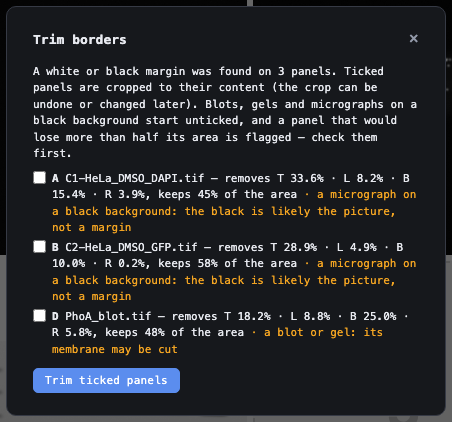

# Tips and tricks

Shortcuts and habits that save the most time, and the pitfalls that cost the most. Checked on this build by [`verify/tips.verify.js`](verify/tips.verify.js); tips that belong to one kind of figure are checked by that guide's script (named beside them).

## Find any tool with ⌘K

Press <kbd>⌘K</kbd> (<kbd>Ctrl+K</kbd>), type a few words, press <kbd>Enter</kbd> on the top hit. Plain phrases work, verbs included. Each phrase below put the named tool first:

| Type | Top hit |
|---|---|
| `add arrow` | Draw an arrow |
| `remove white border`, `trim` | Trim borders… (with a preview) |
| `change font` | Font (typeface) of letters and labels |
| `font size` | Text size in points (charts, gene maps, bar text, key) |
| `letter size` | Size of the panel letters |
| `span` | Make a panel span two columns or rows (big panel): opens the selected panel's span field |
| `make bigger` | Panel width |
| `copy style` | Copy one panel's look to every panel (Apply to all) |
| `swap panels` | Swap or reorder panels |
| `batch crop`, `densitometry`, `lane table` | the blot tools ([Western blot](western-blot.md)) |
| `calibrate`, `auto-detect scale bar`, `ruler`, `count plaques` | the measuring tools ([Phage and microbiology](phage-and-microbiology.md)) |
| `add scale bar` | Scale bar: add one to a micrograph (calibrate it)… (opens the selected panel's ⚙ at **Objective**, **🔬 Calibrate from image** and **🔍 Auto-detect scale bar**) |
| `scale bar off` | Scale bars off on uncalibrated panels |
| `split channels`, `linked inset` | [Fluorescence](fluorescence.md) tools |
| `sample colours` | Sample colours (one colour per strain in every chart)… |
| `nature`, `plos`, `elife`, `asm`… | Journal: … (applies the preset) |
| `mbio`, `j bacteriol`, `jbc` | the journal's preset by its abbreviation (`mbio` and `j bacteriol` find Journal: ASM) |
| `nat comms` | Journal: no preset for Nature Communications (says so and changes nothing) |
| `check against plos` | Check against PLOS ONE (report only, changes nothing) |
| `legend key`, `alt text`, `submission`, `replace image`, `load session` | the [submission](journal-submission.md) tools |
| `position` | Position and size: type X, Y, W, H or angle (freeform) |
| `graphical abstract` | Canvas: graphical abstract (Elsevier) |
| `tutorial` | Tutorials — list them all |
| `save my work`, `add images`, `delete panel`, `make text bigger` | Save session, Add images, Remove the selected panel, Text size in points |

**Journal: …** changes your figure; **Check against …** only reports. To check against a second journal without switching, type `check against` and the name.

## Keyboard

| Keys | Does |
|---|---|
| <kbd>R</kbd> | Render (redraw) the figure |
| <kbd>Ctrl/⌘+Z</kbd> | Undo |
| <kbd>Ctrl/⌘+Shift+Z</kbd> or <kbd>Ctrl+Y</kbd> | Redo |
| <kbd>Ctrl/⌘+S</kbd> | Save the session file, images included |
| <kbd>Esc</kbd> | Close a dialog, leave a tool, deselect |
| <kbd>Ctrl</kbd> + scroll | Zoom about the pointer |
| <kbd>Space</kbd> + drag | Pan a zoomed figure (click the empty canvas first, so the Space is not typed into a field) |
| <kbd>Tab</kbd> once after the page loads, then <kbd>Enter</kbd> | "Skip to the figure toolbar" |
| <kbd>Tab</kbd> twice after the page loads, then <kbd>Enter</kbd> | "Skip to the welcome card — add images, load a session, tutorials" |
| Arrow keys on the figure | Pick a panel (Tab to the figure: it comes right after the toolbar) |
| <kbd>Shift</kbd>+arrow on the figure | Swap the picked panel with its neighbour; the letters follow position |
| <kbd>Enter</kbd> on the figure | Open the picked panel's settings (⚙) |
| <kbd>Ctrl/⌘+I</kbd>, <kbd>Ctrl/⌘+B</kbd> in a text field | Wrap the selection in italic or bold marks |
| Arrow keys / <kbd>Shift</kbd>+arrows | Freeform: move the selection 1 px / 10 px |
| <kbd>]</kbd> <kbd>[</kbd> (with <kbd>Shift</kbd>: 5°) | Freeform: turn the selection 1° |
| <kbd>Ctrl/⌘+A</kbd> | Freeform: select everything |

## Type exact values instead of dragging

Every place where precision matters takes a typed number:

- **Display range of a 16-bit image**: ⚙ › **Black pt** / **White pt** in the file's own counts, then **≡ Sync by channel** ([Fluorescence](fluorescence.md)).
- **Batch crop**: the **px** X / Y / W / H boxes, in any order; the next scan opens with the same box, so every strip has the same size and lane positions ([Western blot](western-blot.md)).
- **Calibration**: **Pixel distance** and the length in nm, µm or mm in **🔬 Calibrate from image** ([Phage and microbiology](phage-and-microbiology.md)).
- **Inset region**: the px fields in **⧉ Add linked inset…**.
- **Chart axes**: **Y min** / **max** in the Chart dialog ([Charts](charts.md)).
- **Freeform**: X, Y, W, H and ∠ in the bar above the canvas, in px or mm, then <kbd>Enter</kbd>. ⌘K `position` jumps to X ([Freeform](freeform.md)).

## Points, not pixels

Journals give type sizes in points at the printed size, and FigureLab keeps text in points:

- **Look › Typography › Text size** (pt) sets charts, gene maps, scale-bar text and the legend key. **Font family** sets them all to one face.
- **Look › Panel Labels (A, B, C…) › Size** has a **pt** box with **px** beside it. Typing px is fine; the pt follows. In the test, 8 pt was 10.7 px at the full canvas width and 21.6 px after **Export › Printed width › 89 mm**: the pt stayed 8.
- Choose the **Printed width** (or a journal preset) before you fine-tune sizes; the pt sizes then print as typed.

## Marks that stay on their panel

- **Double-click a panel, type, press <kbd>Enter</kbd>**: the text is pinned to that panel. In the test it stayed on panel A when A was spanned over two columns.
- Marks drawn over a panel belong to it. Checked here: text and an arrow stayed on their panel through a span change, and MW labels and the lane table stayed on a blot through **⇄ Replace image…** ([Western blot](western-blot.md)). The fixers' notes add rulers and lane numbers, and reorder, width, row-height and crop changes. Draw a mark over the panel it belongs to.
- **📌 Panel mode (annotations follow panels)** in Annotate & Draw attaches new marks to the panel you draw on. Select a mark with **↖ Select**, and its floating toolbar's **⧉ Repeat on…** menu copies it onto **panels in this row**, **panels in this match group** or **every panel** ("arrow repeated on 1 panel" in the test, for a two-panel row).

## Panels

- **Right-click a panel** on the canvas for **⇄ Replace image…**, **⧉ Add linked inset…**, **📏 Scale bar / calibrate…**, **📊 Edit chart…** (charts), **⚙ Open settings** and more. **📏 Scale bar / calibrate…** is the way to a scale bar on a micrograph without calibration: its ⚙ opens at **Objective**, **🔬 Calibrate from image** and **🔍 Auto-detect scale bar** (⌘K `add scale bar` goes to the same place).
- **Drag one panel onto another** on the canvas to swap them; the letters follow position. From the keyboard: Tab to the figure, pick a panel with the arrow keys, <kbd>Shift</kbd>+arrow swaps it, <kbd>Enter</kbd> opens its settings. A screen reader hears each step ("Moved: … is now panel A; … Ctrl+Z undoes it").
- **⌘K `trim` › Trim borders…** previews what each panel would lose. Blots and dark fluorescence fields start unticked; tick only the panels with a real white border.
- **⌘K `span`** with a panel selected opens its **Col span** / **Row span** fields; then **Arrange › ⊞ Fit grid to panels**.
- Charts and gene maps are grid panels with letters of their own: a CSV dropped into a grid becomes the next lettered chart panel, and **Annotate & Draw › 🧬 Linear › 📄 GenBank / FASTA…** adds a gene map panel ([Phage and microbiology](phage-and-microbiology.md)).
- Format marks in labels: `*italic*`, `**bold**`, `10^{8}` superscripts and `H_{2}O` subscripts. Checked here in the figure title (<kbd>Ctrl/⌘+I</kbd>), lane table cells (`Δ*phoA*`, `10^{-1}`), chart axis titles (`OD_{600}`) and freeform text boxes.

## Freeform

- Select several with <kbd>Shift</kbd>- or <kbd>⌘</kbd>-click, or a drag box started on empty canvas, or <kbd>Ctrl/⌘+A</kbd>. <kbd>Esc</kbd> or a click beside the canvas deselects.
- **Space** N then **⇿** or **⇕** puts an exact gap between the selected objects; **=W** and **=H** match the first one selected. Place the two outer objects first, then **←→** spreads the rest evenly between them.
- **Props › Clip ◯ ⬭ ▢** clips a picture to a circle, ellipse or rounded rectangle (radius beside ▢). A clip set in the grid survives **⇱ Pop out to free layout**.
- **⬇ Behind** puts a box behind the panels; choosing a fill colour ticks Fill; **Corner R** rounds a rectangle.
- Double-click a text mark to edit it. Overlapping objects can be picked by name in the **Elements** list.

## Legend key

- **Export › Place the key on the figure** puts the key in free space: a margin, an empty cell or a free corner, never over a panel, letter or heading. With no room, a margin grows and a toast says by how much.
- The **Where** menu beside it picks the place: **Free space**, a corner, **Right edge** or **Below**.
- Drag the key with **↖ Select** to put it somewhere yourself; it stays there through later changes. If it covers something, the compliance row **Legend key on the figure** warns and **Move to free space** fixes it ([Journal submission](journal-submission.md)).

## Caption, Methods and alt text

- Untouched text follows the figure. Text you edited is kept; if the figure changes, a line under the box offers **✦ Regenerate** (Methods: **✎ Rewrite**, alt text: **✦ Redraft**), which replaces your edits, or **Keep mine**.
- **✦ Generate Caption** and **✎ Write Methods paragraph** ask before writing over your edits ("Replace your caption?", "Replace your Methods paragraph?"): **Replace** or **Keep mine** ([Journal submission](journal-submission.md)).

## Charts and blots

- **A sample keeps its colour by name.** Moving a group with ↑ ↓ or adding chart panels never recolours it. **shown as** renames it in every chart at once (the toast names the other panels), and **Look › Sample colours** lists it as `ΔfliC (dfliC)` ([Charts](charts.md)).
- **Source data read back in.** Each `source-data/<letter>.csv` in the submission package can be dropped on the figure again; it charts the same values ([Charts](charts.md)).
- **Band to chart.** In **⫼ Lanes & bands**, the **Band to chart** menu beside **📊 Chart these values** sets which band is charted (by default the largest band in the reference lane). Every lane is measured there; a lane without that band is "n.d." ([Western blot](western-blot.md)).

## Exports keep your text

- **↓ PDF lossless** writes letters, labels, text boxes and the words of charts and gene maps as real, selectable text, in the PDF's standard fonts (Symbol for Greek letters such as Δ). The fonts are named, not embedded.
- **Export › 📊 Export editable PowerPoint (.pptx)** makes the slide the figure's printed width (183 mm for a 183 mm figure), so 8 pt text reads 8 pt in PowerPoint, and chart and gene-map words are editable text boxes ([Freeform](freeform.md)).

## Tutorials without losing your figure

Help (**❔**) › Tutorials, or ⌘K `tutorial`. A tutorial puts your figure aside and shows its own demo. When you click **End**, FigureLab asks **Bring your own figure back?**: click **Restore my figure** and your figure returns in one step. Saving first (<kbd>Ctrl/⌘+S</kbd>) costs nothing.

## Common pitfalls

| Pitfall | How to avoid it |
|---|---|
| Letters fail **Text contrast** on light panels. | Click the row's **Auto contrast** button in the compliance report. Text without a chip over a mid-grey picture may still need its panel darkened (⚙ › **Black pt**). |
| The compliance **Export format** row is still ℹ or ✗. | It counts the formats saved since the figure last changed. After an edit, save in the journal's format again (e.g. **↓ PDF lossless** for Nature). |
| The figure prints taller than the journal allows. | You widened it after choosing the journal: click **Set … mm** on the **Printed height** row, or use fewer rows. |
| A margin stays wide after you move the placed key. | A margin grown for the key keeps its width. Set it back under **Arrange › Margins**. |
| <kbd>Space</kbd> + drag does not pan. | A text field still has the focus. Click the empty canvas first. |
| A whole row typed into a lane table cell lands in one cell. | Separate the cells: `- + - + - +` with spaces fills a +/− row; doses and other text need commas (`10^{0}, 10^{-1}, …`). |
| Bigger figures go missing after a browser crash. | Autosave cannot hold large images. Save the session file yourself (<kbd>Ctrl/⌘+S</kbd>) and keep it. |
| A chart's tick labels run together in a single grid cell. | At journal type size a one-cell chart is small: span it over two columns (⌘K `span`). |
| One strain is listed twice in the key. | Give it one name with the chart's **shown as** box (it renames it in every chart), and spell it the same way in every file (`dfliC` is not `ΔfliC`). |

More in [Troubleshooting](troubleshooting.md). Back to the [guide index](README.md).
