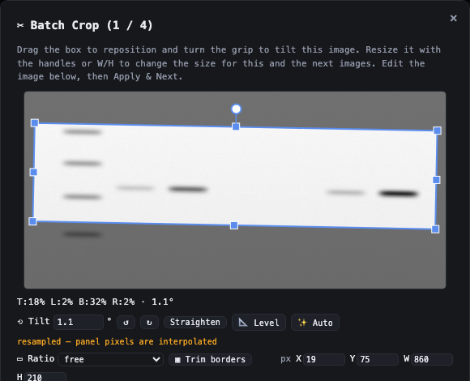
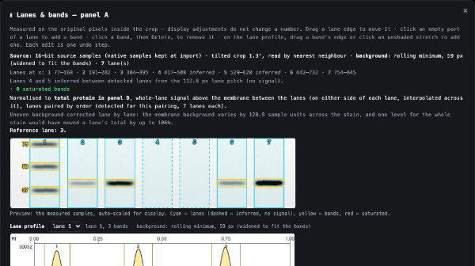

# Western blot figure

## What you'll make

A stacked blot panel (target blots, a loading control and a total-protein stain, straightened and cropped to one size, with MW markers and a +/− lane table), and a bar chart of the band volumes normalised to total protein beside it, one series per target blot, linked to the analysis. Replicate lanes can be charted as one bar with mean ± SD, and the figure is set to a journal's width and checked.

## You need

- One scan per blot, as exported by the imager (16-bit TIFF is best: FigureLab measures the original samples, not the display). Keep the ladder lane in each scan.
- A loading-control scan (housekeeping band) and, if your journal asks for it, a total-protein stain (stain-free, Ponceau, Revert) of the same membrane.
- The marker sizes of your ladder, top to bottom.
- The lane order: which condition is in which lane.

This guide was checked step by step on synthetic 16-bit blots by `verify/western-blot.verify.js`, and the replicate and typed-value sections on a second test figure (one blot with three WT and three R42P lanes and its loading control).

## 1. Bring in the scans and stack them

1. Click **Drop or click to add images** (Images section) and pick the scans in the order you want them stacked, the loading control and total-protein stain last. A 16-bit file shows the toast "… 16-bit scaled to 8-bit for display; native samples kept for measurement".
2. Open **Arrange**. Set **Columns** to 1 and **Rows** to the number of scans.
3. Tick **Rows hug their panels**. Each strip then gets a row as tall as its picture, instead of floating in a square cell.

## 2. Straighten and crop every strip to one size

Batch crop keeps one box size across all the scans, so the strips come out the same width with the lanes in the same place.

1. Press <kbd>⌘K</kbd> (<kbd>Ctrl+K</kbd>), type `batch crop`, press <kbd>Enter</kbd>. (It is also **Crop & Scale › ▦ Batch crop all images…**.) The dialog reads **✂ Batch Crop (1 / 4)**: scan 1 of the 4 you added.
2. Draw a box around the ladder, the sample lanes and the band you need, or type it under **px** (**X**, **Y**, **W**, **H**, in any order). Make the box tall enough to hold at least three ladder markers around your band: the MW fit in task 3 needs three. Leave a little room at the sides; a box that runs off the image after tilting shows "⚠ extends past the image".
3. Click **📐 Level**, then click two points along one band row, one near each end. The **Tilt** field fills in and the box turns with the blot.
4. Click **✓ Apply & Next**. The next scan opens with the same box (X, Y, W and H). Type its **Y** (bands sit at different heights on different blots), leave **X** as it is so the ladder lines up, and level it the same way.
5. For the total-protein stain you can type a taller **H** (and a smaller **Y**) to keep the whole lane, then click **✨ Auto**. Auto works well on dense images; on a sparse blot it may say "No clear straight edge found — use 📐 Level to click along one".
6. On the last scan click **✓ Apply & Done**, then **⟳ Render** (or press <kbd>R</kbd>).

On the test blots, Level found 1.1°, −0.9° and 0.7° for true tilts of 1.2°, −0.8° and 0.6°, and Auto found 1.0° on the total-protein stain (true 1.0°). 📐 Level turns the box about its centre, so X can move by a pixel; that is expected.

## 3. Measure the bands

1. Click the strip you want to measure on the canvas, then press <kbd>⌘K</kbd>, type `densitometry`, press <kbd>Enter</kbd>. (Or **Annotate & Draw › ⫼ Analyse lanes & bands…**.) The dialog opens on the panel you clicked last: **⫼ Lanes & bands — panel A**. If no panel is picked, a **Which panel?** dialog lists the pictures ("No panel is selected. Pick the panel for lanes & bands…"); click the strip there.
2. Check what it found: the number of lanes, "dark on light" for a blot, and lanes marked *inferred* where a lane has no signal (a knock-out lane). Drag a lane edge if one is wrong.
3. **Ladder lane**: pick the ladder's lane. The box beside it starts with a default ladder (`250,130,100,70,55,35,25`); replace it with the sizes of the markers visible in the crop, top to bottom, e.g. `75, 50, 37`, and click **Fit**. It needs at least three markers; with two it says "At least 3 ladder markers are needed for a molecular-weight fit".
4. **Reference lane**: the lane every ratio is relative to (e.g. WT + inducer).
5. **Loading control**: pick the loading-control panel. Choose **Loading band(s)** for a housekeeping band, or pick the stain's panel and **Total protein (whole lane)**, which JBC and ASBMB ask for. The table gains **÷ LC** and **÷LC rel ref** columns. For a phospho-protein over its total protein, see [Phospho over total](#phospho-over-total-pakt--total-akt) below.
6. Click **⬇ CSV** to save the band table (`…-panelA-densitometry.csv`). **⬇ Lane profiles CSV** saves each lane's signal and background.
7. Repeat for each target blot, with the same reference lane and loading control. A blot without them is left out of the chart (task 6).
8. Opened the dialog on the wrong panel? **✕ Remove analysis** takes the analysis off it, with its MW labels ("Lane analysis removed from panel B (Ctrl/⌘+Z brings it back)").

On the test blot (bands loaded 0.3 / 1 / 0 / 0 / 0.4 / 1.6), ÷LC rel ref read 0.30 / 1.00 / 0 / 0 / 0.40 / 1.60 against total protein, and the same against the GapA band.

### Phospho over total (pAKT ÷ total AKT)

A phospho-protein is usually shown over its own total protein, probed on a second blot of the same samples.

1. Add the phospho blot, the total blot and a loading control (GAPDH) as in task 1.
2. Click the phospho strip and open **⫼ Lanes & bands** (⌘K `densitometry`). Set the **Reference lane**.
3. **Loading control**: pick the total-protein blot's panel, and in the menu beside it choose **Another target (phospho/total)**. Each band is divided by the total blot's band in the paired lane (lanes are paired by order). The dialog says so: "Normalised to another target, AKT_total (panel B) (a phospho/total ratio: each band ÷ that blot's band volume in the paired lane) … It is no loading control: show one as well where the journal asks."
4. **📊 Chart these values**. The Y title, caption and Methods name the ratio: "Band volume ÷ AKT_total, relative to lane 3" (the total blot is named by its file); type your own **Y title** (`pAKT / total AKT`) if you like.
5. Under EMBO J, the compliance report's **Loading control** row (ℹ) says "A is normalised to another target, AKT_total (panel B) (a phospho/total ratio), not to a loading control", so show the GAPDH strip as well.

On a test pair (pAKT 0.3 / 1 / 0.6 / 1.2 / 0.2 / 0.8 over total AKT 0.6 / 1 / 1 / 1 / 0.5 / 1), the ratios relative to lane 3 came out within 0.01 of 0.5 / 1 / 0.6 / 1.2 / 0.4 / 0.8.

## 4. Put MW labels on the ladder

1. In the same **⫼ Lanes & bands** dialog, after **Fit**, click **↕ Place MW labels on the ladder bands**. The sizes appear beside the strip at the height of each marker, and move with the panel.
2. Clicking it again replaces the set rather than adding a second one. **✕ Remove MW labels** takes them off.
3. Do this on each strip that should carry markers.

## 5. Add the +/− lane table

Analyse the blot first (task 3): the table's columns then sit on the detected lanes instead of being spaced evenly.

1. In the **⫼ Lanes & bands** dialog click **⊞ Lane table…** (or select the panel and <kbd>⌘K</kbd> `lane table`). It opens **⊞ Lane table — panel A**, showing the blot with each column's number over its lane. The ladder column is marked **M**.
2. Click **+ Row** for each condition, and type the row names (`Δ*phoA*` gives an italic *phoA*).
3. Fill a row in one go: type `- + - + - +` into its first sample cell, or paste cells copied from a spreadsheet, and press <kbd>Tab</kbd>. For names or doses, separate the cells with commas: `WT, WT, WT, R42P, R42P, R42P` (spaces split a row only when every cell is a + or −).
4. As the dialog says, "Click an empty or +/– cell to cycle + / – / blank; click a cell with text, or type, to write anything else (a dose, an MOI)". Each change is one undo step, and <kbd>Ctrl/⌘+Z</kbd> works inside a cell too.
5. Check every row against your lane order in the picture above the grid before you close it.
6. **Position** puts the table above or below the blot.

A row of names (not + and −) also names the lanes when you chart them: see task 7.

## 6. Chart the values

1. In the **⫼ Lanes & bands** dialog, check the **Band to chart** menu beside **📊 Chart these values**. By default each blot is charted at the largest band in its reference lane, for example "Band to chart: auto — at 40.3 kDa (the largest band in reference lane 3)". If that is not your protein (a nonspecific band is stronger), pick your band from the menu ("Band to chart: lane 3 band 1, at 44.8 kDa"). Every lane is measured at that position; a lane with no band there is "n.d.".
2. Click **📊 Chart these values**. A chart panel is added to the grid, with a toast such as "Charted 6 lanes × 1 panel: Band volume ÷ total protein, relative to lane 3; Panel A: the band at 40.3 kDa (the largest band in reference lane 3); a lane with no band there is n.d. … Linked — a re-analysis updates it. Panel E in the grid."
3. Every analysed target blot with the same normalisation becomes one series. Loading controls and the total-protein stain are not charted. A blot without the same reference lane and loading control is left out, and the toast names it: "left out Panel B (no loading control and no reference lane)". Set them on that blot, then open **⫼ Lanes & bands** on a blot already in the chart (strip A) and click **📊 Chart these values** again: the same chart is updated ("Updated the linked chart (panel E): …"), now with both blots.
4. Double-click the chart panel (or its **⚙ › 📊 Edit chart data and style…**) to open the **📊 Chart** dialog. The data box holds the plotted values, one column per blot; n.d. lanes are empty. Leave the numbers as they are: typing over them unlinks the chart (task 11).
5. Under **Names & colours**, type a display name in each **shown as** box: the lanes (`Lane 2` → `WT −`, `Lane 3` → `WT +`, …) and the blots (`Panel A` → `PhoA`). The bars are named "Lane 2", "Lane 3", … until you do, unless a lane table row of names named them (task 7). A blot keeps the name it was charted under, even after you clear its letter (task 8). Click **Apply**. The default Y title ("Band volume ÷ total protein, relative to lane 3") is set on two lines when it is longer than the plot; type your own under **Y title** if you like.
6. A change of reference lane, loading control or band in **⫼ Lanes & bands** updates the chart by itself. Styling the chart (type, colours, error bars) is covered in [charts.md](charts.md).

## 7. Replicate lanes: one bar, mean ± SD

Lanes that are replicates of one sample (three WT lanes, three R42P lanes) become one bar with mean ± SD, n and the replicate points when they share a name. There are two ways to name them, and the chart stays linked either way: a re-analysis or a replaced scan still updates the pooled bars.

**In the Chart dialog.** Under **Names & colours**, type the same **shown as** name for each replicate lane: `WT` for Lane 2, Lane 3 and Lane 4, `R42P` for Lane 5, Lane 6 and Lane 7. A note under the list says what the names do: "One name, one sample — WT: Lane 2, Lane 3, Lane 4 (n = 3); R42P: Lane 5, Lane 6, Lane 7 (n = 3): drawn as one group, mean ± SD, with the points. The chart stays linked to the densitometry." **Error bars** switches to SD and **points** is ticked. Click **Apply**. Each lane keeps its own row, so you can change a name back.

**In the lane table, before you chart.** Type the names into a lane table row (task 5), with commas: `WT, WT, WT, R42P, R42P, R42P`. **📊 Chart these values** then names the lanes from it, and the toast says so: "lanes named from the lane table — WT: Lane 2, Lane 3, Lane 4; R42P: Lane 5, Lane 6, Lane 7 pooled as one sample each (mean ± SD with the points)". A row of + and − does not name or group anything.

On the test blot (WT lanes loaded 1.0 / 0.85 / 1.15, R42P lanes 0.4 / 0.5 / 0.45, normalised to the loading control and relative to lane 2), both ways gave WT 0.997 ± 0.151 and R42P 0.449 ± 0.051 (mean ± SD, n = 3), the means and SDs of the lane values in the data box.

Lane names on a densitometry chart belong to that chart: naming Lane 2 "WT" there is not a figure-wide sample name, so it does not rename Lane 2 on another blot's chart.

## 8. Letters

1. To make the stack one panel, clear the letter in the label box of each strip after the first (the small box in its row of the image list).
2. Type `B` in the chart's label box.

## 9. Journal and printed width

1. Press <kbd>⌘K</kbd>, type the journal (`embo`, `jbc`, `nature` …) and press <kbd>Enter</kbd> on **Journal: …**. The toast lists what it set, for example "EMBO J preset applied — printed width 180 mm (EMBO J allows up to 180 mm), Helvetica letters, 600 DPI — letters 10.4 pt, headings 8 pt, text 7 pt, lane table with the headings". Some presets set no width: JBC's toast reads "JBC figure guide applied — no printed width set — JBC’s data-presentation page states none …: pick the column width from JBC’s author instructions under Export › Printed width".
2. A one-column stack at a journal's full width prints very tall and its strips below 300 ppi: on the test figure, 180 mm gave a figure 323.4 mm tall and **Panel resolution** ✗ at 149 ppi. Choose a narrower width in **Export › Printed width** (here **87 mm — narrowest (EMBO J)…**). The toast warns that text now looks larger against the pictures: "Printed width 180 → 87 mm: text keeps its point size, so it is 2.07× larger against the pictures now…".
3. Open **Check** and click **✓ Check journal compliance**. After the narrower width, the test figure's lane table printed at 4.3 pt and **Text size** failed ("Lane-table text prints at 4.3 pt…"). Click the row's **Lane tables to 7 pt** button: the lane table takes the figure's text size and the row passes.
4. Read the blot rows. On the test figure at 87 mm: **Panel resolution** ✓ (lowest 308 ppi), **Printed height** 159.3 mm ✓, **MW markers** ✓ ("A: 3 markers, above and below every analysed band"), **Charts from densitometry** ✓ (linked and current), and, under EMBO J, two notes: **Loading control** (EMBO J asks for it on the same blot) and **Uncropped originals**, with an **S1…** button (task 10). Other journals show the rows their own guides ask for. **Panel labels** warns "2/5 panels labelled" because the stack is one panel with one letter (task 8); leave it. **Text contrast** on the letters: see [journal-submission.md](journal-submission.md).

A lane-table row prints at one size, the size its tightest cell needs. If a row's labels are too long for their lanes (here `Parkin WT`, `Parkin R42P` in a strip one column of three wide, under Nature), they are drawn smaller and **Text size** fails ("some lane-table text is drawn smaller than its table’s size to fit its lanes … 3.2 pt"). Its **Widen A** button gives the strip the whole row of the grid ("Panel A now spans all 3 columns, so its lanes are wider — Ctrl+Z undoes it"); after it the row passed at 6.7–7.0 pt. Shorter names also work.

## 10. Uncropped originals (S1)

1. Open **Export** and click **📄 Export uncropped originals (S1)…**. Every cropped panel is ticked, marked "(tilted crop)" where you levelled it.
2. Click **⬇ PDF (one page per panel)**. You get `S1_uncropped_originals.pdf`, one page per scan with the crop outlined. **⬇ PNG sheet** puts them on one image.

The S1 file is also in the submission package (**Export › 📦 Export submission package (ZIP)**), together with each analysed blot's band table as source data: in the test, `S1_uncropped_originals.pdf`, `source-data/panel_A-densitometry.csv` and, for the strip whose letter was cleared, `source-data/panel_2026-11-03_PhoB_ChemiDoc-densitometry.csv` (named by its file). See [journal-submission.md](journal-submission.md).

## 11. Revision: replace a blot

1. Right-click the strip on the canvas › **⇄ Replace image…** and pick the new scan. The letter, crop, lane table, MW labels and analysis settings are kept; the toast says what was kept and that the lane analysis is now out of date. The MW labels stay at the old scan's heights for now: "its MW labels sit where the old scan’s ladder bands were — the re-analysis moves them onto the new ladder, or ↕ Place MW labels again".
2. The kept tilt belongs to the old scan. Right-click the strip › **⚙ Open settings** › **✂ Open Crop Editor**, click **📐 Level** along a band row (or move the box), then **✓ Apply Crop**.
3. The chart panel now says it is out of date, on the figure and in its dialog ("⚠ Linked to the densitometry of panels A, B, which has changed since: panel A: the crop changed since this analysis."). Double-click the chart and click **↻ Update from densitometry**: it re-analyses the new scan with the same lane count, ladder, reference lane and loading control, moves the MW labels onto the new ladder, and updates the chart ("1 chart updated from the re-analysed densitometry; 3 MW labels of panel A moved onto the new ladder’s bands"). Click **Apply**.
4. Open **⫼ Lanes & bands** on the strip: it reads the same 7 lanes, reference lane and loading control as before. Click **⬇ CSV** for the new numbers, then re-export the figure and S1.

On the test re-run (tilted −2.0°), Level found −2.2°, and the re-analysed values were 0.30 / 1.00 / 0 / 0 / 0.40 / 1.60.

### A chart whose numbers you typed

Typing over the numbers in a linked chart's data box (to pool replicates by hand, say) cuts its link, and the dialog says so before you apply: "⚠ You edited the data: Apply unlinks this chart from the densitometry of panel A — a re-analysis will no longer update it, and the chart, caption and compliance check will say it is typed by hand." **Undo my edit** puts the linked values back. To pool replicates, use names instead (task 7): they keep the link.

If you apply typed numbers, the dialog reads "⚠ Not linked: typed by hand …", the caption says "Values entered by hand", and when the blot later changes (a replaced or re-analysed scan) everything says the numbers may be stale. On the test figure, after **⇄ Replace image…** on the strip:

- the replace toast: "a chart typed by hand from its densitometry no longer matches it — the chart says so; ↻ Link again in its dialog reads the new values";
- the chart, on screen and in exports: "⚠ typed values — out of date";
- the caption: "Values entered by hand. [⚠ Not current: the densitometry of panel A has changed since these values were entered — check them before submitting.]";
- **✓ Check journal compliance**: **Charts from densitometry** ✗ "… — double-click it › ↻ Link again, or check the typed values";
- the package's `source-data/C.csv`: "# WARNING: Values entered by hand; typed by hand and no longer linked to the densitometry of panel A, which has changed since …".

Double-click the chart: **↻ Link again** reads the current densitometry and links the chart again (Apply); on the test the re-probed lane 3 came back as 1.402 for a true 1.4, and the compliance row passed. **These are my own values** keeps your numbers and stops tying them to the blot.

## Tips

- Order of work: crop → analyse every target blot (ladder, reference lane, loading control) → MW labels → lane table → chart → letters → journal and width. MW labels and lane tables follow their panel through later layout changes, but the lane table needs the analysis to find the lanes.
- 📐 Level on a band row is more reliable than ✨ Auto on a sparse blot; Auto suits dense images such as total-protein stains.
- In a batch crop each scan opens with the previous box; leave **X** as it is so the ladder and lanes line up.
- Analyse the loading control or total-protein panel as well if you want its own CSV; the target blot's dialog reads it either way, and it is never charted as a series.
- <kbd>⌘K</kbd> reaches everything here by name: `batch crop`, `densitometry`, `lane table`. They act on the panel you clicked last; with none picked they ask **Which panel?**.
- Phospho over total: **Loading control** › the total blot › **Another target (phospho/total)**, not **Loading band(s)**: the chart, caption and Methods then call it a ratio to that blot, and the compliance check does not take it for a loading control.
- Replicate lanes: give them one name (shown as, or a lane-table row of names) rather than typing their mean into the chart. Names keep the chart linked; typed numbers do not.
- Before submitting, run the compliance check and add the legend key and caption: [journal-submission.md](journal-submission.md). More shortcuts: [tips-and-tricks.md](tips-and-tricks.md).

## If something looks wrong

- **The MW fit fails.** Type at least three marker sizes, only the ones inside the crop, top to bottom. If the crop shows only two, make the crop taller.
- **A lane is missing or doubled.** Drag the lane edges in the preview, or change the lane count and press **↻ Re-detect**. Lanes without signal are inferred from the lane spacing and marked *inferred*.
- **The lane table columns are evenly spaced, not on the lanes.** The panel has not been analysed; open **⫼ Lanes & bands** on it first.
- **The analysis opened on the wrong panel.** **✕ Remove analysis** in that dialog takes it off (one undo step); click the right strip and press <kbd>⌘K</kbd> `densitometry` again.
- **Lane-table labels print under 5 pt after a narrower width.** Click **Lane tables to 7 pt** (the figure's text size) on the compliance report's **Text size** row; if long names are squeezed into narrow lanes, its **Widen** button, or shorter names.
- **A blot is missing from the chart.** The toast named it as "left out": it has no reference lane or loading control, or not the same ones. Set them in its **⫼ Lanes & bands**, then click **📊 Chart these values** in the dialog of a blot already in the chart.
- **A second chart appeared.** **📊 Chart these values** in a blot that was left out makes a new chart. Press <kbd>Ctrl/⌘+Z</kbd> and click it in the dialog of a blot already in the chart; that updates the existing one.
- **A lane reads n.d. but has a band.** The band is not at the charted position. Check **Band to chart** in **⫼ Lanes & bands** and pick the right band.
- **MW labels sit between the ladder bands after a revision.** The scan was replaced and not yet re-analysed. **↻ Update from densitometry** in the chart moves them onto the new ladder; or click **↕ Place MW labels on the ladder bands** again.
- **Replicate lanes show as separate bars.** Their names differ: give them exactly the same **shown as** name (task 7).
- **The chart says "typed values" or "Not linked".** Its numbers were typed in the Chart dialog. Double-click it › **↻ Link again**, or **These are my own values** if you meant them.
- More: [troubleshooting.md](troubleshooting.md).
