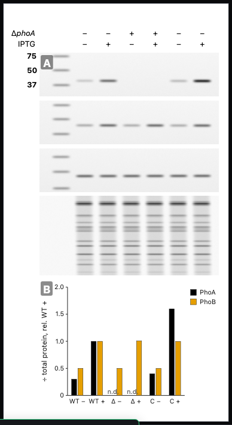

# Western blot figure

## What you'll make

A stacked blot panel (target blots, a loading control and a total-protein stain, straightened and cropped to one size, with MW markers and a +/− lane table), and a bar chart of the band volumes normalised to total protein beside it, one series per target blot, linked to the analysis.

## You need

- One scan per blot, as exported by the imager (16-bit TIFF is best: FigureLab measures the original samples, not the display). Keep the ladder lane in each scan.
- A loading-control scan (housekeeping band) and, if your journal asks for it, a total-protein stain (stain-free, Ponceau, Revert) of the same membrane.
- The marker sizes of your ladder, top to bottom.
- The lane order: which condition is in which lane.

This guide was checked step by step on synthetic 16-bit blots by `verify/western-blot.verify.js`.

## 1. Bring in the scans and stack them

1. Click **Drop or click to add images** (Images section) and pick the scans in the order you want them stacked, the loading control and total-protein stain last. A 16-bit file shows the toast "… 16-bit scaled to 8-bit for display; native samples kept for measurement".
2. Open **Arrange**. Set **Columns** to 1 and **Rows** to the number of scans.
3. Tick **Rows hug their panels**. Each strip then gets a row as tall as its picture, instead of floating in a square cell.

## 2. Straighten and crop every strip to one size

Batch crop keeps one box size across all the scans, so the strips come out the same width with the lanes in the same place.

1. Press <kbd>⌘K</kbd> (<kbd>Ctrl+K</kbd>), type `batch crop`, press <kbd>Enter</kbd>. (It is also **Crop & Scale › ▦ Batch crop all images…**.) The dialog reads **✂ Batch Crop (1 / 4)**.
2. Draw a box around the ladder, the sample lanes and the band you need, or type it under **px** (**X**, **Y**, **W**, **H**, in any order). Leave a little room at the sides; a box that runs off the image after tilting shows "⚠ extends past the image".
3. Click **📐 Level**, then click two points along one band row, one near each end. The **Tilt** field fills in and the box turns with the blot.
4. Click **✓ Apply & Next**. The next scan opens with the same box (X, Y, W and H). Type its **Y** (bands sit at different heights on different blots), leave **X** as it is so the ladder lines up, and level it the same way.
5. For the total-protein stain you can type a taller **H** (and a smaller **Y**) to keep the whole lane, then click **✨ Auto**. Auto works well on dense images; on a sparse blot it may say "No clear straight edge found — use 📐 Level to click along one".
6. On the last scan click **✓ Apply & Done**, then **⟳ Render** (or press <kbd>R</kbd>).

On the test blots, Level found 1.1°, −0.9° and 0.7° for true tilts of 1.2°, −0.8° and 0.6°, and Auto found 1.0° on the total-protein stain (true 1.0°). 📐 Level turns the box about its centre, so X can move by a pixel; that is expected.

## 3. Measure the bands

1. Click the strip you want to measure on the canvas, then press <kbd>⌘K</kbd>, type `densitometry`, press <kbd>Enter</kbd>. (Or **Annotate & Draw › ⫼ Analyse lanes & bands…**.) The dialog opens on the panel you clicked last: **⫼ Lanes & bands — panel A**.
2. Check what it found: the number of lanes, "dark on light" for a blot, and lanes marked *inferred* where a lane has no signal (a knock-out lane). Drag a lane edge if one is wrong.
3. **Ladder lane**: pick the ladder's lane. The box beside it starts with a default ladder (`250,130,100,70,55,35,25`); replace it with the sizes of the markers visible in the crop, top to bottom, e.g. `75, 50, 37`, and click **Fit**. It needs at least three markers; with two it says "At least 3 ladder markers are needed for a molecular-weight fit".
4. **Reference lane**: the lane every ratio is relative to (e.g. WT + inducer).
5. **Loading control**: pick the loading-control panel. Choose **Loading band(s)** for a housekeeping band, or pick the stain's panel and **Total protein (whole lane)**, which JBC and ASBMB ask for. The table gains **÷ LC** and **÷LC rel ref** columns.
6. Click **⬇ CSV** to save the band table (`…-panelA-densitometry.csv`). **⬇ Lane profiles CSV** saves each lane's signal and background.
7. Repeat for each target blot, with the same reference lane and loading control. A blot without them is left out of the chart (task 6).

On the test blot (bands loaded 0.3 / 1 / 0 / 0 / 0.4 / 1.6), ÷LC rel ref read 0.30 / 1.00 / 0 / 0 / 0.40 / 1.60 against total protein, and the same against the GapA band.

## 4. Put MW labels on the ladder

1. In the same **⫼ Lanes & bands** dialog, after **Fit**, click **↕ Place MW labels on the ladder bands**. The sizes appear beside the strip at the height of each marker, and move with the panel.
2. Clicking it again replaces the set rather than adding a second one. **✕ Remove MW labels** takes them off.
3. Do this on each strip that should carry markers.

## 5. Add the +/− lane table

Analyse the blot first (task 3): the table's columns then sit on the detected lanes instead of being spaced evenly.

1. In the **⫼ Lanes & bands** dialog click **⊞ Lane table…** (or select the panel and <kbd>⌘K</kbd> `lane table`). It opens **⊞ Lane table — panel A**, showing the blot with each column's number over its lane. The ladder column is marked **M**.
2. Click **+ Row** for each condition, and type the row names (`Δ*phoA*` gives an italic *phoA*).
3. Fill a row in one go: type `- + - + - +` into its first sample cell, or paste cells copied from a spreadsheet, and press <kbd>Tab</kbd>. Click a single cell to cycle + / – / blank, or type a dose into it.
4. Check every row against your lane order in the picture above the grid before you close it.
5. **Position** puts the table above or below the blot.

## 6. Chart the values

1. In the **⫼ Lanes & bands** dialog, check the **Band to chart** menu beside **📊 Chart these values**. By default each blot is charted at the largest band in its reference lane, for example "Band to chart: auto — at 40.3 kDa (the largest band in reference lane 3)". If that is not your protein (a nonspecific band is stronger), pick your band from the menu ("Band to chart: lane 3 band 1, at 44.8 kDa"). Every lane is measured at that position; a lane with no band there is "n.d.".
2. Click **📊 Chart these values**. The dialog closes and a chart panel is added to the grid, with a toast such as "Charted 6 lanes × 1 panel: Band volume ÷ total protein, relative to lane 3; Panel A: the band at 40.3 kDa (the largest band in reference lane 3); a lane with no band there is n.d. … Linked — a re-analysis updates it. Panel E in the grid."
3. Every analysed target blot with the same normalisation becomes one series. Loading controls and the total-protein stain are not charted. A blot without the same reference lane and loading control is left out, and the toast names it: "left out Panel B (no loading control and no reference lane)". Set them on that blot, then open **⫼ Lanes & bands** on a blot already in the chart (strip A) and click **📊 Chart these values** again: the same chart is updated ("Updated the linked chart (panel E): …"), now with both blots.
4. Double-click the chart panel (or its **⚙ › 📊 Edit chart data and style…**) to open the **📊 Chart** dialog. The data box holds the plotted values, one column per blot; n.d. lanes are empty.
5. Under **Names & colours**, type a display name in each **shown as** box: the lanes (`Lane 2` → `WT −`, `Lane 3` → `WT +`, …) and the blots (`Panel A` → `PhoA`). The bars are named "Lane 2", "Lane 3", … until you do. A blot keeps the name it was charted under, even after you clear its letter (task 7).
6. Type a short **Y title**, e.g. `÷ total protein, rel. WT +`; the default title ("Band volume ÷ total protein, relative to lane 3") is too long for a small panel. Click **Apply**.
7. A change of reference lane, loading control or band in **⫼ Lanes & bands** updates the chart by itself. Styling the chart (type, colours, error bars) is covered in [charts.md](charts.md).

## 7. Letters

1. To make the stack one panel, clear the letter in the label box of each strip after the first (the small box in its row of the image list).
2. Type `B` in the chart's label box.

## 8. Uncropped originals (S1)

1. Open **Export** and click **🗎 Export uncropped originals (S1)…**. Every cropped panel is ticked, marked "(tilted crop)" where you levelled it.
2. Click **⬇ PDF (one page per panel)**. You get `S1_uncropped_originals.pdf`, one page per scan with the crop outlined. **⬇ PNG sheet** puts them on one image.

The S1 file is also in the submission package (**Export › 📦 Export submission package (ZIP)**), together with each analysed blot's band table as source data: in the test, `S1_uncropped_originals.pdf`, `source-data/panel_A-densitometry.csv` and, for the strip whose letter was cleared, `source-data/panel_2026-11-03_PhoB_ChemiDoc-densitometry.csv` (named by its file). See [journal-submission.md](journal-submission.md).

## 9. Revision: replace a blot

1. Right-click the strip on the canvas › **⇄ Replace image…** and pick the new scan. The letter, crop, lane table, MW labels and analysis settings are kept.
2. The kept tilt belongs to the old scan. Right-click the strip › **⚙ Open settings** › **✂ Open Crop Editor**, click **📐 Level** along a band row (or move the box), then **✓ Apply Crop**.
3. The chart panel now says it is out of date, on the figure and in its dialog ("⚠ Linked to the densitometry of panels A, B, which has changed since: panel A: the crop changed since this analysis."). Double-click the chart and click **↻ Update from densitometry**: it re-analyses the new scan with the same ladder, reference lane and loading control, and the chart updates ("1 chart updated from the re-analysed densitometry"). Click **Apply**.
4. Open **⫼ Lanes & bands** on the strip and click **⬇ CSV** for the new numbers, then re-export the figure and S1.

On the test re-run (tilted −2.0°), Level found −2.2°, and the re-analysed values were 0.30 / 1.00 / 0 / 0 / 0.40 / 1.60.

## Tips

- Order of work: crop → analyse every target blot (ladder, reference lane, loading control) → MW labels → lane table → chart → letters. MW labels and lane tables follow their panel through later layout changes, but the lane table needs the analysis to find the lanes.
- 📐 Level on a band row is more reliable than ✨ Auto on a sparse blot; Auto suits dense images such as total-protein stains.
- In a batch crop each scan opens with the previous box; leave **X** as it is so the ladder and lanes line up.
- Analyse the loading control or total-protein panel as well if you want its own CSV; the target blot's dialog reads it either way, and it is never charted as a series.
- <kbd>⌘K</kbd> reaches everything here by name: `batch crop`, `densitometry`, `lane table`.
- Before submitting, run the compliance check and add the legend key and caption: [journal-submission.md](journal-submission.md). More shortcuts: [tips-and-tricks.md](tips-and-tricks.md).

## If something looks wrong

- **The MW fit fails.** Type at least three marker sizes, only the ones inside the crop, top to bottom. If the crop shows only two, make the crop taller.
- **A lane is missing or doubled.** Drag the lane edges in the preview, or change the lane count and press **↻ Re-detect**. Lanes without signal are inferred from the lane spacing and marked *inferred*.
- **The lane table columns are evenly spaced, not on the lanes.** The panel has not been analysed; open **⫼ Lanes & bands** on it first.
- **A blot is missing from the chart.** The toast named it as "left out": it has no reference lane or loading control, or not the same ones. Set them in its **⫼ Lanes & bands**, then click **📊 Chart these values** in the dialog of a blot already in the chart.
- **A second chart appeared.** **📊 Chart these values** in a blot that was left out makes a new chart. Press <kbd>Ctrl/⌘+Z</kbd> and click it in the dialog of a blot already in the chart; that updates the existing one.
- **A lane reads n.d. but has a band.** The band is not at the charted position. Check **Band to chart** in **⫼ Lanes & bands** and pick the right band.
- **The Y title is cut off.** Type a shorter **Y title** in the Chart dialog.
- More: [troubleshooting.md](troubleshooting.md).
